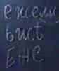

# Еже (три формы записи)

В руском языке осталась всего одна форма - «еже», допустим: ежели (ли – это как приставка). А было три формы:

**1. Еже** – то, что существует в нашей жизни, но не рядом с нами, а где-то, т.е. мы об этом можем только догадываться. Поэтому говорят: «А ежели его там нет?» - как бы форма вопроса.

**2. Еже** (первая буквица Ерь, т.е. уже сотворённая и существующая) – это существующая жизнь, которая связывает Земное и Небесное (буквица Ять в конце). Поэтому такая форма часто шла как именная; она осталась у чехов, поляков, но пишут сейчас латинскими буквами. А также есть животные «ежи» - тоже Богом сотворённые.

**3. Еже** (с буквицей Есмь) – форма, которая просто бытует в жизни.
