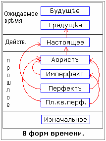

# Глагол

1. Глагол - основа Родной речи  
2. Наклонение  
3. Изъявительные наклонения (8 форм времени)  
4. Глаголы первого спряжения  
5. Глаголы второго спряжения

## Глагол - основа Родной речи

В отличие от советской школы, где изучать русский язык начинают с имён существительных, в древлесловенском **обучение начинали с глагола** - это основа Родной речи. И чтобы детям было проще запомнить, придумали присказку: «Часть речи, которая упала с печи и ударилась об пол - называется глагол», т.е. сразу указано, что данная форма выражает не только сущность и образ, но и действие, поэтому глаголиша (т.е. глаголить) – повествовать о совершённом действии.

Глаголам свойственны категории залога, вида, наклонений, времени, лица, числа, рода. Видите, какой большой объём информации, а существительное – то, что существует.

**Пример:** «Пришедше в лес».  
Сейчас бы сказали: «Мы пришли в лес» - т.е. сначала ставим существительное, потом как направились, и место направления. А глагол сразу определяет, кто конкретно пришёл в лес: «Пришед в лес» - значит «Он пришёл» (един), или «пришедше», «пришедша», т.е. мы пришли или она пришла - окончательные формы глагола, виды, наклонения, они уже несли в себе форму, содержание, образ, структуру.

## Наклонение

В составе глагольных форм были различия:  
1. Формы, составляющие систему трёх наклонений:  
\* **изъявительного**;  
\* **повелительного**;  
\* **условного** (или сослагательного, т.е. совместно слагали данную форму).

2. Формы, стоящие не в системы наклонений:  
\* **Навья** (ныне инфинитив), т.е. неопределённая форма. Но в отличие от «инфинитива», «Навья» сразу было понятно, какая это форма, Навь не определена, она большая;  
\* **данна** (совр. супин) – достигательное наклонение, т.е. чего можно достигнуть. Допустим, «данна» (дана) тебе какая-то форма, значит ты к ней прикоснулся, а это и есть достигательное наклонение;  
\* **причастие**, т.е. причастность, как бы присутствовали при этом, причастная форма.

Глаголу свойственны видовые различия, но не совсем такие, как в современном языке. А формальные признаки залога в древнеруском и древлесловенском языке имели преимущественно причастия.

## Изъявительные наклонения (8 форм времени)

Подробнее разберём изъявительные наклонения. В этом наклонении глаголы имеют три формы: настоящее, будущее, прошедшее время. Но в древлесловенском языке использовалось **7 форм времени**: будущее, грядущее, настоящее, аорист, имперфект, перфект, плюсквамперфект. Потом христиане в древнерусской грамматике сократили до 6 форм - убрали грядущее. Потому что они, а потом и большевики, чем народ довели? обещаниями о «светлом будущем». А слово **будущее** - означает состояние возможности, т.е. оно может быть, а может и не быть. В отличие от грядущего, которое обязательно будет, т.е. **грядущее** – это то, к чему уже созданы все предпосылки, и оно необратимо, как восход Солнца. Т.е. будущее обратимо, поэтому и говорят: «У вас может и не быть никакого будущего», жизнь будет продолжаться, а будущего не быть. А грядущее – это ближайшая форма, она грядёт, к совершению этого ближайшего будущего всё подготовлено, от этого никуда не денешься.

\* На схеме показано, что время из **настоящего** (действительность) всегда проистекает в грядущее, и проникает, т.е. оно уже подготовлено.  
\* Повествование из аориста касаемо грядущего, т.е. не проникает, а касается, потому что повествование идёт в настоящий момент.  
\* Имперфект соотносительно аориста, т.е. как бы два времени.  
\* Перфект, стрелочка в настоящее, т.е. действия в прошлом, результат которых представлен в настоящем.

**Аорист** (прошедшая повествовательная форма) - выражает простое действие в прошлом, предшествовавшее моменту повествования (без какой-либо характеризации действия, т.е. без обозначения длительности или не длительности, или временной отдалённости действия). Допустим: «Наши победили в прошлых войнах».  
Функция аориста – вести рассказ. Повествователь пользуется основными формами аориста для выражения основных функций случая или события.

**Имперфект** – выражает действия соотносительно с другим основным действием в прошлом, выраженным обычным аористом. Как правило, аорист сообщает, а имперфект добавляет к основному действию другое разъясняющее или сопровождающее. Имперфект может обозначать общие обстоятельства, сопровождающие какое-либо действие, не совершённое параллельно происходящим событиям в прошлом.  
Пример: «Руслан сражался, а в это время кто-то тянул его за стремя», т.е. параллельно кто-то совершал другое действие.

**Перфект** – форма перфекта, обозначает действие в прошлом, результат которого представлен в настоящем. Допустим: «Пришёл твой отец и тебя ждёт», т.е. здесь и прошлое (пришёл) и настоящее (тебя ждёт), т.е. действие, совершённое в прошлом, представлено в настоящем. Также перфект может означать действия в прошлом, имеющие по мнению говорящего объективные значения. В этом случае к перфектной форме можно прибавить: «Как всем хорошо известно», «Это неоспоримый факт», «Это доказано самой жизнью» и т.п. Формы перфекта образуются из причастия прошедшего времени, оканчивающегося на «Л» и в связке форм настоящего времени от глагола «Быти». Причастия изменяются по родам и числам, а связки по лицам и числам. При двух причастиях стоящих подряд ставится обычно одна вставка. Таким образом, имеем форму, когда перфект не только в настоящем, когда мы говорим: «Как всем хорошо известно» - это всё равно прошлая форма, а общее действие выдаёт аорист (см. схему).

**Плюсквамперфект** – означает действие, предшествующее другому действию в прошлом. Допустим: «И был набег на город, разорённый до этого другим народом», т.е. как бы событийность пересекается, плюсквамперфект действует и на аорист и на имперфект.

**Изначальная** – это восьмая форма времени, но используется очень редко, только когда события происходят за порогом вообще существования, поэтому на рисунке данная форма даже за гранью прошлого, т.е. не было ещё людей, Богов. Допустим, в Харатьях Света читаем: «Некогда, вернее тогда, когда не было времён и реальностей нами людьми воспринимаемых…», т.е. это всё за пределами прошлого, уходит в изначальную форму.

## Глаголы первого спряжения

Глаголы первого спряжения объединяются по следующим образцам:  
1. При основе на твёрдый согласный в 1-ом лице ед.числа и в 3-м лице мн.числа.

|  |  |  |  |
| --- | --- | --- | --- |
| . | **ед.число** | **мн.число** | **дв.число** |
| 1 лицо | иду | идемъ | идевѣ |
| 2 лицо | иде–ши (шъ) | ид-е-те | иде-та |
| 3 лицо | идетъ | ид-у-тъ | иде-та |

\* **Идеши** (2 лицо ед.число) – идеши или идеше (буквица Еръ звучит как «е-краткая»).  
\* **Идете** (2 лицо мн.число) – так и произносится «идете», а не «идёте» - это искажение, в нашем родном языке буквы «ё» нет.  
\* **Идутъ** (3 лицо мн.число) – «идут», а Еръ (ъ) – сотворяша, т.е. сотворяют движение.

2. При основе на мягкие согласные в 1-ом лице ед.числа и 3-м лице мн.числа.

|  |  |  |  |
| --- | --- | --- | --- |
| . | **ед.число** | **мн.число** | **дв.число** |
| 1 лицо | мелю | мелемъ | мелевѣ |
| 2 лицо | мелеша | молете | мелета |
| 3 лицо | мелетъ | мелютъ | мелета |

\* Мн.число – «мы мелем», «вы молете» (мелете), «они мелют» (или оные мелют).

Ед.число – он, она.  
Мн.число – они, оне.  
Дв.число – оба, обе.

## Глаголы второго спряжения

Глаголы второго спряжения изменялись по следующим образцам:  
1.При основе не на шипящие согласные:

|  |  |  |  |
| --- | --- | --- | --- |
| . | **ед.число** | **мн.число** | **дв.число** |
| 1 лицо | велю | велимъ | велевѣ |
| 2 лицо | велиши (шь) | велите | велита |
| 3 лицо | велит | велятъ | велита |

2. При основе на шипящие согласные.

|  |  |  |  |
| --- | --- | --- | --- |
| . | **ед.число** | **мн.число** | **дв.число** |
| 1 лицо | учу (ю) | учимъ | учивѣ |
| 2 лицо | учиши (шь) | учите | учита |
| 3 лицо | учить | учатъ | учита |

Глаголы первого спряжения отличаются от глаголов второго спряжения окончаниями третьего лица мн.числа и разными тематическими гласными перед всеми окончаниями, кроме окончаний первого лица ед.числа и третьего лица мн.числа.

Дальше: Двойственное число
