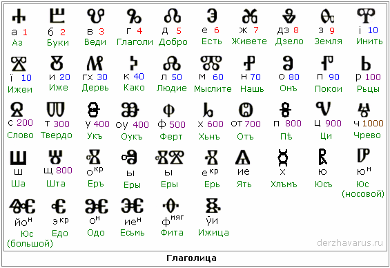

# Глаголица

  
Глаголица: начертание, название, числовое значение. Эти 46 буквиц - в общем обиходе, но есть ещё глаголические буквицы, которые используются всего лишь 1 раз, т.е. как буквы-исключения, потому что такой Образ больше нигде не применяется.

\* Славянские формы письма
