# Глубинные образы буквиц (А – Л)

На первом курсе мы уже записали образы: Азъ, Боги, Веди…, это структурный образ, он звучит (называние), этот образ мы называем. А теперь разберём глубинные образы буквиц, и тут же чтобы эта образная структура закреплялась, будем разбирать словопостроение.

## Глубинные образы буквиц

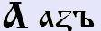

**Азъ** (а) – **Бог, живущий на Земле и сотворяша**, т.е. сотворяет. Но это как бы общий образ (человек), а есть ещё глубинная, изначальная структура: **изначалье, исток, единственный, единый** – это лишь несколько примеров, расписывать эту буквицу можно очень и очень долго. Т.е. образ мог видоизменяться, когда другой образ повествующий имел другое структурное глубинное значение. И чтобы эти образы взаимодействовали, их надо было согласовать между собой. Т.е. «А» - это гласящие образы, как бы повествующие, а между ними были образы согласующие. Сейчас мы имеем просто как формулировку «гласные и согласные буквы», но когда говорят «гласные», то у современного человек не возникает вопрос: «А что они гласят?», если буквы согласные, то «Согласные с чем?». И согласования бывают различные, поэтому согласующих букв больше, и каждая из них тоже несёт свой образ – образ согласования. И заметьте, в Буквице принцип чтения такой же, как в Рунах - каждый последующий образ влияет на предыдущий, поэтому читаем звукоряд в одну сторону, а образ его структурного значения читался в обратном порядке. Так и здесь (изначалье, единственный, исток, человек), т.е. как бы образы различные, но суть у них одна. И это изначалье, исток означает движение, направление к данному образу – точка, из которой пошли лучи содержащие глубины образов.  
И заметьте: изначалье, исток, единственный, единый - имеет как бы однородную структуру, т.е. как бы можно сказать единственную форму, т.е. то что было прежде всего. Поэтому и **числовое значение - 1**, т.е. единая структура.

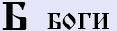

**Боги** (б) - которую христиане заменили на «буки». Но заметьте, у второй буквицы **нет числового значения**, потому что Богов множество. И образ данной буквицы означает: **множество, превосходящую форму, которая как бы преобладает над чем-то**, т.е. вот у нас есть какое-то понятие, а это преобладает, и взаимосвязь как раз и идёт. Рассмотрим пример только на этих двух буквицах.  
\* **БА** – допустим, есть фраза: «Ба! знакомые всё лица», т.е. превосходящее (Б) изначалье (А), т.е. сверх. Поэтому выражение «Ба» у нас звучит в удивительной форме. Человек удивляется: «как это? вот есть нечто, а тут появилось сверх того, что было вначале, и поверх него ещё что-то».  
\* **БАБА** (как бы согласовали с такой же формой). Смотрим первый слог: «Азъ» влияет на «Боги», т.е. как бы человеческое над чем-то, удивились, но при этом опять божественное пошло влиять на первое «Азъ» - на человеческое, и у нас уже образ поменялся: удивлены чем? Божественным созданием, т.е. то, что проявило на удивление новую множественную форму, т.е. ещё единое добавилось. Поэтому образ «баба» означает – произвела сверх того, что мы имеем, новую такую же Божественную форму жизни. Бабой называли женщину, родившую ребёнка, а ребёнок – это потомок Богов. Поэтому и говорили про женщину, что она обабилась, стала бабой, но это когда родила мальчика, т.е. продолжателя Рода. А женщина, которая родила девочку, её называли *молодкой, молодуха*.  
\* **БАБ** – здесь убрали «А» в конце, и получилось – божественное или множественное собирается перед множеством, а единый исток (А) находиться между двумя согласующимися системами, т.е. «А» как точка перехода между двумя какими-то структурами. А точка перехода всегда называлась дверью, **врата**. И эта форма была доступна и понятна не только нашим Предкам, но и многим народам, отсюда «баб» и переименовали как «врата». Допустим, в Ассирии в Междуречье, город в котором находились Врата Бога, или как мы называем Врата Междумирья, которые связывали Божественный мир с Земным, они его называли Бабел (или Баб-Ал, потом уже на «е» заменили) - Вавилон.  
\* **Б. Медведица** - заметьте, структура преобладания осталась до сей поры. Если оставить одну букву «Б» и поставить точку, допустим: «Б. Медведица» - получилось: Большая Медведица, т.е. здесь сама буквица раскрывает в данном контексте преобладание. А раз есть большее, значит есть и что-то меньшее. Т.е. эта форма осталась, но многие её используют на подсознательном уровне.  
Так как множество не может поддаваться конкретизации, поэтому числового значения у данной буквицы как будто и нет.

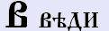

**Веди** (в) - означает **множество определённое**, т.е. если «Боги» - это множество неопределённого, то «Веды» - это множество определённое (**преобладание**), допустим много мудрости, много знания. Также Веди означает и **собранное воедино, определённость, направленность**, это же означает и **связующее звено между двумя системами**. Допустим, связующее звено между прошлым и будущим, между светлым и тёмным, между излучающим и поглощающим, т.е. это взаимосвязь, а взаимосвязь всегда чем-то наполнена, т.е. это не просто точка соприкосновения, это какая-то наполненность. Поэтому Веды это не только **мудрость**, это не только **знание**, в нашем понимании, а **весь спектр всего**: и цветов, и запахов, и вкусов, и ощущений. Это вода причинно-следственного океана, в котором плавает черепаха нашего мировосприятия, и на которой стоят три слона нашего мировоззрения, на которых покоится плоская Земля, как плоское суждение человека.  
**Числовое значение - 2** - соотносится с количеством связанных систем, информационное наполнение мироздания. Настоящее только миг, его как бы и нет. Хотя, при взгляде со стороны, настоящее превращается в вечное сейчас.

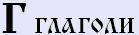

**Глаголи** (г) – **движение, истечение, направление, передача знания от истока**. Допустим, когда мы глаголем, изначально будут наши уста, вторым значением будет сам поток, т.е. наша речь, наш глагол, и третье, он же не в пустоту уходит, он находит чьё то окончание, т.е. уши принимающие. Когда человек просто говорит и его никто не слушает, говорят: «он балакает», но не глаголит. Поэтому если есть точка полноты откуда пошло, точка полноты что передаётся, допустим Веда, и то что воспринимает. И одновременно глагол подразумевал **тройственность**, т.е. передача звуковой формы, образной формы, и сокрытой формы, т.е. тайной (мысль). Поэтому **числовое значение - 3**.  
\* **ГА** - в современном понимании это путь, движение. Если впереди мы поставим утверждённый предел (тай), то получим «**тайга**», т.е. конец пути, т.е. конец потоку проторенного, установленного. А если мы впереди поставим твёрдость (Т) пути, при этом сотворённого (Ъ), мы получим «**гать**» - проторенный путь, т.е. сотворённый путь, сотворённую дорогу.  
\* **ГАВ** - заметьте, Веды это не только то, что передаётся от Предков к потомкам. Предки - это Боги, значит Веды, это мудрость уходящая за пределы понимания, лежащей между тем что мы знаем, и тем что мы не знаем. Т.е. ставим Веды после ГА – «гав», т.е. один человек другому: «Что ты гавкаешь?», т.е. то, что он произносит, выходит за сферу понимания данного человека. Собака тоже гавкает, она сообщает, то, что находится за гранью твоего восприятия. Заметь, когда ты говоришь что-то собаке, она понимает, допустим: «принеси тапочки», и она принесла. Но когда собака что-то прогавкала, ты не понял, что она хотела тебе сказать. Но это не значит, что собака умнее, она ближе к природе. И человек, когда был ближе к природе, мог разговаривать с животными - вспомните русские сказки.

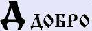

**Добро** (д) - образ Добра: **приобретение, созданное, находящееся над чем-то, сверх того, что есть, превосходящее что-либо**, т.е. превосходная форма. Одновременно добро означает полноту и гармонию созданного, развивающуюся форму. Поэтому для Добра существуют и другие формы записи: рисовали как «Д» (большая), либо как холмик (глаголическая), либо пирамидку с удлинённой нижней чертой (маленькая), т.е. на ровном месте какая-то возвышенность, возвышается над ровным. Поэтому Добро означало ещё помимо всего – **возвышение, поднятие, преуспевание**. А теперь сравните начертание буквицы «Д», это есть целостность (основа - раз, два, три) и оно над чем-то (четыре); и допустим полное развитие, гармонию человека: Тело, Душа, Дух, Совесть, т.е. 4 элемента, поэтому **числовое значение - 4**.  
\* **ДА** - когда у нас что-то преобладает над изначальным, над человеческим, над Божественным, это у нас всегда звучит в утвердительной форме, потому что раз оно преобладает, значит уже существует, оно уже утверждённое. Поэтому мы и говорим: «ДА» (Д – добро, А – азъ), преобладающее над изначальным.  
\* **АД** – здесь Добро не преобладает над изначальным, т.е. преобладание находиться ниже истока, оно ещё не проявилось, находится где-то за гранью. АД – это как противоположная структура, как бы перевёрнутая пирамида (перевёрнутая «Д»). Поэтому «АД» - это русское слово, а не еврейское или греческое.

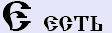

**Есть** (е) - означает: **быть, форма существования, бытия, нахождение в данной реальной форме, нахождение в данной реальности**, т.е. в проявленном состоянии. Кроме того, данная буквица означает то, что имеет объём и восприятие, зримое и чувственное. Одновременно это означает то, что находится в развитии. Т.е. эта форма существования касается только планов восприятия, что существует перед нашим взором, и это касается только Земного мира, а не вселенских структур.  
И заметьте, в общей форме пять элементов: Древо, Земля, Вода, Огонь, Металл. Но славяне и по-другому объясняли, т.е. символ не звезда, а Коловрат в круге – как бы 4 элемента составляющих человека (Тело, Душа, Дух, Совесть), и это всё находится во Вселенной (круг), поэтому **числовое значение - 5**.

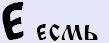

**Есмь** (йе) - **разнообразие, многоплановость, многомерность, многоструктурность** применительно к определённой точке обсуждения, разсуждения. Т.е. точкой могла быть человеческая сущность, точкой могла быть Вселенная, точкой мог быть и сам Ра-М-Ха. Т.е. если у нас есть эта форма бытия (Есмь), у нас есть как бы разнообразие.  
Пример: три слова «ели» - читаются одинаково, но значения разные.  
\* **ЕЛИ** (Есмь) – кушали, вкушали, трапезничали, явствовали, но это разное потребление, т.е. приём разнообразных форм энергий, ведь материя - это разной плотности энергия, эфир.  
\* **ЕЛИ** (Ять) – деревья, т.е. ель во множественном числе. Буквица Ять - связь Земного и Небесного, поэтому деревья.  
\* **ЕЛИ** (Есть) – бытийное, форма предначалья, т.е. то что предварительно начали: «ели-ели начали», «ели дошло». Т.е. здесь несовершенная форма, на уровне бытия.  
И заметьте раз Есмь - многообразие, многоплановость, то это невозможно передать числовой формой, поэтому **числовое значение – множество**.

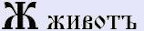

**Живот** (ж) - изначально живот, это **жизнь**. Т.е. данный образ означал не только жизнь, но и **существование различных форм, взаимосвязь множеств, преобразование** (предварительное образование, создание) и **приобразование** (изменение чего-либо). Так же означало **зарождение и рост**, достижение определённого предела, за которым появлялся новый путь к новому пределу. Т.е. жизнь она многоплановая, многоструктурная, многомерная и прочее.  
Заметьте, здесь опять множественная форма, но «Есмь» - это форма множества мысли, многоплановость, многоструктурность, а «Жизнь» - это **разнообразие**, а разнообразие не может иметь какую-то числовую форму.

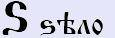

**Дзело** (дз) - означает: **весьма, сверх**, но оно также означает то, что находится **сверх нашего понимания**, сверх нашего сознания и воображения. Дзело **означает то, что нам неведомо и то, что мы ещё не познали**. Т.е. то, что находится вне рамок восприятия, оно как бы взаимосвязано проистекает, но чтобы это всё уразуметь, надо развиваться, т.е. оно не закрыто как таковое, оно должно развиваться, что бы мы могли это всё познавать. А также Дзело – это **дело**, т.е. то что сотворяется, но для других пока непонятное. И заметьте, если наша форма бытия (Есть) показывает, что это пять, то Дзело – это то, что выходит за грани пяти, за пределы бытия, за пределы понимания, поэтому и **числовое значение – 6**.  
\* **ЗЛО** - это незнание и невежество, т.е. то, что выходит за рамки восприятия, то что не познано людьми («З» - непознанное, «Л» - людьми, «О» - структура, объект).

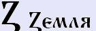

**Земля** (з) - здесь во вселенском понимании: то, что **входит в определённую систему, как составная часть**. Одновременно Землёй называется то, **с чем жизнь контактирует**. Т.е. чтобы понять, что это входящая система, представьте три окружности: центральная - это наше бытие (Есть = 5); всё, что находится за пределами – это шесть (6); а вот сам предел, вселенская система - это у нас семь (7). Поэтому **числовое значение – 7**.  
И заметьте, Земля – это многомерная форма существования, а значит это тоже форма жизни. Поэтому наши Предки её и называли **Мать Сыра Земля**, т.е. «Мать» - как бы плотная, плот(ь)ная; «Сыра» - сырая (не обязательно влажная, а необработанная, изначальная, различная); «Земля» - уже плотное небесное тело, т.е. всё в самом себе порождающее.

**Иже** (и - долгая) - **соединение, единство, гармония, равновесие**. Т.е. представьте многомерный пространственный крест (несколько лучей пересеклись в одной точке), как бы все пути сошлись в одной точке, и вот эти пути гармоничные, их образ тот же самый – гармоничный. Т.е. они соединились, поэтому **числовое значение - 8** - числовое значение гармоничного единства. Но раскрывая дальше образ, у нас там стоит «Ж» - жизнь, и «Е» - бытие. Т.е. как бы **уравновешивающая жизнь бытия**, т.е. гармонизирующая.  
\* **МИРЪ** - мы уже разбирали, что следующие буквы, которые идут, они как бы управляющие. Поэтому смотрите, есть «М» - мысль, мыслите; но мыслите как? Гармонично, что бы равновесное было. Т.е. мудрость и решение, которые гармоничны, они приводят к состоянию гармонии, к равновесию. Поэтому данное слово «Миръ» как правило, использовали для обозначения «состояние без войны», без конфликтов.

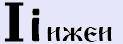

**Ижеи** (и - ровная) – если Иже звучит долго [ииии], т.е. лучи от изначальной точки на 8 сторон могут расходиться очень далеко, то Ижеи была ровная [и]. И заметьте, начертание «i» - здесь **связь с Вышним**, то что находиться в Небесах, с вышней точкой, это как бы **изначальная точка** через которую Ра-М-Ха проявился в новую действительность, и оттуда Свет вселенский пошёл. Поэтому образное значение этой буквы использовали **для определения вселенских масштабов**, не только в глобальном, большом, но и во вселенском малом.  
Заметьте, вселенское «і» - точка, это как гармоничный порядок, а гармоничный порядок у нас обозначался числом 8 (точка), и здесь соединение Небес (верхняя черта) и Земли (нижняя черта), т.е. девять и десять, поэтому **числовое значение – 10**.  
\* **МiРЪ** – здесь уже мудрость (М) исходящая из Вселенной (точки). Поэтому слово «МIРЪ» в Ведах означало Вселенную, т.е. мудрость исходящая, охватывающая всё, и Земное, и Небесное. Но заметьте, Вселенная не одна, поэтому когда говорили «МIРЫ», это означало другие Вселенные. Но впоследствии, когда многие образы были потеряны, Мiрами начали называть даже просто Звёздные системы или планеты, а не Вселенные.

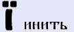

**Инить** (и) - заметьте, тот же порядок, но не точка (Вселенная), а черта, т.е. ограничивает пространство, как бы указывает, что это ограниченность нашего мира. Иногда вместо черты даже над большой ставят две точки. И в названии мы видим буквицу «Нашъ», т.е. (**И**) – гармония (**Н**) – наша (**И**) – истина (**Т**) - утверждённая и (**Ь**) – сотворённая. Понятие «наше» - т.е. общее - не моё, не его, а наше. Поэтому Инить передавало **образ единого многосферного определения**, или как сейчас говорим: общинного определения, общие характеристики, общие формы, общие правила, общие устои.  
\* **МIРЪ** - общность людей, т.е. Община. И не только людей, а вообще общность каких-то определённых видов. Поэтому, если мы говорим: «Мир Природы», то Вселенскую природу запишем через Ижеи (с одной точкой), а Земной мир природы запишем через Инить (с двумя точками). Т.е. МIРЪ - понятие «Община», отсюда и было понятие «**миряне**», т.е. общинники. Наши Предки испокон веков жили Миром (Общиной), в свой мир чужих не пускали. Не на свою территорию, а как бы есть понятие в Духовный мир, т.е. мир в котором живёт Община.

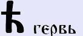

**Гервь** (гха) - в некоторых так называемых толковых словарях древнерусского языка, церковнославянского, эту букву иногда ещё называют не «Гервь», а «Дервь», т.е. и в этом понимании Гервь как **Древо Мироздания** – внизу это наш Явный мир, затем черта поднебесная, и вот это то, что за пределами, что с поднебесья, из другого мира истекает во Явь, поэтому Гервь и называли Древом Времён или Древом Миров, Мироздания. А то, что у нас из Вселенной, т.е. из небес спускается, это **неизведанное, но проявленное в Яви**, или проявление неизвестного в Яви. Поэтому данная форма всегда ставилась в удивительной структуре, **структуре удивления**. И заметьте, знак восклицания (!), а раньше он назывался «удивительный знак», т.е. когда человек не только восклицал, он чему-то удивлялся, а удивлялся человек всегда чуду. Поэтому можно сказать, Гервь использовалась для выражения чего-то удивительного, чудесного, но в тоже время непонятного, оно не определялось каким-то характером.  
Т.е. Гервь - форма множественная, многогранная, её невозможно определить какой-то конкретной формой, поэтому она тоже **не имеет числового значения**.

**Како** (к) – в начертании буквицы «К» видим Иже (I), и как бы к этому миру, к связи между Небесами и Землёй подходит ещё два мира, т.е. «К» должна связать верхний мир – Небеса (это где нет беса, т.е. Правь), и подключение двух миров: Светлая Навь (верхняя косая) - Мир Предков, и Тёмная Навь (нижняя косая) – Мир Духов. А так как Мир Прави находится выше, поэтому и центральная черта всегда была выше по начертанию «k».  
И заметьте «КАКО» - стоит **объединение трёхмерное**; потом «Азъ» - человеки; и опять объединяет его ещё со структурой сферной «О», т.е. что-то ещё. Как бы человек как вселенная, а рядом есть ещё вселенная, вот они у нас две десятки, две вселенные (как говорят: **микрокосмос и макрокосмос**). Поэтому **числовое значение – 20**, две сферы. Т.е. два мира соединились, а когда соединяются два мира - создаётся **объём**, и не просто объём, а слияние как бы двух систем или нескольких систем которые слились воедино, и вот там воедине они начинают взаимодействовать гармонировать.

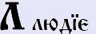

**Людие** (л) - если «Како», это объёмность, то здесь как бы объёмы в разных сферах соприкасаются, каждый человек это определённый объём. Т.е. **какие-то самостоятельные части объединяются в нечто совершенное, подобие единого**. Т.е. у нас есть проявление одного мира (левая косая), проявление второго мира (черта вверху), и проявление третьего (вертикальная черта), и это у нас всё в общности, в объёме, а раз мы объединили три сферы, три мира, то у нас **числовое значение - 30**. И заметьте, к понятию «люди» наши Предки относили живущих не только явной жизнью привязанных к земле, но у них и **Душевная сфера развита**. Помните, мы уже разбирали: Жить – Людина - Человек. Поэтому когда человек живёт только: поработал, поел, поспал - это не относится к людям, потому что должно быть общение, взаимосвязь, и образ «Людие» - во-первых: **мирные люди**. Тех, кто пытался разрушать, их даже в обиходе называли - нелюди. Т.е. мирные жили без войны, нелюди жили войной. Поэтому у нас много похожих на людей, которые людьми в истинном значении, в правильном значении не являются.  
\* **ЛЮДМИЛА** - т.е. «Людие», это когда Душевное, Явное и Чувственная форма объединена. Поэтому имя Людмила - «людям мила», а мила потому, что развита сфера влияния (30), три сферы влияния.  
\* **ЛЮБОВЬ** – это понятие не только земное, но и космическое, вселенское, т.е. Любовь охватывает и Явь, и Навь, и Правь, т.е. опять три сферы, поэтому Любовь через эту буквицу и писали.  
\* **ЛЕС** – здесь тоже «Л», потому что у нас не только человек объединяет три сферы равновесия. Земля, Солнце, Воздух преображаются в бытие, в Яви во что? ЛЕС – корнями в земле, воздух и небеса с солнцем дают свет, он объединяет, чтобы дать жизнь.  
\* **ЛИСА** – тоже тройственность, как говорят: лиса – это хитрость, ложь и обман, т.е. Лиса Плутовка.

Древнерусский язык, курс 3, уроки 1.

### Буквица

- Глубинные образы буквиц (М — Щ)
- Глубинные образы буквиц (Ъ — Ижа)
- Буквица славянская - Образы 49 буквиц
