# Глубинные образы буквиц (М - Щ)

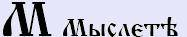**Мыслете** (м) – здесь соединили две «Л», т.е. как бы соединены две направленности. Т.е. уровень один (основание М), и как бы треугольник ушёл вверх, треугольник вниз, и ещё треугольник, и взаимосвязь. Т.е. мыслете. Образное значение было: и **мыслить**, и сама **мысль**, и **думать**, и **обращаться как бы за поддержкой**. А когда человек мыслит, он же всё равно соединяет то, что внутри него и то, что вне его. Но если внешнее, явное - это у нас тридцать (Люди, общность), а здесь ещё есть внутренний мир, поэтому как бы мыслительный мир у нас выходит на новый уровень, и **числовое значение – 40**.  
Сразу же возникает другое понятие: мысль не просто сама по себе, это какая-то последовательность движения, **последовательность обработки информации**, т.е., когда человек последовательно что-то делает, он говорит: «я мыслю» – значит существую. Поэтому образность буквицы Мыслете - она большая, охватывает проявление всего, ведь не зря слово МИР мы начинали именно с Мысли. Т.е. **мысль, движение, форма**, которая последовательна, она отображается, как бы порождает, раз последовательность – одно порождает другое, из одного вытекает следующее. Поэтому происходя из мира в мир посредством чего или кого-либо, идёт проявление последовательное.  
\* **МАТЬ** - посредник между одним миром, вторым миром, третьим миром и четвёртым миром. Т.е. здесь «М» не только в понятии мудрость, но и как источник преображения, т.е. передаточная форма. И заметьте: Азъ (А), Боги утвердили (Т) и сотворили (Ь). Т.е. Мать – это не просто женщина, которая родила ребёнка, а здесь сохранена определённая последовательность (взросление организма, подготовка его к материнству, потом развивается тело в утробе матери, и потом тело рождается и в него вселяется Душа, несущая Дух). Т.е. МАТЬ - здесь сотворённая форма имеет уже глобальное значение.  
Поэтому Мыслите значит: **преобразовывайте, изменяйте, улучшайте**.

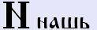**Нашь** (н) – материализованная мысль, т.е. мы к Мыслете добавили как бы ещё воплощение в нашей жизни, ещё одну сферу, поэтому **числовое значение - 50**. Т.е. **сформированная мысль**, поэтому человек говорит: «у меня есть мысля, и я её буду делать», т.е. она сформирована, но, будем говорить, не до конца проявлена в Явь. Поэтому «Н» - **законченный образ, но который существует сам по себе**. Эта форма не носит общий характер, она находится внутри нашего собственного мира, она не пересекает рубеж внутренний и внешний, т.е. она до конца не сформирована, поэтому человек произносит «**НЕ**» - и говорят: ребёнок это не воспринимает, ему говоришь нельзя, а он делает, потому что вы ему сказали «НЕ...», он его действительно не чувствует, это ваше внутреннее, а то что внутри вас – ребёнок не воспринял, или человек. Т.е. форма «НЕ» - это обособленная форма, существует сама по себе.  
\* **НЕМЕЦ** – тот, кто находится вне нашей жизни, т.е. за сферой нашей жизни, за сферой нашего понимания, нашего сознания и образа восприятия (см. немцы – это «не мы»).  
\* **НЕБЫТИЕ** - т.е. это не наше бытие, это за сферой нашего бытия, т.е. другой круг, где-то другая сфера жизни существует. А чужое существование как бы не существует, в нашем мировосприятии отсутствует, но где-то продолжает существовать.  
\* **НАВЬ** – (Нашъ – Азъ – Ведаю – Сотворено) - то, что находится в данный момент за гранью нашего восприятия, за гранью Яви. Т.е. «Н-АВЬ» как бы НЕ наша ЯВЬ.  
\* **НЕВОДЪ** – относится к другой структуре, как бы не вписывается в данную сферу, но существует. Т.е. «НеВод» вообще - это система, не предназначенная для существования в воде, её как бы в другой мир забрасывают, чтобы получить там улов, что-то из другого мира изъять, отсюда и понятие *невод*.

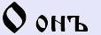**Онъ** (о - долгая) – многие неправильно читают [он], а Еръ тоже звучит, т.е. [оно]. И заметьте, когда мы видим что-то необычное, не входящее в нашу сферу сознания, понимания, что звучит? [о-о-о], т.е. «О» долгое, удивлённая форма. Поэтому «Онъ» - **удивление**, оно раньше означало **нечто или некто**. Т.е. что-то, находящееся в особом состоянии. Т.е. нечто обособленное, отделённое от земного, но уже для нас проявлено. Мы и священное от земного отделяем, и небесное отделяем от земного, и многомирное отделяем от нашего мира, но в то же время мы и определяем, что данная сфера, нечто, оно сотворённое и проявлено. Т.е. оно как бы **не нашего внутреннего мира, но имеет какую-то связь с нами**.  
\* **ОТЧѢ** - когда это утверждено (Т) человеческим понятием (Ч) и определено вышним проявлением (Ять), т.е. есть взаимосвязь, как бы связующая нить. Отче – это духовный наставник.  
\* **ОТЕЦ** – направляющий в жизни. Т.е. здесь после утверждённого понятия (Т) бытие, жизнь (Е), а потом стоит цель (Ц), конкретизированная форма - тот, который направляет в определённую цель. Вот это будет отец. Но дети всегда называли «ТЯТЯ» - тот, кто утверждён свыше, теми, кто ещё выше. А когда Богами определено, т.е. вообще высшее, того уже называли БАТЯ.  
И заметьте, есть какая-то иная сфера жизни, это у нас 50, и есть форма «О», которую мы определили как бы по отношению к себе, наш внутренний мир – это 10. Но мы не соприкосновенны, мы находимся как бы в пространстве, которое разделяет эти две сферы: нашу сферу и чуждую сферу, а это пространство тоже Вселенная, она имеет числовое значение 10. Получается «Онъ» **числовое значение – 70**. Т.е. заметьте, «орати» (пахать) - разделять как бы межой, рубежом, т.е. О-О, две сферы и между ними точка соприкосновения – Вселенная.

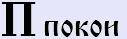**Покои** (п) – т.е. вот у нас покой (П), сфера (О), объёмность (К), и теперь смотрите: две сферы (О) они как бы подключены, т.е. в состоянии равновесия, и эти подпорки (П и К) для двух миров, которые взаимосвязаны, приведены в **состояние равновесия, т.е. когда прекращается всякое движение, всякое давление**. Т.е. понятие покоя - оно многогранно, мы разобрали: влияют сферы, которые объединены с другой сферой в состоянии гармоничного равновесия.  
\* **ПОКОЙНИК** – тот, кто уже находится в покое, не движется. Т.е. у него прекратились как бы все основные функции действия.  
\* **ПРАХ** – то, что ушло из изначалья, отделено от него, оно превращается в прах.  
\* **ПОВЕДЕНИЕ** – т.е. «ПО», это как согласованное, гармоничное, согласованное с данной сферой. Поэтому когда человек знает или как раньше говорили: ведает, и он действует согласно этого знания, т.е. той мудростью (ведой), не отходя от неё ни на шаг - это у нас будет поведение, т.е. ведёт кто-то, а кто следует - это будет поведение.  
**Числовое значение – 80.**

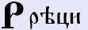**Реци** (р) – это **речь, изречение**. Но заметьте, рекущий **говорит чётко**, т.е. знаете, говорят: «как заученными фразами», «режет правду-матку». Т.е. когда глаголет, говорит, изъясняет - это уже другие формы, а Реци - эта **жёсткая, чётко выраженная мысль**, при этом она разделяет, отделяет как бы зёрна от плевел, правду от неправды, кривду от лжи. Поэтому идёт как **сфера разделения**, т.е. определение изначального между двумя сферами. Т.е. когда нам поручили высказать, вот тогда мы рекём, допустим, в школе заставляли учить **речёвки**:

«Сегодня праздник у ребят,  
Ликует пионерия,  
Сегодня в гости к нам пришёл  
Лаврентий Палыч Берия».

Или рубили правду:  
«Вот расскажем для примеру,  
Полетел Никита к Неру…  
Неру дал ему слона, мол не жалко нам г…»

Т.е. уяснили: Реци - это разделяющая, чётко определяющая форма, которая разграничивает понятия по однородности, структуре, форме. **Числовое значение – 100**.  
\* **ГОВОР** - допустим два человека рекут мудростями, один привёл пример, другой привёл; и они это глаголят, но как бы две сферы разграничены в ответе, и это у нас будет – говор.  
\* **НАРЕЧИЕ** – это когда, будем говорить, не наша речь, но схожая по изначалью.

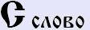**Слово** (с) - **соединяющая форма, направляющая из одной сферы в другую**. Т.е. вибрация, которая проникает в различные сферы мировосприятия, и она идёт по нескольким каналам, поэтому Слово - это **материализованная мысль**, это мысль, которую мы воплотили в вибрацию, которая дарит сосуществование. Поэтому и говорят: «из песни слов не выкинешь», потому что уберёшь вибрацию, и это уже не будет песней, т.е. с определённой информационной нагрузкой. **Числовое значение – 200**.  
\* **СКАЗ** – словом казать, т.е. как бы показали события прошлого словом - сказ.

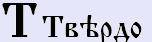**Твердо** (т) – означало: **утверждение, определение, восстановление, наставление, определённую какую-то структуру, ограниченную определённым пространством**, и это пространство ограничено не только Явью, но иногда и определённые формы Нави. Поэтому, малые буквы иногда изображали с удлинённой вертикальной чертой «t», т.е. это основа - взаимосвязь верха и низа, перекрытая поднебесной, и определена гранью, т.е. определёнными рамками «Т». Т.е. в определённых рамках, в определённых сферах это имеет какое-то определённое наставление. Поэтому если мы рассматриваем какое-то явление, событие и у нас стоит Твердо - оно уже определяло меру утверждения.  
\* **ТА** - утверждение Богов (Асов, т.е. Богов, живущих на Земле), т.е. утверждение наших древних Предков.  
\* **ТУТ** – это уже другая форма, здесь опять утверждено определёнными рамками пространство.  
\* **ТМА** (или ещё иногда писали «**ТЬМА**») – это тоже определённая форма,  
сотворённая мудростью наших Предков, т.е. определённое пространство. И эта форма была числовая, т.е. наши Предки утвердили, определили, что эта форма охватывает структуру 10000 (см. числа Буквицей).  
\* **ТО** – здесь видим «О» - нечто, некто. Т.е. здесь как бы утверждается, что это есть, но форма не определена. Поэтому мы до сих пор говорим: «То ли это, то ли не это». Т.е. «ТМА» - это определение, а «ТО» - неизвестно.  
\* **ТЫ** - здесь форма определённости. Стоит Еры (Ы), а это соединение уже сотворённого (Ь) и взаимосвязи между Земным и Небесным (I), и плюс это утверждение (Т). Т.е. сотворено, соединено, и это определено, а то что сотворено - всегда близко и понятно. Поэтому обращались на ТЫ только к чему-то известному, близкому, родному и прочее. Допустим, к родным Богам обращение было «ты».  
**Числовое значение – 300**.

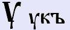**Укъ** (у) - указывал **образное структурирование**, где находится то или иное. Т.е. перед этим разбирали, что Твердо - форма неизведанной (иной) мудрости, а когда мы находимся у неё, т.е. определяем, и говорим: «Увы». Или стоит другая форма «Род», и мы имеем форму «Урод» - тот, кто находится под покровительством Рода.  
\* **УВЕДОМИТЬ** - как бы подвести к определённому знанию, определённой мудрости (т.е. У-Веды).  
\* **УВИДЕТЬ** – т.е. то, что мы можем видеть, и подходя к этому, находясь рядом, мы должны увидеть.  
\* **УЗНАТЬ** - находясь рядом со знанием, мы должны узнать.  
\* **УТКА** - т.е. заметьте, нахождение рядом с определённой системой. Но в старые времена не говорили на птицу: утка, их называли по-другому: кряква, утя. А «уткой» определённую какую-то структуру. Допустим, в больнице у нас – утка (то, что к тебе приближают), или газетная утка, информационная, и имеем форму «КА» - это одно из множеств.  
Т.е. Ук - это **форма приближения** к чему или к кому-либо, т.е. структурированное понятие.  
**Числовое значение – 400**.

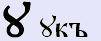**Оукъ** (оу) - т.е. если «Ук» - это нахождение рядом с чем-либо, то «Оук» означал не какую-то структуру, а **определённую сферу, т.е. со своими устоями, формами, содержанием**, но нахождение. Допустим, сейчас мы пишем Русь вот так:  
\* **РУСЬ** – рекомая (Р), У, слово (С), сотворённое (Ь) – но это же не передаёт истинный образ, потому что нет сути и наполнения. А раньше писали это слово с буквицей Оук, и звучание было дифтонгом [оу], поэтому одни произносили [Русь], другие произносили [Рось], а третьи [**Роусь**], т.е. здесь шло определение, что это целостная структура, со своими устоями, со своими определёнными понятиями. И заметьте, здесь у нас Реци, т.е. рекомая определённая структура уже означала как форму объединённого родства (рекущий, т.е. текущий, т.е. откуда-то). Т.е. Р[оу]сь – слово определённой формы, структуры, образа наполнения рекомое, т.е. как бы **народ говорящий на одном языке**, одним словом, т.е. в понятии речи или мови, молви.  
Многие трактуют, что Русь от того, что жили люди с русыми волосами. Но **русы головы** писали с буквицей Укъ, а державная форма была с буквицей Оукъ - Роусь.  
И мы уже разбирали, что Московия не была Русью, поэтому они себя обозначали не Роусь, а **Русия** - как приближающая. Т.е. это уже при Романовых началось, потому что допустим при том же Рюриковиче говорилось Расея, т.е. как божественная. А они ввели понятие «Русия», т.е. приближение, как бы начали приближать к себе, ну под себя всё грести, приближать.  
\* **ОУКНЕТСЯ** - т.е. заметьте, была же старая форма: «как ОУКнется (какой образ пошлёшь), такой и ОТкликнется (то и получишь)». Это уже в последствии переделали: «как Аукнется», потому что оканье во многих местах перешло в аканье. А здесь было - какой образ ты посылаешь, такое тебе эхо и возвращает.  
**Числового значения нет** – хотя в некоторых словенских землях и московийских, иногда, особенно греки они путали Оукъ и Укъ, поэтому и для той и другой ставили одну и ту же форму - 400. Т.е. для них Оукъ и Укъ как бы понятия были одинаковые. Ну что с них взять, греки, они же не знали нашего образа построения.

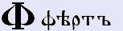**Фертъ** (ф - твёрдое) – означал: **значимость**, т.е. то, что имеет определённое значение. Допустим, даже выражение до сих пор осталось «стоять фертом», т.е. руки в боки. Когда определение Ферта соединялось с определением структуры, тогда было как бы определение взаимодействия.  
\* **ФУ** – т.е. Фертъ поставили рядом с Укъ - это уже структурная форма, т.е. определяющая конкретику. Допустим, в сказках: «Фу, русским Духом пахнет». Или до сих пор собаке говорим: «Фу!», т.е. дана команда определения.  
\* **ФИ** – т.е. «ну и что?», или ФИфочка - т.е. ничего не представляющая из себя структура.  
Т.е. Фертъ как бы объединял вместе, раз идёт здесь пятеричная структура, т.е. плюс временная, указывающая на определённое содержание, т.е. содержание в определённой сфере. Заметьте, начертание «Ф» - дана сфера, и мы эту сферу разделили, т.е. мы как бы Фертъ раскрываем вглубь, **сущность определённого явления, определённой структуры**. И начертание нам говорит - вот было нечто целое, которое мы могли рассмотреть только снаружи, а когда мы эту структуру раскрываем и смотрим что внутри, мы получаем определённое значение. Т.е. Фертъ указывал **раскрытие сути**, указывал на раскрытие глубинного значения, т.е. давал возможность взглянуть. Ну, взять хотя бы дореволюционную игру «Фанты», т.е. вытаскивали какой-то фантик и разворачивали, чтобы посмотреть что там написано внутри.  
\* **ФАКТ** - т.е. заметьте, есть какое-то действие в определённых рамках - это «акт». А когда мы говорим, что этот акт раскрыт и понятна его суть, у нас это будет «факт».  
\* **ФИГА** – т.е. «ФИ», это ничего не значащее. И здесь у нас «ГА» - движение. Т.е. фига – это движение, ведущее в никуда. Фигой называли **шиш, крест** (перекрестье двух пальцев) - дорога в никуда. В польском до сих пор осталось – кшиш (крест). Т.е. «кшиш тебе» - крест тебе. А крест - это дорога в никуда, т.е. жизненный путь прервался, дорога в неизвестность. Поэтому им говорили «фигу тебе», т.е. ты там обещаешь райские кущи, райское блаженство, а на самом деле там этого нет. Или «Держать фигу в кармане», т.е. всё что тебе говорят – это ты не принимаешь, что это идёт по пустому пути, это тебя не коснётся, уйдёт в сторону. И также говорят: никчёмное, пустое дерево - фúговое дерево.  
**Числовое значение – 500**.

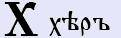**Херт** (х) – означало: **форму, пересечение определённых значений, взаимосвязывающее Небесные и Земные структуры**.  
\* **ХЛЕБ** - собирает и земную силу и небесную (свет от Солнца, Звёзд).  
\* **ХВАЛА** - т.е. есть вал (собранная воедино полнота), и вот это всё пересечение (Х) с Земли на Небо пошло (А), как бы направляющая, отражающая одно в другое, хвалить.  
\* **ХУЛИТЬ** – т.е. то же самое, набирать вот это всё и отправлять. Т.е. ХУЛА - это как бы собранная информация, слухи о человеке, которую направляют ему, а имеют ли они истинное значение или нет - здесь как бы уже дело другое. Т.е. это отражённая информация, а любая отражённая - есть немного искажённая.  
И заметьте, Херт - это ещё имело и определённую жизненную **временную структуру**. Т.е. не сразу проявлялась данная форма, а указывалось на то, что она со временем развивалась. Ведь хлеб не сразу взял и вырос, хула не просто появилась, хорошо тоже не сразу стало, т.е. должна постепенная, временная как бы развязка произойти.  
\* **ХА** – форма связывает Земное и Небесное, да ещё и Богов живших на Земле, поэтому «ХА» имело значение положительное - Божественное, положительное, созидательное. Даже форма радости у нас: «ха-ха».  
\* **ТХА** - т.е. вот эту безграничную радость (ХА) заткнули в определённые рамки (Т), т.е. ограничивали, и получили форму «тха». А когда мы даже произносим «тха-тха», получается страдание, т.е. обездолили положительную силу, её засунули в какие-то рамки. А это уже как бы противоположное свободной форме (Ха), поэтому и соединение двух противоположностей у нас было как «Ха-Тха», но соединённо – «Йога».  
**Числовое значение – 600**.

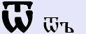**Отъ** (от) - здесь мы видим объединение Омъ (W) и Твердо (Т), то есть Твердо. Т.е. есть какая-то структура (сфера, круг), и всё **исходящее от данной структуры**, оно означало Отъ.  
\* **ОТВЕТ** – т.е. есть форма «Вето», это определённый Устой Мудрый, и когда мы получаем от изначальной структуры этот Устой, всегда писали «ОТвет» (т.е. буквица «Отъ»), потому что когда находилось за пределами структуры, это было уже «Завет». Т.е. вы кому-то что-то задаёте, а к вам идёт ответ.  
Поэтому Отъ означал: **структуру, исходящую от какого-то предела**. Пределом могло быть: предел сознания, пределом мог быть и человек, т.е. вы дошли своими знаниями до определённого предела, вы приходите к знающему человеку и он вам даёт форму, исходящую от него, от данного человека, то есть он для вас, как предел ваших знаний, и чтобы выйти за этот предел, вы обращаетесь к кому-то, и от него получаете.  
\* **ОТБЫТЬ** – т.е. «быти», «существовати» – это глагол существования данной формы на данной местности. А «отбыть» – т.е. из данной точки пространства вы переместились в другую форму, вы отбыли.  
То есть, Отъ означал: **истечение от данного, конкретного определения**. Есть просто «дать», а есть «отдать» - т.е. вернуть что-то.  
И заметьте, есть буквица «Отъ», и есть форма «ОТ» - а это уже другая форма, допустим: Отец – оное (О) утвердило (Т) бытие (Е) и цель (Ц) его. Т.е. отец определяет детям цели.  
**Числовое значение – 800**.

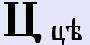**Це** (ц) – означает: **цель**, т.е. как бы **система определения цели**, но она взаимосвязана, указывает на взаимосвязь цели Земного и Небесного (Ять). Но, как бы **предел достижения**. При этом Це (Ци) указывает на то, что данная цель (раз две сферы достижения в одной), является начальной точкой для другой.  
\* **ЦЕ** - на Украине до сих пор говорят: «це пожарные», «це швидка допомога», т.е. как бы конкретика, определение.  
\* **ЦЫЦ** - когда цель близкая, т.е. цель достигнута, то к чему стремиться, оно рядом.  
\* **ЦЫПЛЁНОК** – цель у нас есть (ЦЫ) и дальше ПЛЁНОчКа, т.е. цыплёнок – тот, кто только что появился из плёнки яйца. Потом это уже курочки, петушки.  
**Числовое значение – 900**.

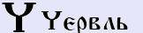**Червль** (ч) - здесь шло **определение, разграничение определённых порядков**, т.е. как бы создание определённой черты. Поэтому, допустим: червлёный, черта, чертовщина – то, что находится за чертой восприятия, а раз за чертой, то мы не воспринимаем. Поэтому Червль (или как многие называют: Червь) – это **структурированная, определённая форма**. А также Червль – **красота** (естественная), т.е. у славян было множество понятий красоты, но основных было два: естественная называлась «красотой», а созданная человеком, слепленная называлась «лепотой», т.е. что слеплено.  
\* **ЧУРЪ** – это рубежный страж. Т.е. разграничение (Ч) обжитой территории (УР) сотворяша (Ъ). Но заметьте, когда произносилось выражение: «Чур меня, чур» - здесь Еръ (Ъ) нету. А когда в слове Чуръ стояла буквица Еръ – это означало Куммир Чура, стоящий на меже, охраняющий межу, то есть рубеж, границу. Т.е.здесь уже шло обращение к тем, кто находится за чертой, т.е. обращение к Предкам Рода. И заметьте «**чураться**» чего-либо означало: закрываться Силой Рода, т.е. не бояться - как сейчас трактуют: «чё ты чураешься?» - в смысле «чего ты боишься?». А на самом деле «чураться» означало – закрываться, защищаться Силой Рода.  
\* **ЧЕРВОННОЕ** – есть такое выражение «**червонное золото**», т.е. красное. Но золото, как правило, жёлтого цвета (златый, золотой). Т.е. как бы спектр червонного золота уходит за предел жёлтого спектра, т.е. выходит за определённые черты, так же как и белое золото, и «чёрное золото» (нефть), она же не жёлтая.  
\* **ЧУРКА** – это заготовка для Куммира Чура. Т.е. дерево пилили, чтобы из него сделать Чуры, то есть поставить Куммиры Чура. И вот эти напилы, допустим мерные или саженные, это и называлось «чурка». А в плохом смысле - это образность, т.е. как глупый Буратино был вырезан из полена, отсюда и пошло выражение «**чурки**» - те, кто невоспитанные, необразованные, они как полено.  
\* **ЧЁРНЫЙ** – чёрный цвет, т.е. как «за чертой», т.е. неизведанный, и будем говорить, свет туда попадает, но ничего не отражает, он уходит вглубь, и какой он изначально, как бы и неизвестно.  
\* **ЧЁРТ** – тот, кто живёт за чертой восприятия. Но это Карамзин придумал слово «чёрт», а раньше писалось «чорт» (чорта). Т.е. определялось не просто, что это какая-то форма бытия, а что это определение неизведанного. И здесь не определяется: хорошие они или плохие, а наши Предки просто сказали, что жизнь за чертой нашего восприятия существует, и есть представители данной формы жизни.  
\* **ЧЕРЕДА** – т.е. смена определённых линий, рубежей; преграды, которые мы переходим.  
\* **ЧЕЛОВЕК** – т.е. ЧЕЛО (совр. лоб), здесь у нас рубеж между нашими, будем говорить, мозгами и окружающим миром, т.е. сквозь чело может пройти только мысль; и ВЕК – это у нас время. То есть, «человек» – мыслящий во времени. Но раньше-то в этом слове в конце стояла **Еръ** (Ъ), т.е. он сотворён (сотворили мама и папа). И здесь действовали не только временные порядки, а была буквица **Ять** (вместо «Е» - бытия), т.е. здесь действовали две силы: и Земная и Небесная, т.е. сотворяют человека во времени Земные и Небесные Боги. И, кроме того, человек – создающий во времени другую структуру, т.е. это тот, кто создаёт свой собственный Мир, свою Вселенную.  
**Числовое значение – 90**.

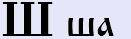**Ша** (ш) – означал: **выходящий за определённые рубежи, за определённые образы восприятий**. Т.е. одновременно он указывал на определённую **широту, площадь, структуру пространства**.  
\* **ШАГ** – т.е. пространство измерил собою, сделал шаг, ещё шаг.  
\* **ШАЛЬ** – т.е. люди сотворили определённую структуру, определённое пространство, т.е. она как пласт определённый, площадь пространства, сотворённая людьми.  
\* **ШАЛОСТЬ** – т.е. здесь в структуре поведения; когда дети выходят за определённые рамки, им говорят: это шалость, не шали, шалить не нужно, т.е. выходить за определённые рамки, определённое пространство и прочее.  
\* **ШАТУН** – т.е. медведя называют шатуном, потому что он как бы выпал из определённых рамок, т.е. все комы (медведи) спят, а этот вылез как бы вне правил, и начинает шататься, т.е. шатун.  
\* **ШАМАН** - человек, управляющий пространством. Т.е. они же входят в состояние камлания - преломляют пространство, уходят как бы в нижние Миры.  
\* **МАША** – мать пространства определённого, выходящего за общепринятое.  
\* **КАША** – т.е. собрали крупу с поля (большое было пространство), и объединили в котелок, запарили. В другой среде у тебя получилась каша.  
\* **ШАР** – определённое ограниченное пространство.

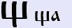**Шта** (щ) – т.е. если «Ша», это у нас «Ширь Божья» (Ширь и Азъ), то «Шта» - это Асами (А) утверждённая (Т) ширь (Ш), **ограниченное пространство**, т.е. пространство ограниченное каким-то рубежом, каким-то пределом. Форма укрепления, т.е. как бы **защитная форма**.  
\* **ЧАЩА** – т.е. определённая мера, черта (Ч) которую Предки разведали (А) и где предел, природа перекрыла туда доступ (ЩА). Т.е. чащей называли пространство, куда не пройти (лесная чаща, глухомань, куда либо трудно, либо невозможно пробраться).  
\* **ЧАЩОБА** - это вообще место, которое мало того, что Природа, ещё и Боги закрыли.  
\* **ЩИТЪ** - это защитная форма, и в то же время показано, что она плотная, твёрдая (Т). Что-то сделанное для защиты из плотного материала.  
\* **ЩУКА** - потому что она себя всячески оберегает (зубы, плавники и пр.). Также как птичка **щегол** - яркая окраска помогает ей скрываться. Допустим, когда щегол садиться на ветви дикой яблони на обмороженные жёлтые, красные листики, она как бы сливается и её невидно.  
\* **ЩАВЕЛЬ** - защитные функции лесного растения, помогающие от различных недугов.

Глубинные образы буквиц (А – Л)  
Глубинные образы буквиц (Ъ — Ижа)
