# Глубинные образы буквиц (Ъ - Ижа)

Продолжаем разбирать глубинные образы буквиц. Остались самые интересные буквицы, самые как бы неожиданные, потому что воздействуют на внутренние области человека, т.е. так называемые: горловые (или грудные), носовые звуки, они создают вибрацию в области чакр, т.е. имели вообще богатейшее и значение и образы.

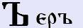**Еръ** (о – краткое) – т.е. привыкли в советском языке «И» краткое, а здесь «О» краткое. Образ, который она несла, означал: **твёрдость**, здесь в понятии утверждения, т.е. **утверждение какого-то действа**, которое происходит под определённым управлением. Или как бы мы записали: образ выполнения действия, которое необходимо сотворять, или как раньше говорили: **сотворяша**.  
\* **ПОСТЪ** – т.е. выполнение определённого действия – очистить все свои тела.  
\* **СОН** – это слово раньше писалось через Еръ, т.е. СЪН – структуру (С) действия (Ъ) в неизвестности (Н) сотворить. И заметьте, в старые времена, т.е. в древлесловенском буквицы всегда звучали, а потом уже в XIII–XIV вв. краткое «О» звучит только под ударением, и выпадают из звучания, но не из написания. Допустим, **СЪНЫ** (соны), а сказали бы [сны].  
\* **РОТ** – это слово тоже писали с Еръ - РЪТЪ (рот), а множественная форма: РЪТЫ (роты), но сейчас в безударной форме говорят: «рты».  
\* **ЛОБ** – в древлесловенском писалось: ЛЪБЪ, и в старину сказали бы: «ударился лобом». А сейчас говорят: «ударился лбом», т.е. потеряли буквицу, и само значение слова, потому что эту часть головы наши Предки называли – чело (челом бьют), а лоб – это затылок, отсюда и «лобное место» - возвышенность.  
Т.е. буквица **Еръ указывала какие-то действия**, допустим: РЪТ (рот) - человек может сказать, т.е. речь, он может дышать, может вкушать, петь, свистеть и т.д. Когда стоит форма «сотворяша» - это не что-то само по себе, а что-то кем-то создано. Но создавали, как правило, всё мама с папой. Поэтому впоследствии множественные формы образа Еръ были убраны, но осталась как бы структура действия, т.е. либо это надо делать, либо это уже существует. Поэтому допустим, до 30-х годов ХХ века в конце заглавных букв всегда ставился Еръ, т.е. он указывал как бы действие. Конечно, сейчас понятно, что библейцам, которые не разбирались в русском языке было абсолютно непонятно зачем после слов указывать, что это надо сотворять, делать. Так же на действие, которое выполняется, влияют предстоящие и послестоящие буквицы. Допустим, сейчас в словарях у нас как бы не существует слов начинающихся c Ера (Ъ), но в старые времена были слова, которые выполняли функцию и начинались именно с Еръ.  
\* **ЪКРИК** - краткое действие, которое было быстро выполнено. Т.е. «крик» может быть долгим, а «окрик» - это краткое сотворённое действо, которое уже произошло.

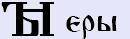**Еры** (ы - мягкое) – т.е. не [ы] как сейчас, а она звучала средне между современным Ы и долгим И, т.е. как бы Ы мягкое. Означала: **множество, множественное действие, множественную структуру**. Кроме того, Еры означали: **сотворённое вдали** от конкретного места. Т.е. смотрите начертание Еры, здесь как бы объединены сотворяша (Ь) и Ижеи (I), а Ижеи - это связь Земного с Небесным, это соприкосновение. Т.е. это и созидательная форма, и взаимодействующая.  
\* **ЫНЫЕ** – сейчас мы используем слово «другие», но иногда заменяем его на форму «иные». Другие – это то, что сотворили допустим, твои други (или недруги), которых ты знаешь. А иные – значит сотворено неизвестно кем, ты их не знаешь, и вообще неизвестно какой силой (в старые времена писалось через «ы» - ЫНЫЕ). Т.е. простой пример: в летописях говорится, что жили **другие** племена и **иные** народы, т.е. «другие» - кого мы знаем, и «иные» - кого мы не знаем, есть только информация о том, что они там существуют. Допустим, в Новой Зеландии для нас живут ЫНЫЕ племена, потому что мы там никогда не были, не знаем, что они едят, какие у них традиции, Вера – для нас они неизвестны, но мы имеем информацию, что там живут похожие на людей. Также ыные земли, ыные времена и т.д., о которых мы не знаем полностью, информация о них дошла в обрывках, из которых мы не можем создать полной информативности. Пример из животного мира – йети (снежный человек) относится к ыным существам, потому что какие-то свидетельства есть, но подробно ничего нет.

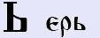**Ерь** (е – краткое) – означало уже **сотворённое, существующее**, природное в каком-то смысле, а значит жизнь Богом данная. Кроме того, природное после определённых буквиц, структура означала как бы не только выполнение, а **продолжение какого-то действия**, продолжение определённого значения. Т.е. не закончено, а оно **продолжает существовать**, продолжающее действовать.  
\* **ГОЛЬ** – т.е. люди принципиально не желающие носить одежду, и продолжают в таком виде существовать. На Руси таких называли «**голь перекатная**», допустим, христианутые, которые прочитали: вот сказано, птицы небесные они не шьют, ничего не делают, а Бог их питает. И вот они ходили чуть не голышом, так продолжали существовать. Т.е. как нудисты, у них нет одежды, вот что дал им там их господь, они этим и жили, т.е. в природе. Потом уже эту голь перекатную назвали «адамитами», даже секта такая есть. Т.е. как Адам не знал одежды, как в учении сказано, так и эти ходили голышом. Пришли тут всё съели, пошли туда, где бананы с чего-то упадут, поэтому таких людей у нас до сих пор называют «перекати-поле», т.е. как сорняк перемещается. Т.е. человек рождается нагим, или купается нагой, а здесь ГОЛЬ – существование. И была форма ГОЛЫ – бездеятельны, т.е. вообще ничего не делают и не хотят делать, как бы паразитируют.  
\* **ВОНЬ** – т.е. есть слово ВОНЪ - он отправился в какую-то сторону, действие (человек ушёл, вышел вон). Но, если он ушёл, а после него что-то осталось, хотя бы запах, это уже называлось ВОНЬ - образ сразу же поменялся (неприятный запах). Т.е. неприятное ощущение после ухода данного человека, т.е. он о себе оставил неприятное ощущение, неприятный запах и прочее. Или было ещё такое понятие **ВОНЫ** – так говорили о неприятных людях: «Воны пришли и ушли», т.е. были нехорошие люди, совершенно чужие, от которых неприятный осадок в Душе, неприятный запах и прочее. Сами наверно замечали: идёшь по рядам на базаре, где, допустим, торгуют мясом - к русским женщинам подходишь, нормально, мяско смотришь, запах приятный, а в соседний отдел зашёл, там нерусь (казахи, грузины, армяне...), и запах уже неприятный, чужой, т.е. вонь. Поэтому про них мы и говорили: «воны там».  
\* **ГАТЬ** – т.е. путь (ГА) твёрдый, утверждённая форма (Т) сотворённый, существующий (Ь). Т.е. гать – дорога по болоту, искусственный путь сотворили.

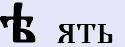**Ять** (ие) - дифтонговое звучание [iе] или как его сейчас пишут [ие]. Данная буквица указывала на **взаимосвязь и взаимодействие Небесных структур и Поднебесных**, или как в просторечии говорят: взаимосвязь Земного и Небесного. Поэтому здесь у нас форма бытия (е) и бытия высшего, вселенского (i). Поэтому [ie] как дифтонговая форма она означала именно высшую, **божественную форму**, которая проявлялась.  
\* **СВЕТ** (если правильно – [свiет]) - люди использовали вот эту взаимосвязь Богом данную, выращивали себе определённые продукты питания.  
\* **СЕНО** (укр. сiно) - правильно это слово пишется через Ять, т.е. сеном называли то, что впитало в себя силу земли и силу солнца – силу небесную. И эти две силы объединены были в сене.  
\* **ХЛЕБ** (укр. хлiб) – то же самое, правильно с буквицей Ять, т.е. хлеб наполнен и земной силой и солнечной небесной, природой. Поэтому, хлеб (каравай) символизировался с самой землёй, а соль (сiль) – Солнце. Т.е. хлеб да соль – вот символ земли и небес, хлебом-солью встречали.  
\* **ВЕРА** (укр. Вiра) – здесь опять взаимосвязь Божественного с земным.

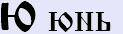**Юнь** (йу) – графика буквицы: сфера (круг) и что-то вовне с ней соприкасается (связано). Образ: **соприкосновение, взаимосвязь**, но взаимосвязь касательная, прикосновение, имеющее какое-то отношение к какому-то целому. Либо **находящееся за пределами** определённого круга вещей, определённого круга знаний, устоев, традиций.  
\* **ЮНЪ** – здесь у нас вместо Ень (Ь) стоит Енъ (Ъ), т.е. есть такое выражение: «ещё юн» (юный), т.е. есть ОНЪ – это взрослый человек, имеющий определённый жизненный опыт; а здесь ЮНЪ – т.е. как бы приближается к этому, т.е. подобный, но ещё не входящий в определённый круг. Т.е. допустим, круг взрослых людей, а дети как бы находятся рядом с кругом, они ещё не имеют слова, чтобы выступать на Копе общинного собрания, потому что они ещё юны.  
\* **ЮНОША** – но раньше это слово писалось: ВЮНЪШЬ - познающие мудрость, т.е. в процессе, находящиеся рядом с кругом знающих мудрость людей.  
\* **ВЬЮНЪ** – т.е. как бы вращается вокруг. Допустим, дикий виноград называют «вьюном», он обвивается вокруг нити или какого-то растения, но он же не является нитью и данным растением, а обвивается вокруг.  
\* **ЮРОД** – т.е. начертание «Ю» - кто-то или что-то выпало за пределы круга, как бы имеет отношение, взаимосвязь, но живёт своей структурой. Таких славяне называли: юрод (юродивый), т.е. не живущий по законам данного Рода. Поэтому христиане и возвеличивают юродивых - тех, кто не соблюдает Родовые традиции, отрёкся. Т.е. юродивые для христианства было хорошо, а тех, кто придерживался родовых традиций (У-Рода) – это плохо. Т.е. буквица Укъ - взаимодействует, чётко сливается, как бы две линии в одну, т.е. урод - тот, кто является неотъемлемой частью. А христиане придали чужеродное, отрицательное значение, как бы подменили «юрод» и «урод».  
\* **ЮГЪ** (юг) – здесь тоже самое, заметьте: «ЮГ» - то, что находится как бы рядом, но в тоже время не наше. Т.е. мы глаголим, что-то есть в стороне (в стороне от наших земель, от нашего Рода, от наших традиций), это ЮГЪ. Поэтому современные историки, многие географы и говорят, что раньше направление (востока, юга, запада, севера) было различным, т.е. юг смещался то на юго-восток, то на юго-запад. Заметьте, «**СѣВѣРЪ**» писалось с двумя буквицами Ять (ие), т.е. «Сие-Веры-Нашей» – все Веры одной, т.е. всё что севернее, это всё было наше, ближним, а «ЮГЪ» - не наше. Допустим, далёкая территория - Индия, она была какая? Юговая.  
\* **ЮГРА** – т.е. когда возле Урала (каменного пояса) поселились племена инородцев, попросившие защиты, они жили как бы под нашим Светом, но имели другую культуру, и эту систему назвали «Югра» или «Югория», т.е. пришедшие из-за гор, с другой территории, пришедшие с юга просили покровительства и поэтому появилась «Югра». А те, кто принадлежали к нашей структуре, вот там была Угра.  
\* **ЮЛА** – так называли то, что вращалось в не нашей среды. Т.е. есть слово «волчок» (крутиться волчком), а «юла» - это как бы иное. Поэтому выражение «**юлить**» означало - вести себя, уподобясь чужестранцам, т.е. которые хитрят, те же греки, хазары, торговцы и прочие.

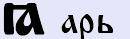**Арь** (а – краткое, я) - в древлесловенском, в древнерусском была как [а - краткое]. Но впереди стоит Ижеи (I) поэтому в дальнейшем в обиходе «а»-краткое заменилось на [йа] или [я]. Но раньше была краткая форма [а]. Образ был: структура одного рода, или как мы говорим **однородная структура**. Т.е. взаимосвязь всё-таки Небесного и Земного, но взаимосвязь очень тонкая, каждое существует само по себе, хотя при этом это всё понятие одного рода. Допустим, мы говорим, что наши деды, прадеды, прапрадеды – они с нами, но они живут Божественной жизнью.  
\* **АРШИН** – т.е. определённая структура имеет определённую ширину (ширь), и мы её определяем мерой – получаем «аршин».  
\* **ЯДРА** – не «ядро», а «ядра» - одна структура (Я) доброе (Д) светлое (РА) объединяет. Т.е. как первое значение: «ядра» – объятия, или объединяющая добрым светом, или могла обозначать как нутро, лоно, пазуха. Вот это всё было - ядра.  
\* **ЯЗВА** - ранение, порез, рана, а также означала: страдание, беду, напасть.  
\* **ЯЗЫК** - в этой форме означает то, что соприкасается с иной действительностью, т.е. то, что тебя окружает, что ты можешь почувствовать. Язык – это орган во рту, который определяет привнесённые яства (т.е. тоже взаимосвязано). Потом ещё будем разбирать это слово через Енъ, там «язык» уже будет как народ, племя.

**Эдо** (ие - краткое) – т.е. буквица Ять (ие) - жёсткая взаимосвязь Земного и Небесного, а Эдо – [ие] мягкая, допустим форма «Егда» (ИЕгда) - т.е. когда? Когда мы только прикоснулись к этому. Обозначает данная буквица **прикосновение к целому**, но при этом, прикасаясь к целому, мы получаем какую-то часть. Т.е. мы прикасаемся, мы ещё не знаем, что это такое, мы пытаемся определить, к какой структуре это можно приписать.  
\* **ЕДИНАКОВО** - т.е. одновременно, вместе с тем, заодно. Т.е. соприкасаясь, сознавая, но в то же время мы находимся сами в своей структуре, а это действует как бы в союзе, т.е. во взаимодействии.  
\* **ЕДИНОСУЩИЕ** – когда «единосуществующие», это вместе существующие, а когда «ИЕдиносущие» - это то, к чему прикасаются, прикосновение. Поэтому христиане и говорят: «Господь наш единосущий», т.е. он существует, а мы к нему как бы прикасаемся, и живём как бы по его законам и прочее.

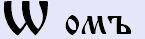**Омъ** (о – мягкое, конечное) – когда греческие монахи Кирилл и Мефодий увидели, что по начертанию буква Омъ схожа с греческой «омегой», они в церковной азбуке для славян Моравии (Чехии) обозначили её как «омега». Но до этого Омъ означала: **сияние, созидание, продолжение движения и существования**. Т.е. «о»-мягкое, концевая означала, что здесь как бы оканчивается данная структура, данная мысль, но не заканчивается существование.  
\* **КТО** (ктw) - мы подразумеваем развитие события, которое будет идти дальше, после того, как мы получим ответ на наш вопрос. Или **ЧТW** - здесь (w) нам указывалась форма, что процесс продолжается вне зависимости от того, поняли мы данную структуру до конца или нет.  
\* **КWСА** – ограниченная визуально (К), но продолжающаяся (W) сказанная (С) предками (А). Здесь речь идёт о песчаной береговой косе, т.е. она же идёт вдоль берега и может уходить под воду. Или **КОСА** – здесь определённость, оная (О), т.е. это уже будет женская коса. А есть другая **КЪСА** – литовка.

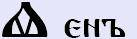**Енъ** (е – носовое) - т.е. Енъ ставился, как **структура, определяющая образ**. И образ, как правило, восходящий, или как раньше говорили: **уходящий ввысь**, но это чисто в образном понимании, допустим: «езык» - это народа, но он же всё равно считается как высшая божественная структура.  
\* **ЕЗЫК** - т.е. народ, племя. Отсюда и выражение «взять языка», т.е. человека.  
\* **ЕЗЫЧЕ** (конечная буква Ять) – т.е. «езык», это множественная форма, а представитель данного племени, народа, у которого свои структуры, обряды, действия, общность по Вере, культуре, языку, традиции – это «езыче» - представитель того или иного езыка. Т.е. как мы сейчас говорим: человечество, а представитель – человече, но здесь форма просто существующий (Е), а езыче – здесь взаимосвязь с Богом (Ять - ѣ).  
\* **ЕЗЫЧЬНИКЪ** – это езыче никакой, неизвестно кем сотворённый - язычник.

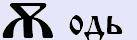**Оде** (еу, ю - носовые) – т.е. не [одь] как сейчас бы прочитали, а на придыхе [оде]. Изначально звук был [еу], как сказать нЕУ (в нос ушёл). А потом уже в древнерусском вот это [еу] превратилось как в Ю-носовое. То есть произошло как бы изменение. В начертании буквицы, как бы структура божественная передаваемая вверх. Т.е. **божественное передающееся по наследству**. Одновременно это как образ **правильности, правоты, близости, согласия**.  
\* **ЮСТА** – т.е. есть «уста» (устами говорит бытие), а если поставим Оде – «юста», это уже форма как бы произносящее какие-то правила, которые сформировались на протяжении многих поколений, как бы божественный Родовой устой. Отсюда и «юстиция».  
\* **ЮЖНИК** - тот, кто находится поблизости. Потом это уже переделали в «заключённый», «узник».  
\* **ЮРОДИВ** – т.е. не говорят «еуродствуешь», а говорят «юродствуешь». То есть это обозначает «юродив» - глупый, неразумный.

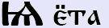**Ёта** (е – краткое носовое) – **форма познания**. Даже выражение осталось: «Не сомневаюсь ни на йоту (ёту)», т.е. нет сомнений, мы это знаем. Поэтому Ёта ставится всегда, где у нас наибольшие знания, в каком-то вопросе наибольшие познания, т.е. мы как бы разбираемся в данном предмете.  
\* **ЕЗЫК** (первая – Ёта) – т.е. перед этим мы разобрали, что ЕЗЫК (с буквицей Енъ) – это народ вообще, т.е. это может быть и другой народ. А ЕЗЫК (с буквицей Ёта) – т.е. добавили Ижеи (I) – связь Земного и Небесного, и вот это понятие уже означает народ, с которым у нас общая культура, общая традиция, общая форма общения, общие формы жизни. И мы это знаем, т.е. о другом народе.  
\* **ЕSA** (Ёта-Дзело-Азъ) - «едза» - болезнь, недуг.

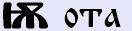**Ота** (о – краткое носовое) - **непознанная, вопросительная**, т.е. неприятие (в смысле «**нету рядом**», «неизвестно где»).  
\* **ОДУЖЕ** – т.е. где? откуда? Т.е. неизвестно, вопросительная форма.

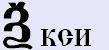**Кси** (кс) – в начертании буквицы видим Землю (З) и что-то пришло на неё (галочка сверху) и продолжает существовать (дорисовали волну снизу). Кси означает – **Дух**, он приходит на Землю, проходит стадии развития (петли буквы «З») и уходит далее (по волне снизу). Т.е. Кси ставится везде, где идёт **определение духовного, определение могущества Духа**. Дух - есть прибежище всего: жизни, света, чистоты и прочего. Т.е. всё, что связано с Духом, с духовностью это всё определяла данная буквица. И это образное значение сохранилось до нашего времени, допустим: ксенофобия - боязнь Духов, т.е. Духа, который существует вне плоти, но существует рядом с человеком. А наши Предки не боялись.  
\* **КСЕНIЯ** – Дух, живущий в бытие, которое мы знаем. Ксения – одно из древних славянских имён.  
\* **АКСТИСЬ** – т.е. подумай о своём Духе; зачем ты его мараешь?  
\* **ЛЬГКСЕЙ** (Лег-КС-Ей) – т.е. несёт Дух Лега, и во многих деревнях говорят не Алексей, не Олексей, а говорят Лексей.  
**Числовое значение – 60**.

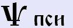**Пси** (пс) – в начертании как руна МАН, т.е. развитие человека, куда ты его направишь: направо пойдёшь или прямо пойдёшь? Пси - это **Душа** и всё что относится к душевному плану, к душевному порядку, всё что связано с **душевными формами** везде стояла Пси. Отсюда у нас и ПСИхология – наука о Душе. Т.е. понятие ПСИхея – это греки от нас переняли. Не мы у греков, а они у нас, так как у них ни письменности, ничего в то время не было. Письменность они взяли от финикийцев, финикийцы взяли от скифов. Поэтому не греки кого-то учили, они ни кого не могли научить, потому что греки - это будем говорить группа жуликов, которая бегала по Средиземноморью и грабила всех подряд, или воевала.  
\* **ПСЕВДОНИМ** – т.е. не принадлежащий своей Душе. То есть, когда человек берёт псевдоним, он как бы прикрывается Душой другого человека, пусть даже надуманного.  
**Числовое значение - 700**.

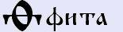**Фита** (ф – мягкое) - **единство двух**, т.е. видите, как две половинки слились, **слияние**. Допустим, если это у нас слияние Духа, т.е. духовные планы - значит маленько непостижимые. Поэтому когда мы говорим даже сейчас «эфемерные», «фантом», то записали бы через Фиту.  
\* **ФАЙНО** – т.е. благодатно. Так до сих пор говорят на Украине, т.е. прекрасно для Души и Духа.  
То есть, эта форма (Фита) у нас встречалась, когда шло **объединение, соприкосновение**, т.е. когда шло проникновение одного в другое. Поэтому человек и говорит ФАЙНО, т.е. он воспринимает красоту, она его затрагивает, т.е. происходит слияние на уровне Души и Духа.  
Поэтому была жёсткая форма «ф» (Фертъ) – как бы ближе к материальному, преобразование, как стоять фертом. А когда у человека файное состояние, он руки складывает на уровне груди, одна на другую, и любуется. Некоторые как бы себя обнимают, складывают руки на уровне живота, ладонями за локти другой руки. То есть всё равно в начертаниях буквиц существует как бы и человеческое взаимодействие.  
**Числовое значение - 9**.

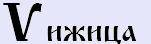**Ижица** (й, у, в, ю, н) – **движение, гармоничное распространение**, как бы пришло, отразилось и в определённую форму превратилось.  
\* **ПАVЕЛ** – имя не наше, но заметьте, когда У (В) ближе к немецкому, получается сочетание «Пауль», американское вообще даёт сочетание «Пол». Т.е. Павел, Пауль, Пол, или Поулина испанская, т.е. по-разному может прозвучать, и это мы воспримем как языки разных народов.  
\* **VПОСТАСЬ** - здесь она звучит как [и] (ипостась) - сущность, природа, естество.  
\* **VСТИНА** – т.е. можно прочитать как «Истина», но здесь написано имя «Устина» (мужское – Устин, допустим: Устин Акимыч - «Тени исчезают в полдень»). Если бы надо было написать земная истина, то пишем Иже (истина), общинная истина – Инить (Iстина), а если надо написать Божественная истина – Ижеи (iстина). А здесь Ижица, т.е. Устина – плод, движение, гармония слились вместе, т.е. существо гармоничное, естество, т.е. природное, красота гармоничная.

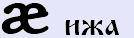**Ижа** (и - кратное) - отражала характеристику движения времени, т.е. **мера времени**. Она у нас самая минимальная. И в то же время Ижа даёт понятие **объёмности, взаимосочетания**, и кроме того, данная буквица использовалась для того, чтобы показать **структуры антиподы** (допустим: белое и чёрное). Т.е. даже по начертанию она как бы зеркальна, две половинки друг к другу. И заметьте, в противоположность большому – маленькое. Т.е. если наш мир: здесь сфера (левая нижняя часть Ижа), а напротив ничего нет (правая нижняя часть Ижа). Зато там где для нас почти ничего нет… мы смотрим в небеса и они для нас как бы безконечны, мы чувствуем себя по отношению к ним маленькими. И вот эта вот структура она как бы и временем отмечена и сочетанием.  
\* **МИРЪ** – самая малая частица времени, которой пользовались наши Предки.  
\* **МИЛАЯ** – если в этом слове стоит Иже, то обращение идёт к близкому человеку, допустим, супруг обращается к супруге: «Милая моя» («и» как бы длинно звучит). А если в этом слове поставить буквицу Ижа, то в такой форме обращение к посторонней женщине, допустим: «Милая, позволь пройти» («и» краткое). Т.е. она касается данного человека только на определённый промежуток времени. Или женщина продавщице в магазине говорит: «Милая, свешай 100 грамм колбаски», т.е. здесь форма «милая» - как промежуток времени, пока вешают эти 100 грамм, всё потом ушла. При этом пришла домой: «А сволочь продавщица, опять обсчитала». Т.е. многие говорят, что «**милая**» или «**милок**» - это уважительная форма; НЕТ, это форма кратковременного обращения, как бы не передающая чувств, но передающая характер времени: «Милок, передай на билет», «Милок, куда прёшь?!». Раньше зло не персонизировали, т.е. одно и тоже слово могло нести как положительный так и отрицательный смысл.

Глубинные образы буквиц (А – Л)  
Глубинные образы буквиц (М — Щ)
