# Славянские названия месяцев

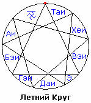Славянские названия месяцев – это образная Руника. Названия месяцев состоят из двух Рун, при этом вторая Руна у всех месяцев одинаковая – ЛЕТЪ (Лето), потому что месяц - это часть Лета; а первая Руна показывает образ, какая именно часть Лета.

Исключение только первый месяц - Рамхатъ, потому что здесь образ - Начало нового Круга. Т.е. после завершения очередного Лета, мы вновь подходим к началу всего - Ра-М-Ха, он утверждает (Т) и сотворяет (Ъ) новый Круг, как бы начало новой Жизни.

## Названия месяцев - Образы

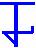 - **Руна Летъ**, она есть в названии каждого месяца, потому что это части Лета; меняется только первая Руна (Ай, Бэй, Гэй, Дай, Э, Вэй, Хей, Тай), которая и раскрывает образ данной части Лета. [\* Буквица Еръ (Ъ) - «О»-краткая]

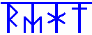**1. Рамхатъ** (сентябрь, октябрь) – месяц **Божественного Начала**. Т.е. Ра-М-Ха сотворил (Ъ) и утвердил (Т) новое светлое, чистое Лето, новый Круг.

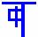**2. АйЛетъ** (ноябрь) – месяц Новых Даров. Руна Ай означает – **полный достаток**, т.е. полные закрома. К этому времени собрали урожай, на Любомир сыграли свадьбы, встретили Новолетие, молодым построили отдельный терем с хозяйственными постройками. Т.е. начинается новая жизнь с полного достатка, с подарков, со своего хозяйства с животинами, со всего.

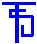**3. БэйЛетъ** (декабрь) – месяц Белого Сияния и Покоя Мира; это **белая часть Лета**. Сияние Мира Слави, Божественный уровень чистоты, ощущение полного покоя в Душе.

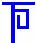**4. ГэйЛетъ** (январь, февраль) – месяц Вьюг и Стужи. Т.е. Гэй – **лютый, суровый**. Поэтому в «народном календаре» февраль – это лютень. Но у славян было 9 месяцев, а христиане переделывали под 12.

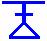**5. ДайЛетъ** (март) – месяц Пробуждения Природы. То есть, это часть Лета, когда **Природа даёт жизненные силы**: листики распускаются, поля наполняются силой, звери просыпаются, всё пробуждается, возрождается, оживает.

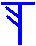**6. ЭЛетъ** (апрель) – месяц посева и наречения. Заметьте, образ «ГЭЙ» - это вьюга, стужа, а вьюга она как бы сеет снегом, ледяными частицами, обильные снегопады и прочее, т.е. образ сеющий. Здесь уже просто «Э» - **посев**, без стужи. Но посев не только зерна в землю, а ещё Слово внутрь человека, т.е. Обряд Имянаречения, когда в человека закладывают тайное имя, новое имя, т.е. как бы вновь человек рождается.

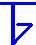**7. ВэйЛетъ** (май, июнь) – месяц Ветров. Образ Руны Вэй – **веять**, а веет ветер. Т.е. эта часть Лета, когда Стрибожьи внуки просыпаются и начинают гулять, часто ураганы, суховеи.

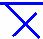**8. ХейЛетъ** (июль) – месяц Получения Даров Природы. Образ «Х» - положительная сила. И заметьте, месяц посева у нас «Э», а здесь как её противоположность «Е», перевёрнута в другую сторону, т.е. там мы посадили, а здесь - **получили**.

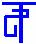**9. ТайЛетъ** (август) – месяц Завершения. Руна Тай – вершина, предел, завершение чего-либо, допустим: ТайГа – конец пути. Т.е. ТайЛетъ - **завершение Лета**, завершение Круга, отсюда и КругоЛет (Круг Лет).

\* Не месяц, а часть Лета.
