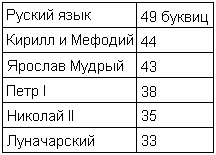
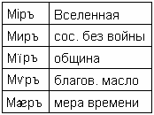

# Уничтожение русского языка

В русском языке было 49 буквиц. Затем Кирилл и Мефодий упростили до 44 буквиц; Ярослав Мудрый убрал ещё 1 буквицу, осталось 43; Петр I изничтожил до 38 буквиц; Николай II до 35 буквиц; Луначарский сократил ещё больше и ввёл букву «Ё», **осталось 33 буквы**. Также Луначарский убрал образы, речь стала безОБРАЗной. Исчезла структура словопостроения – откуда, что и как.

1. Речь — развитие народа  
2. Гласные и согласные  
3. «Одинаковые» буквицы  
4. Числовые значения буквиц

## Речь - развитие народа

Русский язык сократили на 16 буквиц. А что такое каждая буквица – это целый спектр нюансов, моментов, которые мы можем передать с её помощью. У нас не сразу было 49 буквиц, когда-то их было меньше, но постепенно увеличивались.  
**Любой язык развивается, когда у него увеличивается образность**.

Возьмём для примера еврейский язык. В древнееврейском языке было 22 буквы, затем он поделился на арамейский, который стал современным ивритом. Сначала иврит был тоже 22 буквы, потом увеличился до 28, а сейчас уже 32 буквы. Т.е. живя среди народов, евреи обогащают за счёт других свой язык. Пускай они называют эти буквы «конечные», т.е. добавляют как концевые, но у них букв становится больше, значит и образов написания получается больше, а значит **речь развивается, и развивается народ**.

А что у нас? 49, 44, 43, 38, 35, 33… сейчас около 30 - букву «Ё» почти не используют, вместо знаков (Ь, Ъ) пишут апостроф, и предлагается новая реформа, сократить до 26 букв, т.е. сократить русский язык до латиницы.

## Гласные и согласные

**В русском языке было 19 гласных звуков, сейчас осталось 9**. Раньше буквицы гласили, ведь у человека голосовая речь. Гласили – т.е. сообщали какой-то образ. А другие буквицы их между собой согласовывали, чтобы они согласно образу выглядели, поэтому эти буквицы назывались – согласные, т.е. они согласующие между собой. Но сейчас образы убрали и не понятно, что гласят буквы и с чем согласуют.

## «Одинаковые» буквицы

Как говорил Луначарский, а вслед за ним и современные филологи (которых надо называть от слова «филонить»): «Зачем несколько букв, зачем такой алфавит?»

**В русском языке было 5 буквиц «И»**. Допустим: слово «Мир» - вроде бы одно и тоже слово, но образы разные. Когда человек читал даже короткий текст, он знал, о чём речь. Сейчас русский язык упростили настолько, что без дополнительных разъяснений непонятно какой образ вкладывать в слово «мир» в различных случаях.

**Было несколько буквиц «О»** - обычная, краткая, йотированная, полукраткая. Поэтому образ слов был сразу понятен. Пример: слово «Коса» - коса девичья, коса песчаная или коса для сенокоса. Сейчас одна буква «О» и ничего непонятно: «вышел он к реке, и увидел прекрасную косу» - что увидел? 1) Косу-литовку, 2) Девочку с косой, или 3) Песчаную отмель. Поэтому речь всегда имела свой образный смысл.

## Числовые значения буквиц

Кроме образов, буквицы ещё имели числовые значения, которые, соединяясь, создают совершенно разную структуру. **Каждая буквица имела свою меру веса**, отсюда и остались выражения: «весомое слово», «веское доказательство». Слово можно было заменить другим схожим по образу и одинаковым по удельному весу.
