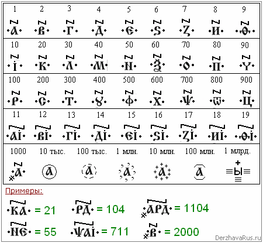

# Числа Буквицей

Для записи чисел Буквицей и Азбукой используют цифирное титло, можно ещё дополнительно ставить по бокам точки, но они не обязательны.

**Единицы:**  
1 - Азъ – единица или единъ (Один - это имя, а число «един»).  
2 - Веди – два.  
3 - Глаголи – три.  
4 - Добро – четыре.  
5 - Есть – пять.  
6 - Дзело – шесть.  
7 - Земля – семь.  
8 - Иже – осьмь, т.е. «ось Мира» - как бы пространственный крест (\*), он имеет по оси восемь концов.  
9 - Фита – девять.

**Десятки:**  
10 - Ижеи – десять.  
20 - Како – двудесять.  
30 - Людие – Ворокъ (в Буквице) и Тридцать (в Азбуке).  
40 - Мыслете – Сорокъ (в Буквице) и Четыредесять (в Азбуке). Название «сорок» сохранилось до сей поры.  
50 - Нашь – Пятьдесят.  
60 - Кси – Шестьдесят.  
70 - Онъ – Семьдесят.  
80 - Покой – Осемьдесят.  
90 - Червль – Девятьдесят (девяносто).

Когда пишем числа от 11 до 19, к единицам просто ставится десять (Ижеи), т.е. как бы лежит 10 рублей бумажных и сверху лежит 1 рубль или 2, 3… т.е. един на десять, два на десять и т.д. А числа от 20 записывают сначала десятки потом единицы (пятьдесят пять).

**Сотни:**  
100 - Реци – сотня (сотка, сто).  
200 - Слово – двести.  
300 - Твердо – три сотни.  
400 - Оук – четыре сотни (в Буквице), а в Азбуке Ук = 400.  
500 - Фертъ – пятьсот.  
600 - Хиеръ – шестьсот.  
700 - Пси – семьсот.  
800 - Отъ – восемьсот.  
900 - Ци – девятьсот.

**Тысяча** = 1000. Для обозначения тысяч к буквице добавляется диагональ с двумя маленькими чёрточкам. И произносили число полностью, допустим: 1104 (едина тысяча и сто и четыре), как бы между ними ставится буква «и».  
**Тьма** = 10000 – десять тысяч. Буквицу ставят в кружочке.  
**Легион** = 100000 – сто тысяч. Кружочек пунктиром. Когда Исус спросил искусителя: «Как имя твоё?», он ответил «Легион имя мне», т.е. их сотня тысяч. Хотя римский легион был десять тысяч, т.е. они перенимали, но уменьшали.  
**Леодръ** = 1 миллион. Кружочек запятыми.  
**Вран (Ворон)** = 10 миллионов. Кружочек крестиками.  
**Колода** = 100 миллионов (10 Воронов). Скобки сверху и снизу буквицы.  
**Тьматем** = 1 миллиард. Ставится знак соответствия (три чёрточки) и сверху знак «плюс», т.е. ещё к чему-то это всё прибавляется. Данное число есть в Библии, Откровение Иоанна Богослова: «Число конного войска было две тьмы тем…», т.е. 2 миллиарда воинов.
