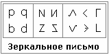

# Зеркальное письмо Расенов (примеры)

**Расены** (как они себя называли) - это один из Родов Расы, латиняне их называли *Этруски* (этнос руский), греки их называли *Тирренами* (т.е. тираны, потому что не позволяли у себя воровать, давали жёсткий отпор, поэтому — тираны, обижают).

## Зеркальное письмо

Зеркальным отображением можно из одной буквы получить несколько.

**1.** В первом примере английский алфавит, буквы: **p, q, b, d**.

**2.** Несколько буквиц построенных по такому же принципу остались в нашем языке, см. Буквицу: буква **N** (Наш) и её противоположность – **И** (Иже), или **Z** (Земля) и **S** (Дзело), сейчас эта буква приняла округлую форму, а раньше начертание было углами.

**3.** Буква **Л** (Людие), если её перевернуть будет **V** (Ижица), если положить набок – **С** (Слово), но раньше её писали углом, а её зеркальное отображение получится буква **Э**, но здесь ещё добавляется язычок, как бы произносим Слово, т.е. открытый рот с язычком. Если букву «С» (угловую) повернуть набок, будет буква **Г** (Глаголи); дальше зеркальное отображение, и получается буква **L** (Руна Лето), а если её перечеркнуть будет «L-твёрдая» – такая форма осталась в польском языке: перечёркнутая – это твёрдая «Л», обычная - мягкая «Ль».

Вот несколько примеров начертательных форм зеркального языка Расенов.

\* Славянские формы письма  
\* Тьраги – это да’Арийская система записи
