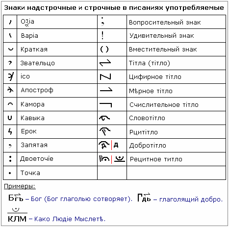

# Знаки надстрочные и строчные

Раньше многие слова сокращали, и использовали для этого всевозможные знаки: надстрочные – над строкой; строчные – в строке.  
  
**1. Оксия**.  
**2. Вариа**. Допустим, встречаем в слове «вариант».  
**3. Краткая**. Допустим: «Й» (И - краткая), «О - краткая», «У - краткая».  
**4. Звательцо** - указывает на звательную форму. Допустим в предложении: «Панас, который час?», над «Панас» (над первой буквой «П») ставим звательцо.  
**5. Исо** - это обращательная форма, т.е. когда обращаются. Допустим: «Панас, ты в Бога уверовал?».  
**6. Апострофъ**. Сейчас апостроф изменили на запятую.  
**7. Камора.  
8. Кавыка** - ставится между буквами, т.е. раньше текст шёл сплошным и ставили кавыку, как бы выделяется.  
**9. Ерок.  
10. Запятая** - ставится внизу строки.  
**11. Двоеточие**.  
**12. Точка** - указывает на вселенские масштабы, т.е. Ижеи (i) у нас с одной точкой.  
**13. Вопросительный.  
14. Удивительный.  
15. Вместительный**.  
**16. Тiтла** (или тiтло) - сокращённое буквенное значение.  
**17. Цифирное титло** - для обозначения цифирей, т.е. чисел.  
**18. Мерное титло**.  
**19. Счислительное титло**.  
**20. Словотiтло** – титло, сокращающее слово, в котором основа сокращения лежит на буквицу Слово (С).  
**21. Рцитiтло** - т.е. сокращение, когда в основе лежит буквица Рци (Р).  
**22. Добротiтло**. Может быть два варианта записи (см. в таблице).  
**23. Рецитное титло** - означает, что данные буквицы необходимо читать по их образам (см. пример КЛМ).

## Примеры

\* **Богъ** – с титло (т.е. сокращённая форма), читаем образ буквиц «Бог глаголью сотворяет».  
\* **Глаголящий добро** – данное сокращение христиане превратили в «Господь», а по образам было просто «говорящий добро». Правда ничего не делает, только глаголит, а говорить мало, надо ещё и делать... поэтому сказано: «По деяниям их и побачите их».  
\* **КЛМ** – в летописи стоит данное сокращение и сверху рецитное титло, когда царь Иван дал ответ на просьбу народа вернуться на царствование. Советские переводчики перевели как «Коломна», как будто царь спрашивает Коломну «возвращаться мне на престол али нет?», но там же не только с Коломны народ был, с разных деревень шли, и написано под рецитным титло, т.е. читать надо по названиям буквиц: «Како Люди Мыслете», т.е. царь обратился ко всему народу «Как вы люди мыслете».
