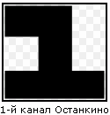
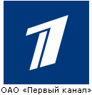

# «Первый канал» принадлежит евреям (логотипы)

Помните, какой был логотип у 1-го канала Останкино? Была как бы единица, заключённая в квадрат. Эта странная «единица» - вторая буква лашенкойдеша - еврейского языка, то есть **буква Бет** (её структурная форма). Все воспринимали как «1», но кто знал образное значение – понимание было другое. То есть, после горбачёвской перестройки, в 1991 году первый канал Центрального Телевидения прибрали к рукам евреи, и сразу же объявили об этом всем посвящённым – поставили свой логотип. Образ буквы «Бет» означает «дом», т.е. сказали для посвящённых: «мы уже тут, здесь наш дом, связь принадлежит нам».

Потом логотип **заменили на перечёркнутую единицу** – это знак принадлежности к шотландскому масонскому ритуалу. Т.е. масоны Шотландии использовали **единицу со скошенной платформой**, и они указали: «теперь канал принадлежит нам». И до сих пор принадлежит масонам шотландского ритуала. То есть, достаточно посмотреть на логотипы телекомпаний, чтобы увидеть, кому принадлежит контора. Масоны после горбачёвской перестройки начали восстанавливать свои ложи, официально регистрироваться по всей России. Т.е. ничего в этом удивительного нет.

\* Символы иудеев, жидов, Гринпис и пр.
