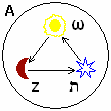

# Астральный Мир

**Астральный мир** (от греч. astra – «звезда») – т.е. Звёздный мир, или его ещё называют Тонкий мир, Астрал. «Звёздным влиянием» или «Планетарным магнетическим током» древние мудрецы называли Азот. У франкмасонов **планетарные токи** изображались следующим образом: «Солнце бросает лучи к Луне, Луна отражает их к Звезде, и Звезда снова отбрасывает лучи к Солнцу». Изображение данной системы породило геометрическую форму в эзотерике - треугольник. Но заметьте, это же всё вращается в другой среде, которая дана изначально, т.е. «А» - первая буква, древние мудрецы её ассоциировали ещё с Небесным эфиром.

**Луна** символизировала свет отражённый. Её продукционный знак всегда минус (-), он символизировал Женское Начало.  
**Звезда** символизировала космическое пространство, свет положительный. Её продукционный знак был всегда плюс (+), он символизировал Мужское Начало.  
**Солнце** символизировало объединение плюса и минуса. Продукционный знак безконечность (∞), этот знак символизировал разум, интеллект.

Таким образом, согласно данной схемы **на человека действуют 4 внешних элемента**: Солнце, Луна, Звезда-Владыка и Небесный эфир (А). Т.е. как бы это всё внутри, а вокруг всего Небесный эфир – есть Душа Мира. Планетарные лучи – это двигатель Природы, а Природа есть отражение всемогущего Бога.

## Треугольник

Если разбирать внутреннюю структуру, то здесь Омега – как бы Солнце, т.е. **греки** всё умствовали, философствовали, говорили вплоть до того, что «мы Солнце наземляем». **Латиняне** - это лишь отражение греческой культуры, т.е. всё приземлённое, опущенное, и они говорят: «Да, мы не отрицаем, что брали греческую мудрость, но мы дали основу для мистицизма еврейского». А **евреи** говорят: «А мы своей мудростью породили разум греков, они пришли к нам тёмные, воевать умели, а мозгов не было, мы хоть просветили их», т.е. написали для греков 70 толковников «Септуагинта» - это перевод еврейской мудрости. И заметьте, какая здесь Звезда – семиконечная, так называемая «Звезда магов».

## Астральный мир

**Каждая Звезда излучает свой собственный свет**, который древние мудрецы называли Астральным светом или Астральным излучением – это и есть планетарные токи, окутывающие «плотным» слоем любое космическое тело. Мир, наполненный астральным светом, в древности называли Астральным Миром, он начинался за пределами любой Земли (планеты). Кроме того, **Астральный мир** – это Тонкоматериальный мир, имеющий свою собственную природу и свои собственные законы, которые установил всё тот же всемогущий бог. Этот Астральный мир своим излучением создаёт каждому живому существу защитную оболочку; у разных народов её называют по-разному: **астральное тело**, астральная оболочка, аура. Данная астральная оболочка у человека воспринимает астральные излучения и синхронизирует внутренние энергетические процессы в теле человека с планетарными токами и другими космическими излучениями.

Поэтому, познавая структуру образного проявления древних языков, необходимо отстраниться от современного мировосприятия и современных точек зрения, и взглянуть на язык, события прошлого, глазами древних людей. Это позволит узнать, какую древнюю мудрость они заложили в тех или иных символах, в древних словах и древних образах.  
**Простой пример:** сейчас из большинства языков мира исключили Образные структуры, поэтому люди произносят слова как попугаи, даже не понимая их изначального значения. Допустим, в обиходе слово «**хохма**» – это как шутка, что-то весёлое. А на самом деле «хохма» - это еврейское слово, означает Мудрость. Или другое еврейское слово «вундеркинд» - чудо-ребёнок. И если разобраться, современный, будем говорить, советский язык – он на 40% состоит из еврейского языка. Почему так получилось? Потому что правили в Советской стране евреи, перед Второй мировой войной из 500 членов правительства, 449 были евреями. Поэтому с трибун и по радио, в газетах звучали чуждые нам слова, которые потом входили в обиход. Но при этом, вставляя своё, они убирали у народа Родной язык, т.е. потихоньку не только обрубали ветки, но и обрубали корни, а народ, не имеющий корней - погибает.
