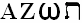

# АЗОТ (Образы древних алфавитов в системе Мироздания)

Древние Мудрецы использовали различные сочетания древних языковых систем для того, чтобы объяснить структуру Мироздания, её многоплановость и многообразие.

**Современная наука считает основанием мироздания – водород**. Этот элемент, первый в периодической системе Д.И. Менделеева. Это связано с тем, что единица как число, в Явном Мире является основой. Допустим, в древнееврейском языке мы уже записали – первая буква Алеф, она и основная, и единица. Т.е. как бы основа.

**Древние Мудрецы многих народов считали основой мироздания – азот**, седьмой элемент по таблице Менделеева. Почему азот? Во-первых: 7 - означает мистическую тайну. Взять иудаизм, христианство, ислам и другие религии – «Семь дней творения», 7 цветов радуги, 7 чакр. Т.е. все мудрецы находились на втором уровне - это семеричность, на Юджизме уже разбирали три уровня: троичность, семеричность, трансценденталичность (божественность). Можно говорить, что человек дышит кислородом, но кислорода-то в воздухе всего 20%, а почти 80% - азот. Аквалангисты, погружаясь на большие глубины, они же не чистым кислородом дышат, а азотной смесью. Гонщики, чтобы увеличить скорость, ставят системы закиси азота. Т.е. учёные современности всё равно как бы обращаются к знаниям древних, и их используют. Во-вторых: кроме 7 – мистической тайны, само наименование основного элемента (азота), который охватывает все формы жизни, появилось от начальных и конечных букв трёх алфавитов. Т.е. первая буква трёх языков: Алеф – еврейский, Альфа – греческий, А – латынь. Чтобы было легче воспринимать, оставим только латинскую букву «А». Итак: **А – это основа**. Но заметьте, самый поздний язык, который появился из этих трёх – латынь. Так как пишется в этой традиции наоборот, поэтому латинская «зед» (Z) последняя, потом греческая «омега» (ω), и еврейская «тав» (ת). Получается – **АЗОТ**: «А» - начальная буква всех алфавитов, т.е. как бы общая; «Z» - конечная латинского алфавита; «ω» - конечная греческого, «ת» - конечная еврейского.

## 4 Мира

Название «АЗОТ» как бы объединяет 4 Мира:

\* **А** (любого языка) – принадлежит к **Божественному Миру**.

\* **Z (зед)** – латинский мир, или по-другому: **Материальный**, мы называем Явным. Чтобы понять сущность этого образа достаточно вспомнить, что у многих народов, у которых письменность основана на латинице: Z - это последнее материальное воспроизведение. Поэтому «Конец Света» будет как два ZZ, т.е. предел. Есть даже такая рок-группа «ZZ Top» - Конец Света. «Top» - это выше, то, что находится за пределом материального мира, а что находится за пределом материального мира, у всех народов называется «концом Света» - предел, находящийся за пределом.

\* **ω (омега)** – греческий мир, мудрецы его ещё называли: **Умственный**. Т.е. если латинский – это материальный мир, то греческий – как бы умственный мир. Отсюда и фраза Иисуса: «Я есмь Альфа и Омега, начало и конец». Т.е. «за пределами меня мыслить вообще невозможно», он как предел мысли. Неплохо, да? Амплуа себе избрал.

\* **ת (тав)** – еврейский мир, его многие называют: **Божий мир или Пустой**. А «пустой», это «айнцофт», т.е. предел, за которым нет ничего. Можно сказать: божественная пустота. Т.е. всё начинается от Света и уходит в Пустоту, вместе с материальностью (Z), с мыслями (Ω), и со всем существованием. И всё это воплощено в одном элементе, который древние мудрецы называли **АЗОТ**. Оригинально, да?

## 4 элемента Мироздания

Четыре буквы означают как бы 4 элемента Мироздания: «А» – это Свет (первый элемент), «Зед» - теплота, «Омега» - электричество, «Тав» - магнетизм.  
\* Кстати, отсюда и единица электрического сопротивления – Ом (омега). И отсюда: «Аум», «Амен» (аминь) и прочее, т.е. «А» - как бы принадлежит к божественному миру.

**Свет**. На поверхности Мидгард-Земли солнечные лучи преломляются, как мы говорим, в воздухе, а воздух на 78% состоит из азота. Т.е. преломление рассеивает поток Солнечного Ветра, и мы видим белый свет. Значит, в отношении этого мудрецы были правы.

**Теплота** (второй элемент «Z»). То же самое, солнечный поток, проходя в воздухе, как бы трётся об азот (элемент), а при трении выделяется теплота, поэтому воздух у нас от Солнца нагревается (в космосе, в безвоздушном пространстве минус 273, а здесь тепло).

**Электричество и магнетизм**. Электричество тоже как бы проходит сквозь азотные связи, т.е. течение тока. И магнетизм то же самое, чтобы улучшить качество магнита, вокруг него надо создать поле из азота, азотную среду.

Т.е. видите, древние не ошибались, но у этих народов были только обрывки, которые давали им белые, и из них уже составляли свою систему.  
\* *Урок 3: Структура образного проявления древних алфавитов в системе Мироздания.*

Продолжение: Астральный Мир
