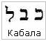

# Каббала (Кабалистика)

Старое написание слова «Каббала» из трёх букв – каф, бет, ламед, но сейчас его пишут четырьмя буквами, чтобы как бы изменить значение, чтобы не догадались. Т.е. в старой записи числовое значение каф = 20, бет = 2, а ламед = могущество (это его сокрытое значение), т.е. **Каббала – могущество двадцати двух**, а 22, это буквы древнееврейского алфавита (лашенкойдеш).

Каббала или система кабалистики была создана евреями для сокрытия и раскрытия тайных знаний. Данная система заключалась в неком искусстве разлагать слова на образы и **производить дешифровку сокрытого знания**, а также производить этими словами чудеса, произнося их определённым образом. Сама система Каббалы состоит из двух частей: «Зогар» и «Сефир Йецира».

Кроме того, из составленных преобразований слов создавались определённые заклинания, речевые формулы, при помощи которых действовали на окружающие силы, как мира природы, так и мира Духов. Полученные словесные формулы соединили в сборник, который назывался «Гонтия». В Гонтии объяснялось как совершается **призвание Духов** и вызываются тени умерших с того света.  
\* Тень в старом понимании означала также Душу. Поэтому у многих народов было табу (строгий запрет) наступать на тень другого, а в некоторых арабских и других странах, если кто-то наступит на тень правителя, как бы истоптал Душу, то за это казнили.

## Отличие вызова Духов у славян и евреев

У наших Предков тоже были системы «вызова Духов», но на самом деле вызывали не Дух (как сейчас принято – приди!) нет, просто с ним налаживали связь и общались. Т.е. создавалась невидимая нить, а это маленько другое – не призывают из того мира, а просто с ним налаживают связь. И на основе этого было построено **русское чародейство**. Т.е. не безпокоить по пустякам, а связаться и спросить совета.

У евреев вызывались тени умерших, и обращение было в Мир Духов, т.е. они обращались в Тёмную Навь (образно «Подземный Мир»). А славяне обращались к Душам своих Предков, т.е. в Светлую Навь (Славь). У нас общение с живым, а у евреев – материализация умершего, берётся как бы его оболочка и при помощи ритуала наполняется жизнью, вызывается к жизни, либо вообще вызывается Дух, который живёт в Тёмной Нави, ему придаётся сила, чтобы он материализовался в Яви. Т.е. они пытаются материализовать в Яви из Пекельного Мира не только Души умерших здесь, но и жителей Тёмного Мира – бесов, демонов и пр.

Поэтому в просторечии различают – **белое волшебство и чёрное колдовство**, или чёрная магия и белая магия, но магия - это жречество. Т.е. они вызывают из другого мира, но при этом, когда использовали эту систему, они старались защититься, т.е. вызывая Духа, ему постоянно давали какую-то работу, одну выполнил, сразу надо дать новую работу, иначе он эту тёмненькую Душу из Яви утащит к себе в Тёмную Навь. Поэтому они и придумывали, отправляли плести верёвки из воды и песка, или разгонять крик чаек и т.п.

При этом, чтобы наполнить силой жизни тёмного, для этого в ритуалах всегда **использовалась кровь**. Т.е. если ты вызвал, должен рассчитаться силой жизни – кровью, либо своей, либо чужой кровью. Поэтому появились кровавые ритуалы, если нет чужой крови, то забираются жизненные соки с того, кто вызывает, поэтому в сказаниях они быстро старятся при каждом обращении. Либо используют защитную систему – пентаграмма в круге, и становятся в цент пентаграммы.

Но в наше время уже не пользуются словами «гонтия», т.е. сборником этим, не пользуются названием «чародейство» (а чародейство – это не только общение со Славью, но и с природными стихиями, отсюда и понятие навести чары, зачаровать человека, т.е. создать иллюзорный образ, воплотить его). Сейчас общение с Духами, систему их вызывания называют **спиритизм** или **спиритуализм**.

## Идиш и иврит

Чтобы более подробно понимать образные формы, существовавшие в лашенкойдеше, необходимо знать структурную форму идиша и хибры (иврита) хотя бы в начальных формах, так как эти два еврейских языка имеют в своей основе всё тот же лашенкойдеш. Поэтому следующая тема – идиш. Он очень много в себя впитал из лашенкойдеш, также как и иврит тоже впитал из лашенкойдеша. Т.е. чтобы понимать лашенкойдешевские корневые основы, надо брать идиш и иврит. Это и есть кабалистика – знать что означает.

В современном русском языке (советском) очень много слов из идиша. Тюремный жаргон на 90% - чистый идиш, а его из тюрьмы в парламент, в обращение перетянули наши думские депутаты.
