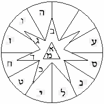

# Лашенкойдеш - древнееврейский язык

1. Форма письма лашенкойдеша  
2. Образы лашенкойдеша

**Лашенкойдеш** (Лешон hа-Кодеш) – это древнееврейский язык, в последствии появились его разновидности: арамейский, иврит, идиш. В переводе с древнееврейского Лешон hа-Кодеш - Святой Язык (или тайный, сокрытый). «Святой» он для евреев - потому, что **образный**, в отличие от идиша и иврита. Но многие евреи просто читают его, как алфавит, не знают образные значения, потому что к расшифровке текста допускаются только мужчины, и только после 40 лет; это у них называется Каббала, т.е. познание зашифрованной мудрости.

## Форма письма лашенкойдеша

Форма письма лашенкойдеша отличается от других языков, которыми пользуются белые народы, жёлтые, красные, чёрные, отличается тем, что начертательные формы имеют **иную, не Земную форму отображения**. Начертание каждой буквы лашенкойдеша связано с прообразом звёздных структур, которые наблюдали предки древних евреев на своей прародине (на Земле Эден и Земле Нод).

\* Т.е. раз они жили в другой Звёздной системе, то и созвездия у них были другие. Потому что начертательная форма наших буквиц тоже связана с определёнными созвездиями, допустим, созвездие Кассиопея - получились буквы **W, M, ∑, З**. Звёздное небо же вращается, и как бы начертательная форма меняется. Соединяем отрезками созвездие Большой Медведицы и получается рисунок, точно также они соединяют свои созвездия и получаются буквы.

**Каждая буква лашенкойдеша имела 22 значения** – 1 числовое и 21 образное (тайное, символьное, особое, божественное, элементарное и т.д.). Также определённые буквы выполняли роль математических знаков: сложение, вычитание, умножение и деление.

**Совокупность написания букв давала три смысла:**  
1. Простой - для непосвящённых (или как они говорили: «для профанов»).  
2. Символьный или образный - для посвящённых (или как они называли: «для адептов»).  
3. Тайный - для особо посвящённых (их называли: «раввины», «раби», «магистры», «рахданиты» и т.д.). Т.е. это была группа особо посвящённых, которые знали информацию, а двум нижним уровням её не давали. Их любимая фраза во времена существования Римской империи была: *«То, что положено Юпитеру, не положено быку»*.

Написание текста происходило **справа налево**.

**В еврейском алфавите 22 буквы, каждая буква имела свой особый статус:** 3 буквы считались основными, 7 двойными (т.е. в обиходе они читались и мягко и твёрдо, или имеют обычную и конечную формы), и 12 простых букв.

Как правило, лашенкойдеш («еврейскую азбуку») записывали в круге, который делили на 12 частей (это простые буквы), в него вписывали семиконечную звезду (двойные буквы), а в центре звезды – треугольник (основные буквы).

\* Зодиакальная и другие их системы (та же каббалистическая) – они были переделаны под наши, т.е. когда серые прибыли на Мидград, они привели свои системы в соответствие с теми знаниями, которые были у народов Мидгард-Земли. Поэтому сейчас в значениях их букв созвездия, которые можно видеть с Мидгарда. С кем бы они ни общались, они брали знания от каждого народа себе. И если воевали с каким-то народом, то в первую очередь уничтожали библиотеки, а всё необходимое для себя оставляли.

## Образы лашенкойдеша

Даже в ульпанах… при изучении Каббалы дают всего три значения: числовое, таинственное и образное. Здесь перечислены 10 значений.

**1. Алеф** (основная). Числовое значение – 1. Таинственное значение – человек. Каббалистическое значение – точка опоры. Энергетическое значение – энергия жизни. Символьное значение – воля. Особое значение – корона. Божественное значение – господство над самим собой. Интеллектуальное значение – изнурение плоти. Вещественное значение – хитрость, жадность. Небесное значение – Солнце.

**2. Бет** (двойная). Числовое значение – 2. Таинственное значение - рот человека. Каббалистическое значение – таран. Энергетическое значение - энергия иных сущностей (вампирическая энергия). Символьное значение – знание. Божественное значение - мысль. Интеллектуальное значение - наука. Вещественное значение - высокомерие, зависть. Небесное значение – Луна. Особое значение - мудрость. Особо-таинственное значение - дом.  
\* Особо-таинственная форма этой буквы стала логотипом ОРТ после перестройки 1991.

**3. Гимель** (двойная). Числовое значение - 3. Таинственное значение - берущая рука. Каббалистическое значение - мужская сила. Энергетическое значение - энергия космоса, (или энергия эфира). Символьное значение - действие. Особое значение - понимание. Божественное значение - нежность. Интеллектуальное значение - потребность наслаждений. Вещественное значение - сластолюбие. Небесное значение – Земля (планета).

**4. Далет** (двойная). Числовое значение – 4. Таинственное значение – грудь. Каббалистическое значение - женская сила. Энергетическое значение - энергия Души (или психическая энергия). Символьное значение - реализация. Особое значение - милосердие. Божественное значение - мудрость. Интеллектуальное значение - мощь. Вещественное значение - гордость. Небесное значение - Юпитер. Особо-таинственное значение - огонь.

**5. Гхе** (в иврите «Гэ»). Числовое значение - 5. Таинственное значение - дыхание. Каббалистическое значение - линия без начала и конца, т.е. круг. Энергетическое значение - сила размножения. Символьное значение - вдохновение. Особое значение - устрашение или правосудие, т.е. или то, или другое. Божественное значение - мистические грёзы. Интеллектуальное значение - желание отдыха. Небесное значение - Меркурий. Вещественное значение – леность (т.е. лень). Скрытное значение - объединение вечно-мужественного и вечно-женственного начала. Действие – умножение (т.е. буква выполняет ещё и роль знака).

**6. Вау** (любимое слово нынешней молодёжи, т.е. учат шестую букву еврейского алфавита). Числовое значение - 6. Таинственное значение - глаз, ухо. Каббалистическое значение - страх. Энергетическое значение - интуиция. Символьное значение – испытание. Особое значение - красота, гармония. Интеллектуальное значение - свобода. Вещественное значение - обжорство. Небесное значение - Дева. Особо-таинственное значение - Вселенский Бог. Божественное значение - Душевный голод. Арифметическое действие – деление.

**7. Зайн**. Числовое значение - 7. Тайное значение – стрела. Каббалистическое значение – Дьявольское Начало. Энергетическое значение – ангел-хранитель. Символьное значение – победа. Особое значение – победитель. Божественное значение – торжество. Интеллектуальное значение – желание победы. Вещественное значение - величие, гнев. Небесное значение – Стрелец. Особо-таинственное значение – Духи неких форм жизни. Элементарное значение – собственность.

**8. Хет**. Числовое значение – 8. Тайное значение – поле. Каббалистическое значение – Материнская сила (или Сила Жизни. У серых генофонд передаётся по маме, поэтому и материнская сила). Энергетическое значение – энергия Судьбы или энергия Кармы. Символьное значение – равновесие. Особое значение – слава, вечность. Божественное значение – правосудие. Интеллектуальное значение – приманка отталкивания (т.е. как бы призвать к себе отталкивающую силу). Вещественное значение – обещание, угроза. Небесное значение - Весы. Особо-таинственное значение – мировая гармония. Математическое действие – сложение.

**9. Тет**. Числовое значение – 9. Тайное значение – кровля (т.е. крыша). Каббалистическое значение – мировое равновесие. Энергетическое значение – сила разума. Символьное значение – благоразумие. Особое значение – основание зарождения. Божественное значение – осторожность. Вещественное значение – страх. Небесное значение – Нептун. Интеллектуальное значение – мудрость. Особо-таинственное значение – Дух-покровитель.  
\* Теперь понятно, откуда пошло выражение: «**Тет-а-тет**»? Т.е. как бы благоразумие против благоразумия, разум против разума, мудрость против мудрости, Дух-покровитель против Духа-покровителя.

**10. Йод**. Числовое значение – 10. Таинственное значение – указательный палец. Каббалистическое значение – Бог, бытие и небытие. Энергетическое значение – энергия созидания. Символьное значение – удача. Особое значение – царство, реализация, существо. Божественное значение – Вера, потенциальное проявление вечности. Интеллектуальное значение – просвещение в высших науках. Небесное значение – Козерог. Вещественное значение – мужество, жестокость. Скрытое значение – божественная мысль и божественная наука. Особо-таинственное значение – порядок. Математическое действие – вычитание.

**11. Каф** (двойная). Числовое значение – 20. Таинственное значение – рука сжимающая. Каббалистическое значение - призрак, Дух. Энергетическое значение – чёрная дыра. Символьное значение – сила. Особое значение – распространение могущества, силы, а также соединение. Божественное значение – сила. Интеллектуальное значение – работа (в смысле - гешефт). Небесное значение – Лев. Особо-таинственное значение – сила человеческая.

**12. Ламед**. Числовое значение – 30. Таинственное значение – рука разжимающаяся. Каббалистическое значение – мужество. Энергетическое значение – энергия 3-х ангелов. Символьное значение – насильственная смерть. Особое значение – распространение могущества знаний. Божественное значение – терпение. Интеллектуальное значение – нравственность. Особо-таинственное значение – жертва Духовная (искупительная жертва). Небесное значение – Уран. Вещественное значение – опыт, безпечность. Скрытное значение – могущество.

**13. Мем** (основная). Числовое значение – 40. Таинственное значение – женщина (отсюда и «мэм» в английском языке. Также, как «вундеркинд» - все думают немецкое слово, а это на идиш: вундер – «чудо», кинд – «ребёнок», т.е. чудоребёнок). Каббалистическое значение – женственность. Энергетическое значение – сила развития. Символьное значение – превращение человека. Особое значение – закон. Божественное значение – надежда. Интеллектуальное значение – любовь. Вещественное значение – разрушение. Небесное значение – Сатурн. Особо-таинственное значение – смерть и возрождение.

**14. Нун**. Числовое значение - 50. Таинственное значение – плод. Каббалистическое значение – абсолют. Энергетическое значение – сила знаний. Символьное значение – человеческое начало. Особое значение – сила познания. Божественное значение – умеренность. Интеллектуальное значение – движение. Вещественное значение – подвижность. Небесное значение – водолей. Особо-таинственное значение – гармония сочетаний.

**15. Самех**. Числовое значение – 60. Таинственное значение – змея. Каббалистическое значение – прогресс. Энергетическое значение – сила творчества. Символьное значение – рок. Особое значение – движение вперёд. Божественное значение – сокровенная наука (сокровенное - т.е. тайное, сокрытое). Интеллектуальное значение – красноречие. Вещественное значение - рок. Скрытое значение – сила, могущество, агрессия. Небесное значение – Марс. Особо-таинственное значение - магический змей (жезл Моше).

**16. Айн**. Числовое значение - 70. Таинственное значение – материальная связь. Каббалистическое значение – тайна Энергетическое значение – магическая сила.

**17. Пэ**. Понятие - устная передача знания. Смысл названия буквы - рот. Форма - голова в профиль с открытым ртом. Число - 80. Пространство - Меркурий. Время - четверг. Человек - левое ухо. Качество - власть. Архетип - Аарон. Канал - от Гебура к Ход.

**18. Цади**. Понятие - вера праведника. Смысл названия буквы - праведник; сторона, бок; охотиться. Число - 90. Пространство - Водолей. Время - месяц шеват. Человек - верхняя часть желудка. Качество - вкус. Архетип - Асир. Канал - от Гебура к Тиферет.

**19. Коф**. Понятие - парадокс святости, отчуждение трансцендентной божественной жизненной силы материальной сферой. Смысл названия буквы - обезьяна; окружать; касаться; сила. Число - 100. Пространство - Рыбы. Время - месяц адар. Человек - селезёнка. Качество - смех. Архетип - Неффалим. Канал - от Бина к Хесед. Вездесущность - искупление павших искр.

**20. Рэш**. Понятие - способность начать процесс исправления ейш (вещественности) Мироздания. Смысл названия буквы - голова, начало; бедный человек. Форма - затылок, видимый в профиль. Число - 200. Пространство - Сатурн. Время - пятница. Человек - левая ноздря. Дар - безмятежность. Архетип - Иосиф. Канал - от Тиферет к Йесод.

**21. Шин**. Понятие - колышущаяся, как пламя, изменчивость всех вещей происходит из вечного и неизменного Источника. Смысл названия буквы - зуб; год; изменение; безмятежность; спать; учить; два; острый. Форма - три штриха Вау поднимаются, как языки пламени, из общей исходной точки. Число - 300. Пространство - небо. Время - лето. Человек - голова. Качество - любовь, проявляющаяся как огонь. Архетип - Машиах Бен Йосеф. Канал - от Хохма к Бина.

**22. Тав**. Понятие - отпечаток, который вера в вездесущность бога оставляет на человеке; сверхсознательный опыт. Смысл названия буквы - знак; отпечаток; код. Форма - штрих Далет, как бы ставящий печать сверху на штрих Нун. Число - 400. Пространство - Юпитер. Время - суббота. Человек - рот. Качество - милость. Архетип - Давид. Канал - от Йесод к Малхут.
