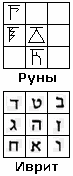

# Образы магического квадрата у евреев

**Как жреческий (магический) квадрат попал к евреям?**  
Образы, которые несли древние языки, встречались у многих народов Мидгард-Земли. Схожесть образов у народов, стоящих на разных ступенях развития, позволяла заимствовать определённые системы сочетания образов. Как правило, заимствовали более низшие народы, у народов стоящих на более высокой ступени развития, т.е. как бы брали готовую систему. У белых заимствовали жёлтые, красные, чёрные; но так как чёрные не могли понять всё многообразие образов, которое было у белых, то они старались заимствовать эти системы у тех, кто пониже, и уже адаптировали под себя. Допустим, у жёлтых или у серых. А серые, когда прибыли (самые последние) на Мидгард, они у всех заимствовали, и у вышестоящих, и у нижестоящих, чтобы создать свою адаптированную систему. В частности, **заимствовали жреческий квадрат**, или как его ещё называют – магический квадрат, который мы уже записывали на предмете «Звёзды и Земли», в этом квадрате сочетание девяти простых чисел, т.е. 9 Образов.

Сейчас продаётся много книжек (нумерология, магия чисел, каббала и прочее), и везде лепят этот квадрат, магическую систему. Люди, которые ничего не знает о древних образах, древней культуре, древних сочетаниях, открывают такие книги и видят: нарисован квадрат, написано: «**Магический каббалистический квадрат**», у человека сразу ассоциация, что это придумали лица библейской национальности, а то, что они заимствовали у других народов, в книжке не написано. Или в другой книге, квадрат заполнен не цифрами, а арабицей, написано: «**Данными образами сунниты шифровали свои системы**», и человек делает вывод: «Основа оказывается не у евреев, а у арабов». И между собой эти чтецы начнут спорить. Хотя и те и другие просто-напросто заимствовали. Тоже самое и чернокожие народы, и индейцы Северной, Центральной, Южной Америки.

А в основе-то лежал не квадрат с цифрами, как сейчас привыкли видеть, а Руны, и в центре была записана **Руна ДОБРО** (число 5). Т.е. в основе всего у белых народов было Добро, а Добро - это и действия, и достаток, и Мудрость, и хозяйство, и жизнь. Поэтому когда спрашивают человека: «Как ты живёшь?», он отвечает: «Добре». Соединение рунических образов порождало как бы новую образную систему, и вот эту систему, уже переделанную под жёлтых, приняли так называемые семитские и хамитские народы (т.е. потомки Хама). Т.е. они перенимали и вставляли в квадрат образы своего древнееврейского языка (лашенкойдеш) соответственно: Алеф-1, Бет-2, Гимель-3, Далет-4, Гхе-5, Вау-6, Зайн-7, Хет-8, Тет-9. И вот эта основа легла и в каббалу и в магию, и куда только её не всунули. Но заметьте, структурированное понятие остаётся то же, система соединения образов остаётся та же, но **смысловая нагрузка уже изменяется**, потому что образы, которые несут символы того или иного языка, они не обязательно передают всё многообразие. Спрашивается, почему тогда многие народы взяли это за основу? Да потому что одно из 10, 20-ти образных значений совпадало. Поэтому была взята такая система. Так проще.

## Образы магического квадрата у евреев

Тройственные сочетания по горизонтали:  
**1. Далет, Тет, Бет**. Это сочетание имеет значение: «Благоразумная реализация знаний».  
А где человек благоразумно реализует знания? В первую очередь у себя дома воплотить, применить и т.д. Поэтому здесь и воплощение, и определение места, и дом. Это тоже всё в образах соединено.  
**2. Гимел, Гхе, Зайн** - «Действие, вдохновляющее на победу». Т.е. смотрим по образам: действие, вдохновение, победа – получается фраза. Ведь никто не говорит: «я сидеть, стол, еда», логичней сказать: «Я кушаю за столом». И здесь точно также, из отдельных слов собираем определённый смысл.  
**3. Хет, Алеф, Вау** – «Равновесие воли при испытании».

Тройственные сочетания по вертикали:  
**4. Далет, Гимель, Хет** - «Реализация действия в равновесии» или «Реализация Действия Равновесия»..Т.е. когда устраивают равновесие: т.е. где - то чего - то было больше, чего - то меньше, и реализовано, т.е. установлено равновесие (т.е. установление равновесия).  
**5. Тет, Гхе, Алеф** - «Благоразумие, вдохновлённое Волей».  
**6. Бет, Зайн, Вау** - «Знание, приводящее к победе через испытания».

Диагонали:  
**7. Хет, Гхе, Бет** - «Равновесие, вдохновлённое знанием».  
**8. Далет, Гхе, Вау** - «Реализация собственных сил через испытания».

Нет тройственных сочетаний:  
Когда мы разбирали славянскую систему, мы записали, что в случае если нет ни одного сочетания по три символа, то даётся свобода выбора. Здесь же маленько по-другому: если нет ни одного сочетания по три символа, то это означает **«айнцофт» (пустота)**. Т.е. видите как? Не дано, значит, не дано. Но понятием «айнцофт», в том же иудаизме, называется как бы «божественная пустота», т.е. сам Бог это и есть «айнцофт». А вам ничего не дано, значит, всего добивайтесь своими силами.

**Как получили данные значения?** На прошлых уроках мы записали значения букв еврейского алфавита (тайное, особое и прочие), и эти значения подставляются в жреческий квадрат. Т.е. не просто 3 еврейских буквы, а смотрите их значения. Допустим, выписываете таинственные значения этих 9-ти букв, и вам будет ясно, откуда взялись данные сочетания.

**Пример:** верхний ряд (справа налево) – Знание, Благоразумие, Реализация. Т.е. получается «Знание, которое благоразумно реализуется». Поэтому школу, институт, библиотеку ещё как называют? «Дом Знаний» (буква Бет), т.е. смотрите, одно из значений буквы Бет – это «дом», и одновременно «знание», т.е. Дом знаний. Поэтому, где евреи получают знания? Славяне получают знания в Общинах, школах, Духовных училищах, семинариях. А евреи получают знания в синагоге. Но это название в обиходе, по-русски: «**синагога**», а еврейскими символами будет «бет-кнессет», т.е. «**дом собрания**», где они получают свои вот эти знания.
