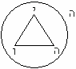

# Яхве (значение)

**Яхве (Иегова)** – это имя бога в иудаизме и христианстве. Но что оно означает? Греки сказали просто, это «тетраграмматон» (ЙХВХ), т.е. четырёхбуквенник. А что это за буквы, в которых зашифрована глубокая структура - грекам не дано знать.

Прочитаем это имя на древнееврейском (лашенкойдеш): «**יהוה**», видим 4 буквы (справа налево): **Йод, Хе, Вау, Хе**, прочитаем их значение по каббалистике:

Йод – бог, бытие и небытие;  
Хе (Гхе) – линия без начала и конца, круг;  
Вау – страх;  
и опять Хе.

Т.е. соединили чисто каббалистические значения, и получили образ: «Бог, который создаёт круги бытия и небытия, и он такой всесильный, могущественный, что его надо бояться».

## Яхве (символика) - круги

Мы уже разбирали символы евреев. Заметьте, нарисован **круг**, т.е. как бы два круга: есть внутренний, т.е. что внутри – это бытие (Гхе), и внешний Гхе – небытие. Основа всего – **треугольник**, т.е. бог, он всё это создал и он наверху (Йод).

Поэтому у них запрещено произнесение того, кто создал бытие и небытие. И у них же выражения: «убойся бога», «бойся бога», «страх божий», «страх перед богом (или господом)». Т.е. это всё вытекает из данной структуры: Бог - это нечто высшее, и поэтому его надо любить и бояться.

Когда мы соединяем все значения образов, мы получаем полную картину. А каббалисты дают простому народу только простое, и когда их спросят: «Кто такой Бог?», они отвечают просто: «Тот, кто создал живое и неживое, т.е. бытие и небытие, и он всесильный. Что вам непонятно?, вы должны молиться и бояться». Вот это их система, на таком простом примере.
