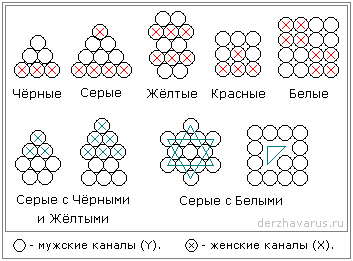

# Энергоновая система крови (группы крови)

**Что такое энергон?** На Юджизме мы уже разбирали: Три Слона стоят на Черепахе, а основа черепахи – это Юджизм – энергия. Так вот «энергон» – это как бы образ самой мельчайшей частицы во Вселенной, **первокирпичик** (ни кварк, ни квант, а энергон), и в этой частице заключена информация о всей Вселенной, т.е. энергон - это самая великая и самая малая частица. Если проще – сравним энергон с человеком. Человек может представить, что самая маленькая частица (энергон) – это наша Земля, а человек находится на этой Земле, т.е. он будет меньше самой малой частицы. И в то же время человек может представить, что все вселенные – это как пылинки в комнате вокруг человека, т.е. человек будет больше всех вселенных. Так вот, **энергон – это система образа**, поэтому энергоновая система крови – это то, что передаёт образную структуру данного живого существа (дерева, человека, животного и т.д.). Имея информацию, энергон одновременно является и каналом связи.

## Энергоновая система крови

Сейчас мы рассмотрим систему крови, но не надо это понимать дословно, что кровь состоит из такого-то количества шариков. Ничего подобного.

**1**. Энергоновая система крови **чёрных народов – 6 каналов**, из них 3 канала женских и 3 канала мужских. Поэтому, при воспроизводстве потомства, чтобы получалось информационное подобие, должны соединиться 3 мужских и 3 женских, и рождается новый чернокожий человек. Мы знаем, что они природники (см. философия Духа разных народов) и этих трёх каналов хватает, чтобы человек жил в гармонии с Природой, как бы вписывался в природную среду, достаточно трёх каналов. У чёрных народов существует 3 группы крови резус-положительный (Rh+) и 3 группы крови резус-отрицательный (Rh-).

**2. Серые – 10 каналов**, но они имеют такую же систему (треугольник) как и чёрные, поэтому серые, когда прибыли на Мидгард начали смешиваться именно с чёрными. Отличие заключается и в том, что у серых женская система как бы довлеет над мужской (окружает с двух уровней: сверху и снизу), поэтому у серых генофонд передаётся по матери. И групп крови у серых 5, при этом 5 Rh+ и 5 Rh-.

**3. Жёлтые – 12 каналов**: 6 мужских и 6 женских, и преобладание мужских (сверху, снизу и посредине) сдерживает и указывает на то, что здесь генофонд передаётся по мужской линии. Считается, что разновидностей у жёлтых народов изначально 6 разных групп крови, из них 6 Rh+ и 6 Rh-. Кроме того, примерно такая же структура энергоновых каналов была у серпентов (люди-ящерицы или люди-змеи), и как гласят предания, та же группа крови была у драконов, поэтому у жёлтых народов один из символов покровителей – дракон. И говорят, что дракон живёт внутри каждого человека, и каждый должен победить дракона, который в нём. И ещё это связано с тем, что прибыли жёлтые из созвездия Дракона.

**4. Красные – 9 каналов** и они близкородственные по типу к нам, т.е. квадратурная структура построения, а не треугольная или цветкообразная, и она стабильна. Преобладающее число структуры крови мужское (5) и оно как бы охватывает женские 4, т.е. генофонд передаётся по отцу. И заметьте, идёт как бы стабилизирующее (мужские каналы буквой «П»), т.е. предыдущие как бы плавающие, а здесь стабилизировано. Преобладание групп крови 4 (4 Rh+ и 4 Rh-), но есть одно «НО» - все предания краснокожих говорят о том, что приходили боги и брали в жёны местных женщин, либо спускались богини, которые брали себе мужей и от них рожали и оставляли здесь. Т.е. центральная форма (центральный кружок или «пятый элемент») имеет как бы особую структуру, она хранит информацию не только о человеческом Земном виде, но и о других, поэтому кроме 1,2,3,4 встречается как бы непонятная группа крови или редкая.

**5. Белые - 16 каналов** – это полностью гармоничная система, но генофонд передаётся по отцу, т.е. облик. Но здесь ещё выведено женское начало, а оно тоже имеет свою основу, и ребёнок перенося в себе геном отца, ещё дополняет себя чем-то от матери. И это считается как бы полная система.

## Кровосмешение

**6. Серые с чёрными** – сначала серые брали только женщин чёрных (Библия: «сыны Божии увидели дочерей человеческих и брали их себе в жёны»), появилась ещё одна система – **8 каналов** (3 женские и 5 мужских). Из них появился народ, который стал преобладать над другими чёрными, потому что у них уже было 8 каналов, а у тех 6. Т.е. они уже были не просто природники, а раздвинули сферу своего восприятия, поэтому из этих детей серые начали готовить жрецов – своих служителей, или как сейчас говорят «пятую колонну».

**7. Серые с жёлтыми** - потом серые начали смешиваться с жёлтыми женщинами. Появился новый вид с **11 каналами** (6 женских и 5 мужских, потому что брали жёлтых женщин), т.е. на один порядок ниже, чем жёлтые, но на 5 порядков выше чем чёрные. И заметьте, эта система нестабильная, поэтому они начали смешиваться с себеподобными. Таким образом, кроме чёрных (дравидов и нагов) появились **непальцы и индусы** (это современные названия). Т.е. они ни белые, ни жёлтые, ни серые, ни чёрные, а нечто как бы среднее и они только между собой. Поэтому у нас было понятие «каста» - профессиональное, а у них стали «варны» - запрещали смешение, потому что может получиться непонятно что, и ветвь прекратиться.

Обе эти нестабильные системы (6 и 7) называют – цегане, т.е. не имеющие пути. Но заметьте, они умные почти как жёлтые, умнее чёрных, и получились как бы на один порядок выше серых, а какой серый потерпит, чтобы ему кто-то указывал?, т.е. у них 11 каналов, а у серых 10, хотя вверху треугольная основа (выдаёт их генотип, серых и негроидов). Т.е. ликом похожи, а нижняя часть тела ближе к жёлтым. Поэтому в Индии можем наблюдать вообще чёрных, светлых, полусерых, получёрных – цегане. Но до того, как их начали изгонять, они узнали все таинства, знания которые потом использовали в своих целях.

**8. Серые с красными** – они иногда сами выходили замуж за индейцев, чтобы обновить кровь, тем более там 5 мужских и 5 женских. Появились **метисы, мулаты и пр.**, есть уже и с белой примесью. В Америке этот генетический эксперимент очень сильно распространился.

**9. Серые с белыми** - серые похищали и белых женщин, в результате от серых (10 = 5 + 5) с белыми (16 = 8 + 8) получалось **13 каналов** (Звезда Давида) – это нестабильная форма, и происходит постоянная борьба с божественным определением внутри данного человека, поэтому и говориться «народ богоборец» - т.е. Израиль (в символах много чего сокрыто). Также при смешении **белых с серыми** получается «квадрат 13», т.е. внешне похож на белого, но внутри пустота (треугольник) - не хватает 3-х элементов (Духа). Потому что в отличие от белых, серые не ассимилируются, а мимикрируют. Поэтому по определению, результат кровосмешения - это «не мы», и об это же говорят сами серые, что когда допустим, мужчина-еврей женился на нееврейке, его дети не считаются евреями (мальчика они называют *баистрюк*, а девочку – *шикса*, т.е. незаконнорожденные, не соответствуют их Законам). Но есть ещё один важный момент - мощь генофонда отца (белого) стремиться восстановить нужную структуру, добавить 3 недостающих элемента у первородного ребёнка, поэтому если белый человек женится на еврейке и она рожает ему 10 детей, первый ребёнок по еврейским законам считается русским, а девять остальных – евреями. Поэтому в Талмуде и сказано: «первородного убей». Таких систем (квадрат 13) полно, вы их можете встретить на улице – с виду вроде бы русский, хохол, немец, а когда пообщаешься с ним, он как-то не так смотрит, говорит, делает, пропорции тела нарушены, и потом оказывается у него папа немец, а мама еврейка - ясно, что это мимикрирующий.

Мы разобрали лишь основные системы - все разные, вариантов смешения очень много. **Мы должны сохранять свою эгергоновую систему крови**. При этом нет смешения в пределах Расы, т.е. так скажем, русский может жениться на украинке, белоруске, полячке, француженке, шотландке, ирландке, норвежке и т.д. - в результате будет нормальный белый белокурый ребёнок (которого представители серых почему-то называют «белокурой бестией») и он будет нести мощь генофонда Расы. И хотя СМИ (они в руках серых) каждый день навязывают мысль, что давно уже все перемешались - это ложь. Ещё в 1940-е годы во время Второй мировой войны с территории России эшелонами везли рабочую силу, и в рейхсканцелярию поступила докладная, что 80% девушек от 16 до 30 лет – девственницы. И там говориться: пока в стране такая высокая нравственность и чистота – такой народ не победить.

Продолжение: Резус-фактор и цвет крови
