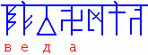
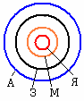

# Веданта или что такое философия? (урок 1)

Предмет называется **Веданта – она же Мудрость Предков**, она же Философiя. Само руническое название раскрывает суть предмета. Первые четыре Руны означают - Веда - огненная, чистая, светлая (4-я Руна), и она уходит за поднебесную, т.е. в Небеса (2-я Руна). Потом стоит Руна Навь - это Мир окружающий Явь. Последняя Руна Ас, т.е. Веда признанная и утверждённая Богами.

Образно: философия – это наука умирания (когда говорят «человек умер» - значит он перешёл на более высший уровень), т.е. философия – это наука, которая даёт знания о переходе на более высокие, запредельные уровни сознания. **Философия – это образное восприятие окружающей действительности в различных проявлениях**.

## Части философии

В наше время философия разделена на разные части:

\* марксистко-ленинская философия.  
\* идеалистическая философия.  
\* атеистическая философия.  
\* религиозная философия.  
\* философия Души.  
\* философия Духа.  
\* философия тела.  
\* философии поэзии, философии музыки и т.д.

**Т.е. сегодня изначальная философия поделена на части**, каждая пытается описать одну из граней многогранного шарика. Получается тоже самое, как в притче «**Слепые и слон**»: слепых людей попросили описать: что такое слон. Первый слепой потрогал за хобот, второй за хвост, третий за ухо, четвёртый за ногу. Первый слепой сказал, что это змея; второй (державший за хвост) сказал, что это ветка; третий сказал - это большая лепёшка; четвёртый сказал – это столб. Но если собрать вместе: змею, ветку, лепёшку и столб – получим мы слона? Нет. Так и вырванные из контекста части не дадут нам полного понимания, потому что все эти системы поверхностны.

Пример: круг – это какая-то целостная система, допустим, это может быть Земля (З), вокруг неё атмосфера (А), внутри магма (М) и ядро (Я). Так вот, ядро – как бы сама суть; но кто-то описывает атмосферу, кто-то поверхность земли и т.д. А основа должна рассматриваться изнутри, что это всё держит вместе, должна быть скрепляющая сила. Также этот круг может быть другой системой - человек, вокруг него аура, внутри Душа, а внутри Души Дух.
