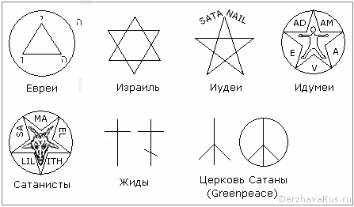

# Символы иудеев, жидов, Гринпис и пр.

Не надо воспринимать серых как нечто единое. Допустим, многие кричат, что вот «евреи в России захватили власть. Долой евреев!» Но в России нет ни одного еврея. Т.е. согласно Библейской энциклопедии архимандрита Никифора: «еврей» - это пришелец. Чистокровные евреи живут в Израиле, и это самая притесняемая народность в Израиле, потому что они шимотники - многобожники. А у нас в основном жиды и иудеи.

## Евреи, иудеи, жиды и пр.

**1. Треугольник в круге** – это **евреи**. Чистокровные евреи живут в Израиле – шимотники (многобожники), те, кто не пошёл с Мойшей в «Синайский турпоход», а остались в Египте, и потом уже переселились в Палестину. Т.е. не приняли монотеизм, а исповедовали многобожие (10 богов), у них даже куммиры богов были. А тот, кому поклонялся Мойша (Моисей) он ему сказал: «Да не будет у тебя других богов, кроме меня». Основной покровитель у евреев Йове, Иегова, или как греки называли «тетраграмматон», т.е. четырёхбуквенник: Йод-Хей-Вав-Хей.

**2. Звезда Давида** (Маген Давид) – это израильтяне (народ **израиль** – переводится «богоборец»). Здесь основная система не Йове, а Адонай, т.е. Господь. Также Маген Давид использует ещё один народ – **караимы**, так называемые «евреи Моисеева Завета», их очень много в Крыму, Ставрополье, Краснодарском крае.

**3. Звезда Соломона** (Маген Шломо) – это **иудеи**. Вот они в России, поэтому одна из государственных религий РФ называется иудаизм, а не израильтянство или еврейство, мошеизм. Вспомните символ СССР - пентаграмма.

**4. Звезда с человеком** – это **идумеи**. Их символ: пентаграмма, в которой как бы распятый человек. «Адам» они переводят - человек, а «Ева» - жизнь.

**5. Перевёрнутая звезда** – это **сатанисты**, но раньше их называли «галилеяне», т.е. в Галилее жили. Их символ – перевёрнутая звезда в круге. Надпись: «Самаэль и Лилит».

**6. Крест** (христианский) – это **жиды**. Заметьте, Руси навязывали византийско-греческое христианство, а всё церковное руководство, т.е. весь Синод, исповедовали иудаизм - так называемая «ересь жидовская».

## Церковь Сатаны и Гринпис

**7. Перевёрнутая Руна Ман** – это символ **Церкви Сатаны**. В XIX веке в Америке появилась Церковь Сатаны, потом их официально зарегистрировали. Впоследствии они объединили свои мастерские и создали своё предприятие по выпуску сначала колясок, а потом автомобилей. Символ использовали - перевёрнутая Руна Ман, т.е. у нас Ман означает «человек приветствующий Солнце, выбрал духовный путь», а у них Ман перевёрнута, и её поставили на эмблеме автомобилей «Old mobile» - можно перевести как «старый двигатель» или «изначальный», а согласно их учению изначально творил и привёл в движение этот мир Сатана, т.е. «Old mobile» - «древний процесс».

**8. ПРМ в круге (пацифик)** - в начале ХХ века Церковь Сатаны создала ещё одну организацию «**Гринпис**», и так как входят в эту церковь очень богатые люди, они снабдили новую организацию всем необходимым (рации, корабли, самолёты). И организация заявила: «Мы боремся за мир во всём мире. Мир без оружия», т.е. оружие должно быть только у Америки, а весь мир без оружия. «Зелёные» они потому, что помнят кто проводил эксперименты – зелёные (см. Философия Духа разных народов), поэтому и назвали организацию «зелёный мир». И вот эти уже не просто наблюдают, их цель – захват власти во всём мире, т.е. единая система, которую они будут контролировать и управлять. В XIX веке назвали себя «Тайным мировым правительством», а теперь называются «Новое мировое правительство», которое несёт **новый мировой порядок** – уничтожение государств, создание единого еврейского союза (Евросоюза), управлять Землёй будет «золотой миллиард», всех остальных разделят на две группы: техническая обслуга (инженеры) и рабы. Белым в данной концепции уготованы только могилы.

Против «золотого миллиарда» и глобального закабаления выступают народы во всём мире – называют себя «антиглобалисты». А эти называют себя «**мондеалисты**» (от франц. «monde» - мир), т.е. Всемирное правительство. Символ который они выбрали, сейчас привыкли называть «величайший» или «пацифик» и многие наши ходят с этим перевёртышем, не знают, что как бы причисляют себя к американской Церкви Сатаны. Хотя чему удивляться, как говорил Исус: «Вы смотрите, а не видите, слушаете, а не слышите, потому что сердца и уши ваши воском залеплены». Т.е. откройте глаза и сердце своё, откройте разум, просите, стучитесь, и отворят вам, ибо каждому будет дано по вере его.
