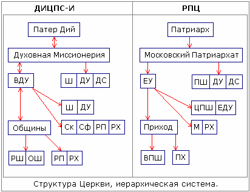

# Структура Церкви

**Церковь** – это один из типов Державы, название образовано от ЦЕРК - «Це Родовой Круг» и ОВ - «Отцов Вышних», т.е. это форма, когда многие Роды объединены не только по крови, но и Единым Вышним Законом своих Отцов (Богов).

**Церковь** – это единственная общественно-социальная система, которая никогда не меняется. Да, там иерархия, но заметьте, Церковь Староверов-Инглингов на протяжении сотен тысяч и даже миллионов лет - как существовала, так и существует, система не меняется, т.е. она показала свою жизнеспособность. Поэтому она была взята за основу и РПЦ, а потом уже от РПЦ система начала переходить в другие структуры, допустим, тот же Ватикан, но там есть свои видоизменения и пр.

Сравним иерархическую систему Древнерусской Инглиистической Церкови Православных Староверо-Инглингов (ДИЦПС-И) и Русскую «Православную» Церковь (РПЦ).

## Структура Древнерусской Церкви

\* Руководство – Патер Дий, он управляет Духовной Миссионерией, но и Миссионерия предлагает Патер Дию сделать то-то и то-то (поэтому на схеме стрелочка двойная), т.е. всё решается сообща, хотя какие-то вопросы Патер Дий может решить сам.  
\* Духовная Миссионерия - это Верховный Совет или Круг Жрецов, под их руководством находится Большой Круг из глав – Весевые Духовные Управления (ВДУ), и кроме того, Духовная Миссионерия создаёт учебные заведения: школы (Ш), духовные училища (ДУ), духовные семинарии (ДС).  
\* Весевому Духовному Управлению подчиняются Общины, и Управление может создавать учебные заведения: школы (Ш), духовные училища (ДУ), а также Скиты (Ск), Скуфы (Сф), и как сейчас принято называть - религиозные предприятия (РП) и религиозные хозяйства (РХ).  
\* Общины имеют право создавать: родовые школы (РШ) - это школы закрытого типа, и общинные школы (ОШ). А также Общины могут создать для ведения своего хозяйства религиозные предприятия и религиозные хозяйства.

## Структура РПЦ

\* Руководство – Патриарх, управляет Московской Патриархией.  
\* Московский Патриархат создаёт Епархиальные Управления (ЕУ), они находятся в его подчинении. Также Патриархат создаёт учебные заведения: приходские школы (ПШ), духовные училища (ДУ), духовные семинарии (ДС). Я уже не говорю, что они могут создавать различные хозяйственные мастерские, предприятия и пр.  
\* Епархиальное Управление создаёт Приходы, а также церковно-приходские школы (ЦПШ) и епархиальные духовные училища (ЕДУ), создают монастыри (М) и религиозные хозяйства (РХ).  
\* Приход имеет право создать воскресно-приходскую школу (ВПШ) и приходское хозяйство (ПХ), допустим по изготовлению рамочек, иконок, свечей, хотя это у них считается подпольным, свечи они должны покупать в Московской патриархии.

По структуре ДИЦПСИ и РПЦ видно, что примерно то же самое, но в системе славянской Церкви всего поболее. Плюс на схеме не указано, что Общины создают **Капища, Святилища, Городища, Священные Рощи и Дубравы, ставят в них Куммiрни, дольмены, менгиры и т.д.** А у Прихода может быть либо церквушка (молельный дом), либо Собор, всё. Хотя у нас одна и та же Община может иметь одновременно и Капище, и Святилище, и Городище, и Священную Рощу, и Священный водоём или Священную Реку, т.е. проводить свои богослужения в различных местах.

Для нас ближе наша родная древняя система. Потому что в РПЦ всё построено на Библии, плюс, как они сами себя подготовили, т.е. переписали. А в Древнерусской Инглиистической Церкви Православных Староверов-Инглингов всё построено на системе Небесных Законов и кровного Родства. У нас все братья и сестры, а в РПЦ - руководство и рабы.
