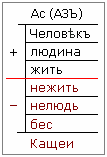

# Типы людей (жить, людь, Человек, Ас)

Людей, живущих на Земле, наши Предки разделяли на несколько категорий. В предыдущей таблице (см. Управляющая Сила) мы разделили людей на три уровня по Управляющим Силам - троичный, семеричный и трансценденталичный. Сейчас запишем следующую таблицу.

1. Типы людей  
2. Деградация за 1000 лет  
3. Типы людей на уровне «Жить»

## Типы людей

**1**. Троичный уровень относится к жителям (или **Жить**), т.е. живущие в Яви, в материи, они привязаны к своим чувствам, инстинктам, к земле, живут как бы одной жизнью, т.е. «я живу, у меня всё нормально, а до остального мне дела нет».  
**2**. Семеричный уровень - Людина (или как раньше говорили: **Людь**), помимо того, что он живёт на земле, ему ещё интересна поэзия, музыка, думает об окружающем мире, о том, что внутри и что снаружи.  
**3**. И верхний уровень трансцендентальный - **Человек**, т.е. Духовный или беЗсмертный (не путайте с Кащеями – они бесы, т.е. смертны, поэтому русский витязь Кащея и побеждал).

Эти три типа людей находятся в положительном поле, т.е. в поле «ХА». И есть три их противоположности, как бы люди-антиподы: **Нежить, Нелюдь, Бес**. Т.е. если в положительном поле Человек («чело» - мысль, «век» - время, т.е. мыслящий во времени), то его антипод: бес – не умеющий делать ни то, ни то, ни то – про них и писал Ф.М. Достоевский.

Но заметьте, положительный предел не ограничен, там только обозначен небольшой рубеж, и стоит **Ас** (или старым письмом Азъ), а внизу как противоположность: правители бесов – **Кащеи**.

## Деградация за 1000 лет

**1. Уничтожить Дух**. Заметьте, до христианизации наш народ был Духовный, одухотворённый, т.е. использовал Высшие Силы для своего развития, и управлял всеми Силами. А при христианизации, Человека (Аса) начали стаскивать с верхнего уровня и говорить: «Да не уподобится человек Богу – это грех», т.е. про Дух можно забыть, про Ум и Волю тоже, ведь рабы не имеют Ума и Воли, за них господин думает. Т.е. христиане опустили человека до уровня «Людина» - «думай о своей Душе», это в предыдущей таблице 7 уровень.

**2. Уничтожить Волю**. Постепенно, используя 6-ю силу (Сила Слова), людей опускали-опускали-опускали, пока не передали власть большевикам, и те начали ломать Волю, волю к жизни, а для этого понастроили ГУЛАГов, тюрем и прочее. Потом перекрыли доступ в высшие учебные заведения, т.е. церковно-учебные заведения большевики прикрыли сразу, отделили церкви от государства и школы от церкви, т.е. не дали возможности учиться хоть какой-то грамоте. Потом ввели «ликбез» (ликвидация безграмотности), потому что народ не знал нового советского алфавита (безОбразного, т.е. образы удалили и включили одни фонемы).

**3. Уничтожить Разум**. Потом начали всячески уничтожать Разум. Кто-то может возразить: а как же Туполев, Королёв?… - а потому и гении, что они появились не благодаря системе, а вопреки ей. Человек после школы, после ПТУ у станка получал 250-300 рублей, а с высшим образованием инженер получал 120-150 руб. Т.е. отбивали желание учиться в вузах. И вместе с этим сделали планку – строгие экзамены, и в каждом регионе малые народности протаскивали, ставили им троечки автоматом. После распада СССР многих людей выбросили с работы, лишили жилья, кто не приспособился, бомжуют, хотя у них по 1, 2, 3 высших образования, т.е. их опустили на самый первый уровень (Инстинкт), где живут инстинктами, где чувства залиты водкой и наркотиками.

Представьте, с 9-го уровня ни одного человека, а почти весь народ стремятся загнать на первый уровень. Берия Л.П. часто повторял: «**Нет человека – нет проблем**». Сейчас для «мирового правительства» в России одна проблема – здесь ещё есть русские люди. Поэтому Парижская хартия 1975 года гласит: «К 2025 году в России должно остаться не более 25 миллионов русских». И заметьте, смертность в России превышает рождаемость, навязали чужую модель семьи, т.е. идёт уничтожение народа, геноцид. Народ свели к инстинкту, а высшее благо – выиграть в лотерею.

## Типы людей на уровне «Жить»

**Первый тип** – он пассивен, живёт на уровне инстинктов, потому и называется «инстинктивный тип». Он пассивно исполняет свою работу или чужую волю, т.е. как бы вечно находится в сомнамбулическом сне (или как сейчас говорят - в прострации). Чувства представляют единственный путь сообщения с его психикой. Может реагировать на чувства восприятия, лишь проявляя соответствующие потребности, во всех своих поступках руководствуясь чисто животными побуждениями. Идеалы этого типа – **еда, питьё, сон**. Высшее наслаждение он находит в опьянении, и лишь в этом состоянии начинает пробуждаться в нём ближайшая высшая сфера – чувства (сентиментальность). В этом состоянии он способен любить «как самец самку», ибо его разум находится в зависимости от инстинкта. Это инстинктивный человек, но не Человек в прямом смысле слова.  
\* Этот тип, в народе называли «летарии», т.е. «вечно спящие». А лат. «пролетарий» – это «безмолвный раб», который может питаться, работать и размножаться.

**Второй тип** – у него развиты чувства, он стоит по уровню выше предыдущего, т.е. «инстинктивного человека». К такому типу относятся фабричные работники или ремесленники. Чувственное восприятие возбуждает в таком типе соответствующую потребность, но это возбуждение, а не Любовь. Чувствительность у него всегда вступает в свои права и управляет его жизнью, врождённые задатки способны более или менее развиваться по его прихоти. Во всех проходящих процессах чувствительность играет главную роль. Такой тип любит весёлую музыку, романсы. Высшее наслаждение для его по-детски наивного характера является **«любовь», весёлая компания, катание на транспорте с музыкой, увеселительные прогулки**. Для такого человека женщины занимают первое место в жизни, а для женщины этого типа, мужчина – это высший идеал. Этот страстный тип обладает большими способностями и не меньшими недостатками, но всё-таки он способен к громадному развитию при соответствующем жёстком развитии (т.е. когда развитие идёт в жёстком режиме – то-то, то-то, то-то). Чувствительные люди, как правило, считают, что мир существует для того, чтобы они в праздности и весёлости проводили свою жизнь. Высшее достижение для них – мысль «где бы раздобыть деньги для празднеств», и всё, что они смогут заработать и достать, они тратят.

**Третий тип** - его можно назвать «рассудочный автомат» или «компьютер». Представитель этого типа не пьёт, если это не принято в конторе, где он служит, и не увлекается женщинами. Люди этого типа рано женятся и ведут как бы правильную жизнь. Про таких говорят: рассудочен, уравновешен, но это не Человек в нашем понимании, это машина, механизм. Его чувства еле коснулись спящего инстинкта. Немного больше он развился на почве сентиментальности. Всё его существо целиком сосредоточено в сфере интеллекта. Сухой расчёт заменяет для него любовь. Вычисление различных пустяков для него - как лучшая музыка. **Денежные вопросы занимают главное место в его существе**, и его жизненный путь представляется ему ровной дорогой, уставленной сияющими верстовыми столбами, на которых таблички с надписями: «300 рублей», «480 рублей», «600 рублей», «900 рублей», «2400»… и в конце табличка – чин «Его Высокопреосвященство» или «Высокопревосходительство». Т.е. карьерист, вся жизнь протекает у него как бы между столбом «300 рублей» и столбом «Его Высокопреосвященство», т.е. чего он достиг. А затем начинается ожидаемое блаженство, заблаговременно рассчитанное и взвешенное: его рай – дача с коттеджем и палисадником и прочими атрибутами. Изредка он остаётся холостым. Умственная деятельность прекращается вместе с выходом в отставку (т.е. достиг определённого уровня, и всё, думать больше не надо). Инстинктивная сфера захватывает его полностью, его карьера полная безкорыстия, почестей, умственной линии, заканчивается в старости полным отуплением. Этот субъект представлен как тип рассудочной машины, построенной государством для своих целей, и весьма полезной для общества, так как, способности, развитые в нём строгими учителями посредством наказания, принадлежат к высшим из доставшихся человеку форм: дедукция, анализ, сравнение, память. Его лучшее развлечение, нередко переходящее в страсть, не вино и женщины, где нечего размышлять, а карточная игра или стол рулетки. Основная пружина, двигающая этим человеком-интеллектом – это числа. В этом кроется причина точных вычислений, действий в назначенную минуту, секунду, то есть он должен всё рассчитать. И всё же, это человек-автомат, а не Человек, в нашем понимании (т.е. мыслящий во времени), хотя, в некоторых случаях, из него может проявиться Человек Воли, т.е. иногда на него что-то подействует и он с уровня «Жить» перейдёт на уровень «Людина».

**Четвёртый тип** – «человек воли», он может непосредственно действовать на рефлексы, инстинктивные чувства, интеллектуальные, а при посредстве взгляда, слова или движения – на других людей и Природу, так как он принимает и раскрывает в себе Великую Силу Природы. Он смотрит на расстилающийся перед ним жизненный путь, вскрывающий перед ним опасности, которые надо избежать, и сообразно этому управляет своей жизнью. Человек воли, опираясь на человека-машину, управляет им, будучи осведомлённым внешними чувствам окружающего мира и самочувствием о состоянии организма, имея, кроме всего прочего, нервную систему, позволяющую ему ускорять или сразу останавливать свои действия и начинания. Но, заметьте, он борется с Природой, как с равным себе, истребляя леса, которыми она покрывает землю, и строит на этом месте прекрасные города, где безчисленные изобретения – это действие его воображения на Волю. Сии изобретения делают жизнь для него более приятной, но при этом более опасной для первых трёх типов. Человек воли, как пионер материального, так и идеального мира, он первопроходец: основатель гор, исследователь, провозвестник вечной истины, всегда сумеет воздержаться, пострадать и даже умереть за свою идею, потому что повелевает своим организмом, а не подчинён организму, он господин своего тела, а не раб его. Активно использует своё мышление, оно состоит в умственной обработке идей, порождающих развитие у различных людей, которые воплощают его идеи в мысли, а мысли в суждения. В любом из выше перечисленных факторов, Воля является для него определяющим звеном.

Все четыре типа относятся к Жити (жителям), остальные мы будем разбирать на других курсах, потому что сначала надо с Троичностью разобраться, чтобы подтолкнуть человека к развитию. Начинать с нижних уровней и прийти к Семеричности, а потом уже говорить о Трансцендентальности и Личности (Ас). Нельзя придя в 1 класс просить знания за 10 класс или аспирантуру.

\* Образ мысли (жители, люди, Человеки, Асы)
