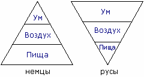

# Треугольники: Ум и Пища

Есть две пирамидальные системы, которые показывают взаимосвязь - при каких условиях и какой объём в жизни человека занимает УМ (духовная составляющая).

Треугольник слева – это можно сказать немцы, т.е. инородцы, чужестранцы, а треугольник справа – русы. Треугольники одинаково делятся на три части: **Ум, Воздух, Пища**. Воздух одинаковый и там и там, а вот Ум, т.е. образ мышления, уменьшается, когда Пищи много. Т.е. там Пищи больше, зато у нас «**Ума палата**» (раньше это выражение означало, что человек по разуму равен целому собранию мудрецов, т.е. Палате). И действительно, давно замечено, что от пресыщения пищей ум меньше. В медицине даже есть описание болезни Дауна, т.е. как бы умственно отсталый. И что с такими детьми делают? Их закармливают, поэтому дауны обычно толстенькие, закормленные. И заметьте, тоже самое происходит в Америке.

## Пример: Америка и Россия

Для примера возьмём нашу психологию и заокеанскую – это две противоположности.

**1**. Вот все говорят: «В Америке сытая жизнь, а здесь впроголодь». Так и наши Предки всегда говорили: «Ты должен подниматься из-за стола отобедавши, но с лёгким чувством голода», а в Америке эффект переедания, извращённый культ еды, поэтому они все толстые и умом не блещут.

**2**. Вспомним ещё нашу мудрость, русская поговорка: «Посади свинью за стол, она и ноги протянет на стол». И посмотрите американские фильмы – садятся в кресло, ноги на стол. Поэтому в нашей славянской философии вся эта американская культура – это свинство.

**3**. Раз мы живём умом, у нас основной принцип: «**Жить по Совести**», а у них: «Деньги есть – ума не надо», т.е. деньги превыше всего.

**4**. Или другой пример, у нас говорят: «Бог каждого наделил способностями, а в первую очередь способностью Любить и Созидать». Они говорят по-другому: «Господь дал человеку жизнь, а господин Кольт сделал их равными».

## Отношение славян к одежде

**Русский человек (славянин) в отличие от иностранца, живёт практичностью** - Духовной и Душевной практичностью. Простой пример: сейчас нам навязывается западная культура, дома высокой моды. Если посмотреть – это какое-то убожество, худые девки обвешаны то сетями, то ещё какой-то бред нацепят, и это считается как бы хорошо.

Отношение славян к одежде совершенно другое – одежда должна быть удобной, добротной, т.е. надёжной, чистой, и уже в последнюю очередь, будем говорить, в нашем понимании красивой. Было две одежды: повседневная — для будней, и красивая — для праздников и служб. Поэтому часто можно видеть - бабушки, дедушки одеты в старенькое пальтишко, зипунчик какой-то; это не говорит о том, что им надеть больше нечего, дома есть и шубы и дублёнки (дети покупали), но они их не носят, потому что **когда человек носит одежду, он накапливает в ней свою энергетику**. И, во-вторых, раньше шили одежду с Душой, т.е. вкладывали в одежду Душу, поэтому и одежда эта роднее. Вы наверно сами много раз обращали внимание: купили одежду или обувь, прошлись пару раз – неудобно, и одели старую; в новой чувствуете себя неуютно, сняли – и сразу легко.
