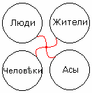

# Жители – Люди – Человеки – Асы (образ мысли)

**Образ мысли у всех разный**. Допустим, Образ мысли военного человека отличается от Образа мысли художника; Образ мысли художника отличается от Образа мысли врача; Образ мысли медика отличается от Образа мысли строителя. Потому что в основе каждого Образа мысли лежит совершенно разная суть. Поэтому, когда мы разбираем, вникаем в суть Образа, мы стараемся для себя как бы определить изначальные **структуры поведения и мышления** данного человека. Сначала мы изучаем третьестепенные, потом второстепенные, потом первостепенные признаки, а потом – изначальные.

1. Все люди разные  
2. Пища и поведение  
3. Жизненная безопасность  
4. Соседи-инородцы

## Все люди разные

Зная какие-то азы (второстепенные признаки) мы уже разделяем людей по их клановой системе, потому что **разный Образ мысли, он и жизнь человека строит по-разному**. Проникновение в это - и есть система подхода к каждому конкретному человеку. Т.е. не так как сейчас говорят, что вот есть одна система «люди» - они все одинаковые: ходят, дышат, спят, едят, размножаются и всё. **Наши Предки выделяли 4 системы:** Жители (Жить), Люди, Человеки, Асы. Вот это у нас третьестепенные признаки, по ним мы выбрали как бы одну систему, т.е. они все между собой связаны, есть некая точка пересечения (на рис. центр свастики), которая их объединяет, это общая объединяющая характеристика, т.е. они все мыслящие создания, живущие на Мидгард-Земле. И через эту общую точку, раз они мыслящие, они общаются: Люди могут общаться с Жителями, могут общаться с Асами, с Человеками, т.е. есть пути (лучи свастики), которые их как бы соединяют.  
\* «Мыслящие» в данном случае мы разбираем только Род человеческий, потому что допустим, дельфины тоже мыслящие, но у них своя система; или волки – у них тоже своя система, своя градация. И при этом мы сейчас не касаемся других народов, а только белых, рассматриваем наш взгляд на Мир.

Т.е. **третьестепенные признаки** - это общие характеристики для Жителей, Людей, Человеков, Асов; у них у всех есть физическое тело, все дышат воздухом, едят пищу, спят, размножаются. Но раз мы их выделили в отдельные группы, значит, каждый имеет что-то своё, допустим, **Жители живут инстинктами**. Т.е. инстинкты есть у всех групп, но у Жителей инстинкты превалируют, и их Образ мысли построен в соответствии с инстинктами. Пример - инстинкт самосохранения, и на Жителя влияют чувства, которые связаны с инстинктом: чувство голода, чувство жажды, чувство страха, чувство размножения, чувство взаимосуществования, чувство ограниченности данного мира (чувство ограниченности жизни). И заметьте, чувство голода, страха также влияет и на Человека, но ты же можешь перебороть чувство голода или чувство жажды, а значит точно также можешь перебороть и чувство страха. Кроме того, чтобы на Жителей не давило чувство ограниченности данного мира, они должны подняться на новую ступень, поэтому для них ещё важно **чувство познания**, оно им тоже присуще, чтобы подняться на новый уровень. В среде Жителей есть даже выражение: «жить по-людски». А когда Житель начинает жить по-людски, он как бы начинает переходить в группу «Люди». Точно также, живущим в категории «Люди», чувство познания даёт «жить по–человечески». Т.е. Жители мечтают жить по-людски, Люди мечтают жить по-человечески, а когда переходят в систему «Человеки», они мечтают и пытаются жить по-Божески. Но допустим, для Жителей жить по-Человечески и по-Божески, это что-то из области фантастики, потому что у них Образ мысли абсолютно разный.

**Жители** - превалирует система выживания, т.е. желание быть сытым, обутым, одетым, что-то создать материальное для своей семьи, для своих потомков.  
**Люди** – в этой категории мыслят уже не просто выжить, а всё должно быть чувственно, красиво, благоустроенно. Т.е. не просто срубили дом, а надо придать красоту, уют.  
**Человеки** - не просто красота и уют, а здесь ещё система, где отдыхают Душа и Дух, наполняется каким-то смыслом.  
**Асы** - здесь Образ мысли совершенно другой. Жизнь в данном Явном Мире рассматривается уже как система посещения одного класса в школе: сдал экзамены, перешёл на более высший уровень, т.е. жизнь более Духовная, более насыщенная, и как бы сейчас сказали - просвещённая жизнь.

## Пища и поведение

**Жители** - мыслят о еде любой, лишь бы насытиться.  
**Люди** - не просто насытиться, а чтобы пища была вкусная, хорошо приготовлена.  
**Человеки** - не просто пища, чтоб желудок набить, и хорошо приготовленная, а она должна быть ещё и хорошо украшена. Т.е. не только аромат и вкусовые качества пищи, но чтобы она была приятна глазу. Пища уже воспринимается не как нечто необходимое, а как обряд, процесс соединения и восполнения и получения каких-то энергий из пищи для Духовного и Душевного самосовершенствования. Т.е. здесь пища воспринимается уже и как подпитка Духовной и Душевной Божественной сути. Поэтому находящиеся на переходе из категории «Человеки» в категорию «Асы» начинают задумываться о Прановом питании. **Прана – это считается, как Божественная энергия**, т.е. человек может долгое время находиться без пищи, но при этом он не худеет, а как бы подпитывается, т.е. он как бы на энергетическом питании - поглощает энергии из Природы, минуя создание самой пищи. А раз у него пища явная, физическая составляет как бы уже не полный питательный рацион, а иногда даже малую часть, значит и в организме будут происходить другие процессы, и физиологические, и энергетические одновременно. А раз процессы будут проходить другие, то потоки энергии будут более лёгкие, более чистые, светлые, а значит, и Образ мысли будет совершенно другой. Т.е. в Жителях Образ мыслей будет тяжёлый, т.к. пища тяжёлая; в Людях пища средней тяжести; в Человеках пища полусредней тяжести; в Асах – пища лёгкая.

Есть выражение: «*Завтрак съешь сам, обед раздели с другом, ужин отдай врагу*».  
**Жители** - никому ничего не отдадут, съедят всё сами.  
**Люди** - и сами поедят и часть отдадут, т.е. когда есть излишек могут отдать его кому-то.  
**Человеки** - делят пополам, т.е. Человеки всегда поделятся.  
**Асы** - сначала накормят страждущего, а потом уже, если что-то осталось, поедят сами. Если нечего есть, они из Природы возьмут.

Т.е. рассматривая только на примерах пищи и отношения к пище, мы начинаем понимать, что Образ мысли этих четырёх категорий людей совершенно разный. Т.е. система питания и отношение к питанию – разное, и Образ мысли разный.

Но заметьте, между ними (Жить, Люди, Человеки, Асы) взаимосвязь всё равно есть. Что общего в Образе мыслей у этих четырёх категорий людей? Что присуще всем группам белых людей? **Независимо от категории к которой относятся люди, они воспринимают всех окружающих подобными и равными себе**. Житель воспринимает и Людей, и Человеков и Асов – подобными себе, и отношение у него к ним такое же как к себе подобному. Людина воспринимает Жителей, Человеков, Асов равными и подобными себе. Человеки воспринимают Жителей, Людей и Асов равными и подобными себе, даже Асов, про которых они говорят: да они равны и подобны нам, но в них Мудрости и Духовности больше. Асы же воспринимают всех - Жителей, Людей, Человеков равными и подобными себе, но при этом они говорят для себя: да, они нашего вида, подобны и равны нам по жизни, и наша цель им помочь подняться до нашего уровня. Т.е. если группа Человеки - Чело и Век, т.е. Мыслящий во Времени, то Асы - Боги, живущие на Земле, они на себя ещё берут миссию как бы просвещения, чтобы помочь остальным подняться до уровня Асов. И на этом у них построен Образ мыслей.

Это мы вкратце рассмотрели с точки зрения пищи и поведения. Дальше рассмотрим с точки зрения как бы жизненной безопасности.

## Жизненная безопасность

**Жители** - в первую очередь защищают себя, т.е. как бы перебарывают страх на защиту себя и своих близких, т.е. своего Рода.  
**Люди** – защита себя, своего Рода и своих ближних соседей. Т.е. у Людей взаимопомощь и взаимоподдержка.  
**Человеки** – защита всех подобных своему виду. Т.е. не только ближних, а Человек старается защитить и помочь всем Белым; и это сидит в подсознании. При этом Человек, защищая свой вид, уже как бы не обращает внимания на сохранность своей жизни. Т.е. пусть даже ценой собственной смерти, но защитить свой НаРод. Вот проникновение в суть Образа Человека, т.е. Человек всегда думает о народе.  
**Асы** – сохранность всех существующих видов жизни. Здесь идёт речь не только о сохранности человека (всех видов народов), но и сохранении животных, растений, т.е. Мира Природы, сохранении экологии и пр. Потому что Асы уже более глубинными категориями мыслят, их Образ мысли построен на том, что жизнь на Земле – это частичка Вселенской жизни, поэтому уничтожение одного вида жизни, влечёт уничтожение других видов жизни, т.е. если где-то какой-то вид уничтожен, а ты не препятствовал этому, не помог ему сохраниться, значит, на тебе уже отпечаток: «А почему ты не помог, если находился рядом?» Т.е. сохраняют и другие народы, и вообще весь Мир Природы.

ВОПРОС: **Как быть с паразитами, тоже сохранять?**  
ОТВЕТ: Есть понятие: Мать Природа сама определяет, какие виды жизни ей нужны, какие нет; от ненужных она избавляется сама. Поэтому если появляются паразиты, Асы их не уничтожают, а ограничивают распространение. Допустим, когда на Мидгард-Землю прилетели Серые (5762 Лета назад), их поселили на острове, там живите и не вылезайте никуда. Т.е. и гуманно, и они никому не мешают, их там изолировали - трудитесь, выращивайте пищу, и раз пространство ограничено, они сами начнут контролировать свою численность. Например, как в современном Китае, ртов больше чем пищи, поэтому ограничили рождаемость.

ВОПРОС: **Почему паразитов не уничтожали?**  
ОТВЕТ: Потому что Природа не терпит пустоты, и даже космической. Считается, что если уничтожить какой-то вид, который человек считает ненужным, паразитическим, то Природа всё равно создаст подобие, но уже более жуткий паразитический вид, и он займёт нишу уничтоженного паразита. Т.е. философия следующая – сохранять все виды жизни, так как любая жизнь Священна, при этом паразитов надо ограничить, и там идёт как бы отбор, селекция, развитие. Но кто этим занимается? Жители, Люди, Человеки? Нет, этим занимаются Асы, т.е. те, кто владеет Древней Мудростью, как не навредив человеку, изменить его психосостояние, мышление и сознание на новый уровень, в котором он мог получить толчок к развитию.

## Соседи-инородцы

Как поступают, рассуждают о жизненной безопасности различные группы?

**Жители** – если рядом появилась чужеродная система, для них эта система как нечто непонятное, а всё непонятное вызывает чувство страха, за которым следует чувство агрессии. К чему это приводит? Уничтожить! А почему уничтожить? Вроде бы они поселились на свободную территорию, к тебе не лезут, но они очень быстро плодятся, значит, через некоторое время их станет больше, и они могут начать захватывать. Поэтому Житель считает, что надо сразу в самом зародыше ликвидировать возможную в будущем опасность.

**Люди** - они говорят: надо встретиться и обговорить точки соприкосновения, чтобы установить соседское сосуществование.

**Человеки** - говорят: мы живём тут, а рядом есть свободная территория, там можете жить вы. Как будете жить, это ваши проблемы, главное, чтобы по Совести, т.е. надо чем-то помочь: советом и пр. – взаимообмен. Но предупреждаем: любая агрессия с вашей стороны, и вы подвергаетесь уничтожению. Просто предупреждение.

**Асы** - они рассуждают так: чтобы сохранять в чистоте все виды, у каждого должна быть своя зона проживания, т.е. своя территория. Раньше так и шло разделение: там живут только Белые, там только Жёлтые, там живут только Чёрные, там – Серые, там – Красные. И никто не покушается на территорию другого, и между ними определённые пустые территории, как бы пространства, для того чтобы сохранять в чистоте вид, чтобы виды не смешивались, не было межвидового смешения.

Поэтому когда появились смешанные - цегане (т.е. не имеющие пути), их даже не пускали в города, у них никогда страны не было. Т.е. это как мы сейчас говорим – каста неприкасаемых, нарушивших законы, устои. Поэтому их никуда и не пускали, даже не вступали с ними в контакт. Если они пришли, им говорили: проходите мимо, ищите пустую территорию. Поэтому вся их жизнь проходила в скитании, т.е. в кочевничестве.  
*\* Обзор и проникновение в суть Образа (урок 7).*

Дальше: Спектр пищи
