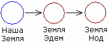
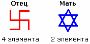

# Два человечества в Библии

В Библии говорится о сотворении двух человечеств: одно создал Бог (Боги) по образу и подобию, а другое Господь Бог - из праха земного.

1. Бог и Господь Бог  
2. Первое человечество (Бытие. Глава 1)  
3. Второе человечество (Бытие. Глава 2)  
4. Миссия Иисуса Христа

## Бог и Господь Бог

**Бог и Господь Бог разные**, подтверждение можете найти в Библии - Деяния святых апостолов гл. 2 ст. 36: «Итак твердо знай, весь дом Израилев, что Бог соделал (т.е. назначил) Господом (т.е. повелителем) и Христом (т.е. спасителем) Сего Иисуса, которого вы распяли». Видите, Бог назначает Господом Иисуса. Но назначил его Господом только после распятия, а не так как написано, что при жизни его называли Господом. Если читать апокрифы, там везде к нему обращаются – *рабби*, т.е. учитель.

**В Библии сказано, что Господь не один, а их много:** «И сказал Господь Бог: вот Адам стал как одни из Нас…» [Бытие 3:22]. Он не сказал «как Я», он сказал «как один из Нас», т.е. их много. Некоторые называют Господа – полубогами, т.е. есть Боги, а есть Полубоги, и в Библии есть этому подтверждение - Деяния святых апостолов гл. 2 ст. 34: «Ибо Давид не восшел не небеса, но сам говорит: сказал Господь Господу моему: седи одесную Меня». Т.е. один Господь говорит другому Господу: садись справа от меня (потому что слева уже занято).

**Есть Господь Иегова, Адонай, Саваоф**, и христианские проповедники через каждое слово говорят: «Господь Иисус», хотя они этого не имеют права делать. Знаете почему? В 1-ом послании к Коринфянам гл. 12 ст. 3 сказано: «Никто не может называть Иисуса Господом, как только Духом Святым». Т.е он Дух Святой, а Господом его называть нельзя. Остальные Господа небесные, они его могут называть Господом, а людям нельзя, пусть ты хоть трижды иерарх.

## Первое человечество (Бытие. Глава 1)

«На шестой день Бог сотворил человека по образу Своему, по образу Божию сотворил его; мужчину и женщину сотворил их» [Бытие 1:27]. Но это в современной Библии Бог в единственном числе, а в Торе по-другому, там созидал Элохим, что по-еврейски означает БОГИ, т.е. их множество, и какие они - многим неизвестно, потому что в Тору и Библию вошли учения и предания различных народов.

**Боги создали людей по образу и подобию:**  
1. Раз мы в теле - значит, и Боги были в теле. Так? Да.  
2. Кто сказал, что Бог бездушный? Может такое быть? Нет.  
3. Может Бог быть бездуховный? Нет.  
4. Может Бог быть безсовестный? Нет.

Значит, была создана **Свастичная система: Тело, Душа, Дух, Совесть**, которую мы называем Человеком, т.е. потомок Божий. «И сказал им Бог: плодитесь и размножайтесь».

## Второе человечество (Бытие. Глава 2)

На седьмой день Элохим (Боги) отдыхают. А на восьмой день начинает трудиться помощник Божий – Господь Бог, или как его называют свидетели Иеговы – Иегова, т.е. помощник начинает трудиться: «И создал Господь Бог (Иегова в Торе) человека из праха земного, и вдунул в лице его дыхание жизни, и стал человек душею живою» [Бытие 2:7].  
Т.е. **Господь Бог создал только Душу**, и поместил её в Эдеме на востоке от Земли, т.е. на планете Эдем (или рай) восточнее нашей Земли.

Затем разделил Душу пополам, отделил мужское начало от женского, и создал им телесную оболочку: «И сделал Господь Бог Адаму и жене его одежды кожаные и одел их» [Бытие 3:21]. То есть, у этих (серые) только **два элемента: Тело и Душа**.

И заметьте ещё - **генетические формы тоже разные**: в свастичной системе генофонд передаётся по линии отца, а в форме из двух элементов (из двух треугольников) генофонд передаётся по линии матери: «И нарек Адам имя жене своей: Ева (евр. Хава), ибо она стала матерью всех живущих» [Бытие 3:20], т.е. через неё начал передаваться генофонд.

Вот, пожалуйста, два различных человечества - у наших Богов и Предков свастичная система (4 элемента: Тело, Душа, Дух, Совесть), у них дуальная (Тело и Душа); у нас генофонд (наследство Рода) передаётся по отцу, у них по матери. Т.е. различные системы.

## Миссия Иисуса Христа

Миссия Иисуса заключалась в том, чтобы **двухэлементному человечеству добавить ещё два элемента**. Поэтому он пришёл (его же послали) и сказал: Ребята, я вам принёс Духа Святого (третий элемент). Ибо кто примет Духа Святого, станет как дитё малое, и в нём Совесть пробудится (т.е. появится и четвёртый элемент), и они будут такие же как и все, у которых четыре элемента. Но кто-то пошёл за Иисусом (учеников у него было много), а те, кому этого было не надо, сказали: «Пройдите на крест, пожалуйста».

Т.е. Святого Духа не приняли, Совесть не появилась - остались бездуховными и безсовестными. **Поэтому они и говорят: «Подумайте о своей Душе»**, а о Духе никто не призывает позаботиться, потому что Дух у них - это божественное, руками не трогать. А что они про Душу-то говорят? Они слова Павла приписали Иисусу: «Кто погубит Душу свою ради меня, тот её спасёт; а кто сохранит, тот её потеряет». Но Душу нельзя во имя кого-то или чего-то губить! Нельзя!

И заметьте, рай у них в Эдеме: «И насадил Господь Бог рай в Едеме на востоке» [Бытие 2:8]. А Иисус что сказал? Всякий принявший меня в рай попадёт? Нет. Иисус сказал: «Всякий принявший меня обретёт Царствие Божие». А когда спрашивали: «Какое оно?», Иисус отвечал: «А обителей у Отца моего множество». Но спросите любого христианского священника: «Где находятся все праведные христиане?» Вам ответят: «Они все в раю, в райских кущах». А **Иисус обещал Царствие Божие, но не как не рай**. И обратите внимание, мы все – дети Божии, а христиане – все рабы божии. И что получается: умирает человек, ему вкладывается в руки сопроводительное письмо, в котором написано: «Сей есть раб/раба Божия и отправляется он в рай». Т.е. не в Обитель Божию, а в Землю Эдем - был рабом здесь на Земле, теперь давай в последующей жизни побудь в рабстве на Земле Эдем, там поработай рабом. То есть, рабство земное и посмертное.

А теперь смотрите: праведные христиане, но не все, а только 144 тысячи из 12-ти колен Израиля обретут Царствие Небесное (т.е. Небесный Иерусалим). И попадут они туда когда? После суда божьего; суд божий будет после конца света; а конец света, когда второе пришествие. Иисус пришёл во второй раз? Нет. Конец света наступил? Нет. Суд божий был? Нет. Значит, **никто из христиан за последние 2000 лет в Обитель Божию не попал**. А куда они все попали? В Эдем, по туристической путёвке – сопроводительному письму: «Направляется раб божий в рай (т.е. в Эдем)».

\* Мы потом ещё распишем все 6 дней творения, разбирая не только Библию (см. Ветхий Завет, Книга Бытия), но и апокрифы и прочее, допустим: христианский план уничтожения.
