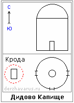

# Дидово Капище

**Дидово Капище** (Храм Предков) — имеет округлую форму, символизирующую вечность жизни наших Мудрых Предков в Чертогах Миров Слави и Прави. Сии Капища ставились рядом с погостами, а также на местах ратных сражений. Рядом с Капищами ставились Кроды. Дидово Капище было посвящено всем нашим Многомудрым Первопредкам и предназначалось для проведения обрядов Тризны и поминальных Богослужений во славу Великих Предков Родов наших и всего Рода Небесного.

## Устроение Капища

\* **Дидово Капище имело округлую форму** и купол полусферу, т.е. всё символизировало Вечность. Современные археологи, когда раскапывают такие Капища, называют их древними обсерваториями. А на самом деле, округлость форм в первую очередь символизировала Вечность. Заметьте, когда прощаются с погибшим, становятся в круг, как бы единство; и потом тело на погребальный костёр, где опять все становятся в круг.

\* В Храме Предкво нет как такового Асгарда, нет дверей с северной стороны, но стоят 16 Куммиров (Богов), перед которыми престолы, т.е. Алатырь-камни, у которых сверху высечены углубления для пожертвований, и рядом углубление, в которое заливается благовонное масло и горит, т.е. перед Куммиром всегда горит огонь. Жрецы, как правило, живут рядом в строении, и всегда поддерживают огонь, подливают масло.

\* Центр Храма находится на Источнике Жизни, и там располагают тело усопшего. Затем, когда все попрощались, покинули помещение, там остаётся жрец, который читает умершему «Книгу Напутствия» - куда идти дальше, дальнейший путь.
