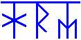

# Храмы славян

**Храм** – это сооружение, излучающее Сияющую Радость Мироздания (Руна ХА - положительная созидающая Сила), ибо для строительства Храмов выбирали особые места, где из недр земли идёт положительная энергия. Храмы работали как линзы, фокусируют энергию и настраивают человека на созидание, позволяют быстрее развиваться. **Храм – это школа**, а Путь к Храму – это путь к изначальному Знанию; правильное знание несёт за собой правильное поведение, а вместе с ним и правильную жизнь.

«Стройте Храмы, да во всех Мирах, познавайте Мудрость Божию, ибо кто Мудрость Божию не познает, тот себя потеряет» - Заповедь Бога Рамхата.

## Храмы славян – социальный институт

Храмы славян представляли собой очень интересный социальный институт. Профессор Чудинов В.А. называет такое устройство общества – «храмовое устройство» или Храмовый строй, когда всё основано на Древнем Знании и воспитании, а не на страхе и поклонении, как при государственном строе.

**Храм Макоши** – это министерство искусств (здесь изготавливали скульптуры, картины и т.п.). Также, это министерство любви (если какой-то мужчина не мог найти себе женщину, и поэтому у него нет детей, он мог прийти в храм любви и выбрать любую женщину, лишь бы у них были дети, потому что больше всего следили за демографией, всё работало на то, чтобы было как можно больше детей). Также Храм Макоши – это библиотеки.

**Храм Мары** – это министерство по охране природных ресурсов. Здесь человек получал разрешение на отстрел животных. Например, надо вам отстрелить 1 лошадь, выдаётся жетон, на котором изображена лошадиная морда, если 2 лошадиные морды – можно отстрелить две лошади. Но только попробуйте превысить предел, с вами поступят очень плохо. Плата за разрешение - часть добычи, которую охотник должен отдать в Храм, куда приходили неимущие и предъявив жетоны на питание, получали пищу, чтобы продержаться 2-3 дня. То есть, Храм Мары - это ещё и министерство социального обеспечения.

**Храм Рода** – здесь занимались астрологией, предсказывали судьбу, определяли расположение Земель (планет), периоды их обращения, углы, составляли звёздные карты. Также Храм Рода – это министерство строительства и машиностроения, занимались любой строительной деятельностью (сделают постройку, отделочные работы и т.п.), здесь были сосредоточены все механизмы, машины, инструменты. На любом изделии ставили клеймо «Мастерская Храма Рода», например, такое клеймо найдено на бивне мамонта времён палеолита. И если изделие не понравилось, были претензии, человек знал куда обратиться, чтобы переделали.

**Храм Семи Врат** (Капище Перуна) – здесь совершались Богослужения во славу Перуна и Богов-Покровителей Славяно-Арийских Родов. Капище имело девять Залов-Святилищ: восемь располагались вокруг девятого, посвященного Богу Перуну, Куммир которого находился в самом центре Капища. Над каждым Залом-Святилищем была звонница, увенчанная купольным шатром, причём все шатры разные.  
\* Система построения Капища Перуна была использована строителями при возведении девятикупольного Храма Василия Блаженного в Москве.

**Белый Храм** (Капище Света) – в данном храме жили жрицы, помогающие женщинам в чадородный период, и здесь воспитывали младенцев при гибели матери во время родов. Таких детей содержали в храме до 3-х лет, затем отец забирал ребёнка.

**Храм Предков** (Дидово Капище) – эти храмы ставились рядом с погостами, Долинами Предков, а также на местах сражений. Предназначены для проведения обрядов Тризны и поминальных Богослужений во славу Предков и всего Рода Небесного.

**Храм Мудрости** (Капище Веды) – здесь постигали Древнюю Мудрость Богов и Предков.

**Чёрный Храм** (Скитуальное Капище) – строились в Скитах из гранит-камня или обожжённой красной глины (отсюда и название – Чёрный Храм). Здесь жили ушедшие от мирской жизни отшельники, которые выполнили Долг перед своим Родом и решили посвятить себя служению Небесным Богам, богоугодным делам. В этих храмах воспитывались дети, живущие на территории Скита, и дети-сироты, которых доставляли Жрицы Йогини-Матушки, которых в народе называли также, как и Богиню, которой они служили – Бабы-Йоги.

Существует много других Храмов: Капище Духа, Капище Инглии, Пятивратное Капище и т.д. все они различны по внешнему виду и назначению.  
*\* Лекции Чудинова В.А. и Славяно-Арийские Веды.*
