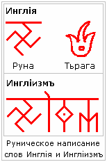

# Инглиизм (урок 1)

**Инглиизм – это Древняя Вера Славянских и Арийских Народов**. Название «Инглiизмъ» произошло от да’Арийского слова-образа Инглия. В да’Арийской письменности этот Образ изображался Тьрагой, а в х’Арийской письменности Руной (см. рисунок).

**Образ Инглии** - Божественный Первичный Огонь Творения, в котором появились разнообразные формы Жизни в Безконечных Безконечностях, порождённых в Новой Действительности, т.е. многочисленных Вселенных. Свет Инлгии наполнил и нашу благословенную Мидгард-Землю, поэтому для обозначения нашего Вероисповедания, к Руне «Инглiя» добавляется понятие «ИЗМ» - Истина Земного Мира.

## Что такое Инглия?

В «Книге Света» сказано: «Когда Ра-М-Ха проявился в Новую Действительность… он озарился Великим Светом Радости». Вот этот Свет Радости Единого Творца-Созидателя и есть **поток Инглии – Жизньродящий Божественный Свет**. Этот Свет (Инглия), который отошёл от Ра-М-Хи, материалисты называют «первичным взрывом» (Большой взрыв).

## Ра-М-Ха един во Вселенной?

В Новой Действительности Ра-М-Ха един (один). Но если он проявился в Новую Действительность, значит, где-то была Старая Действительность, в которой он был не один. А может есть и ещё какая-то структура, выше чем Старая Действительность. Поэтому, вообще **Творцов уровня Ра-М-Ха множество**. Но чтобы это понять, надо достичь такого же уровня развития, кем является Ра-М-Ха, т.е. пройти через многие Миры и Вселенные, каждый Мир познать и осознать, понять как двигаться дальше.

## Язычество – это иноверие

Инглиизм – это наша изначальная Вера, т.е. она существовала у наших народов изначально. Официальные СМИ называют Веру наших Предков язычеством, а нас язычниками, что в корне неверно. Т.е. люди не знают этимологию слов: ЯЗЫК – это народ, а ЯЗЫК с отрицанием НИК - язычник – инородец, человек чуждой нам культуры, чуждого языка и Веры. Можем мы быть сами для себя иноверцами и инородцами? Нет. Поэтому для нас **язычники – это христиане, мусульмане, буддисты и прочие**, то есть люди другой культуры, другой Веры.

Ещё говорят, что до христианства на Земле было язычество. Это как понять? Была одна Вера, наши Предки и папуасы верили в одних и тех же Богов? Нет. У каждого народа свои Боги-Творцы, своя культура и традиции. И мы не говорим, что наша Вера лучше, просто она наша, и мы сохраняем её для наших потомков. У других народов их Родовые Веры, и пускай они сохраняются в своей первозданной чистоте, не надо смешивать, чтобы не получился винегрет. **Изучать нужно, но изучать - не значит исповедовать**. Хорошая она или плохая, но она чужая. Вы не можете выбрать новую мать, нового отца, и родиться от них, также и Вера - вы не можете переменить Богов, т.е. Первопредков.

\* Дальше: 9 основ Инглиизма  
\*\* Славяно-Арийские Веды: Инглиизм (общие сведения)
