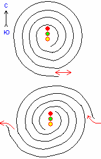

# Каменные лабиринты (спирали) – это тропы к Куммирам

В цветущих долинах и на холмах славяне устраивали Святилища и Куммирни, допустим на вершине холма Источник Силы (на рис. жёлтым), и там ставили Куммир (красным) с жертвенником (зелёным). **Прямого пути к Источнику никогда не было**, тропы шли по спирали, создавая особый Духовный настрой. По краям тропы обкладывались камнем, очень часто использовался так называемый Светоч-камень, т.е. он после захода Солнца ещё несколько часов светился (возможно, в нём были элементы фосфора). Для чего использовали Светоч-камень? Чтобы, если кто-то допоздна в Куммирне задержался, или прибирался там, мог потом даже в темноте выйти по спирали, видя еле заметное сияние Светоч-камня.

Т.е. находили Источник Силы и рядом с северной стороны ставили Куммир и требный стол (жертвенник), куда приносили требы. Сегодня археологи, что только не выдумывают об этих «каменных лабиринтах», а это просто были пути.

## Варианты спирали

**Однопутная система**. Вход к Идолу делали с юга, от него камнями выкладывали тропу (спираль), так чтобы вход в спираль получился с востока, т.е. шли к Куммиру по ходу Солнца. Вошли, требы оставили, и тем же путём вышли. Это как бы основная система.

**Система двух путей**. В Святилищах и Городищах (прим. Городище – это огороженное Святилище или Куммирня) спирали были двух направлений: вход с востока, а выход на запад, т.е. требы оставили и уходили за Солнцем, причём выход был правосторонний, т.е. пообщавшись с Богами, ты идёшь правым путём (правильным).

Спирали делали по круговой системе, т.е. квадраты, круги, квадраты, круги и делали переходы с одного круга на другой.
