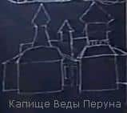

# Капища Веды

**Капища Веды** (Храмы Мудрости) — имеют различные формы и предназначены для постижения Древней Мудрости Богов и Мудрости Великих Предков наших. Капища Веды имеют: Асгард, срединное Святилище, Святилища для проведения обрядов, Духовницу, трапезную, помещение для познания мудрости, и в некоторых Капищах есть дополнительные помещения. Кроме того, существуют Капища Веды, посвящённые какому-либо Светлому Небесному Богу.

Капища Веды, посвящённые Светлым Богам, **имеют трёхкупольную структуру**, и только в таком Капище совершаются все обряды, богослужения, Правьславления, ритуалы и познание Мудрости. Если Капище Веды в честь какого-либо Бога (или Богини) не достроено, т.е. имеет 1 или 2 купола, то в таком Капище совершаются только праздничные богослужения. Повседневные богослужения могут проводиться в Капище Веды только при наличии трёх купольных шатров (пример: действующее Капище Веды Перуна в г. Омске).
