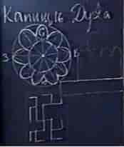

# Капище Духа

**Капище Духа** (Храм Цветка Папоротника) — имеет форму цветка о девяти лепестках, он предназначен для Духовного преображения человека при переходе к Новой Духовной Жизни во Сварге.

**Храм состоит из надземной и подземной части:**  
1) Капище Духа – это то, что над землёй (9 лепестков, в центре получается в виде круга, а сверху купольный шатёр 9 граней).  
2) Под землёй находилась остова храма, остовница, т.е. подземная часть с помещениями и ходами в виде Цветка Папоротника (см. Солярные символы).  
Весь храмовый комплекс ограждён стеной.

## Подземная часть храма

См. нижний рисунок - сам храм расположен в центре на свастике (по круговой системе), угловые лучи – это выходы к угловым сторожевым башням, срединные лучи вели под врата (врата были с 4-х сторон). Т.е. из храма можно подняться на сторожевые башни, на стены, пройти в хранилище, всевозможные помещения. Ходы под землёй могут продолжаться и дальше чем на рисунке, и как правило, **системы переходов делали из урал-камня**, потому что он быстро рассыпается. Т.е. если люди ушли, то через три года урал-камень рассыпается в прах и перекрывает ход - нет людей, нет и доступа к их ходам.

Центр купола и центр Цветка Папоротника совпадали, получалась определённая генерирующая система, а в самом центре храма, в зале находилось то, что наши Предки называли – Цветок Папоротника. В преданиях говорится, что всяк выполнивший Духовное предназначение на Мидгарде, входя в Храм Цветка Папоротника, вдыхал его аромат и переходил в высший Мир, минуя смерть (современным языком – **телепортация**). Т.е. сам храмовый комплекс помимо всего, ещё был энергетической системой, которая обладала определённым энергетическим комплексом для перехода в другой Мир.

Кроме Источника Жизни в центре Храма, и Шара Мироздания в самом низу, сама система лепестков тоже имела свою энергетическую систему, т.е. силовые линии девятиконечной звезды рассчитывались по так называемым источникам жизни, и вся эта система генерировалась, создавала определённое поле.
