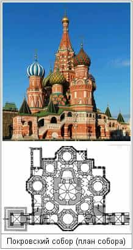

# Капище Перуна

**Капище Перуна** (Храм Семи Врат) — имеет форму восьмиугольника, сориентированного по сторонам света. Он предназначен для Богослужений во славу Перуна и Небесных Богов-Покровителей Славяно-Арийских Родов.

Внутри Капище Перуна имело девять Залов-Святилищ, в которых совершались Богослужения Светлым Богам. Восемь Залов-Святилищ, располагались вокруг девятого, посвящённого Вышнему Богу Перуну, Куммир которого находился в самом центре Капища. Т.е. **9 Залов – это славянская Неделя**, каждый Зал-Святилище посвящён Богу-Покровителю определённого дня Недели. Над каждым Залом-Святилищем была звонница, увенчанная купольным шатром. Причём, купольные шатры были различные, с неповторяющимися формами.

Система построения и внешний вид Капища Перуна были использованы строителями при возведении девятикупольного Храма Василия Блаженного в Москве. Восемь залов (церквей) сгруппированы вокруг возвышающейся над ними девятой столпообразной церкви. Все девять залов объединены общим основанием, обходной галереей и внутренними сводчатыми переходами.
