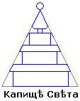

# Капище Света

**Капище Света** (Белый Храм) — имеет форму пирамиды и предназначен для жизни жриц, помогающих женщинам в чадородный период, и для наблюдения и воспитания младенцев при гибели матери во время родов. Такие младые чада находятся в Капище Света на попечении заботливых жриц до 3-х лет, после этого срока ребёнка забирает отец или представитель данного Рода, если отец ребёнка погиб, защищая Отечество.

В гористой местности для Капища Света использовались естественные ходы и пещеры в горах, которые расширялись, углублялись, укреплялись и украшались.

**Форма пирамиды** – это не обязательно как пирамиды в Египте, а строение в несколько этажей сужающихся кверху. Гора тоже имеет пирамидальную форму, поэтому и использовали горы для строительства Капищ Света. На нижних уровнях Капища были мастерские, хранилища продуктов, всевозможных запасов. Чада находились в верхней части Капища (как бы Небесная часть), а сами жрицы - на срединном уровне.  
\* Схематично над пирамидой изображали круг, который означал Солнце.

Дети находились в Капище до 3-х лет, потому что там были кормилицы, которые детей выкармливали. Как правило, при Капище Света были сельхозугодия, держали коз, чтобы детей поить не коровьим, а козьим молоком, оно ближе по структуре (по питанию) к человеческому.
