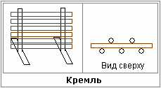

# Кремль - это забор из деревьев с корнями

**Кремль** – это забор вокруг поселения, которое кремлили.

**Происхождение слова «кремль»**. Нижняя часть дерева называется - комель, а остальной ствол от комеля и выше – кремЕль. Поэтому крепостные стены, которые кремлили и получили название «кремль».

## Устройство кремля

Если просто вкопать столб в землю, даже наполовину, его легко можно расшатать и вытащить. Но попробуйте расшатать дерево, которое на меньшей глубине и более высокое, его тараном не расшатаешь. А почему? Потому что определённая структура. Поэтому данную систему наши Предки взяли за основу для построения кремля, т.е. охранной системы. Либо **оставляли деревья, которые росли на данном месте**, либо выкапывали деревья со всей землёй и пересаживали, и между деревьями устраивали изгородь (забор), а потом ещё обсыпали землёй, делали вал, т.е. укрепляли как столб, тогда невозможно было ни подорвать, ни пробить такую крепостную систему. **Забор с корневой системой** вокруг поселения получил название КРЕМЛЬ (отсюда и слово «кремлить», т.е. создать устойчивую систему). Сейчас по этому принципу устанавливают, допустим, металлические столбы - снизу сваркой приваривают поперечную опору, т.е. идёт повторение кремлёвки.

Так же **кремлины делали и в строениях**, допустим, дом могли делать таким же образом, т.е. ставили четыре кремлёные стены, скрепляя друг дружку как в срубе. То есть на века.

\* Это продолжение темы «Вера и Природа». Т.е. то, что наши Предки замечали у Природы, они старались воплощать это в своих целях. Сейчас мы разобрали один из примеров: устройство кремля - крепостной стены.

Дальше: Рыбные фермы и водяные мельницы
