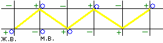

# «Путь Пилы» - ходьба на большие расстояния

Мы уже разбирали, что силовые линии Земли создают положительные и отрицательные участки (см. Живая и Мёртвая вода), человек, проходя по этим путям, привыкал и чувствовал их. Поэтому, когда отправлялись в дальний путь, шли «путём пилы», т.е. от положительного источника к положительному, как на схеме.

**Почему шли таким образом?** Мы сейчас говорим о больших расстояниях, допустим, когда отправлялись «Бог знает куда», за 500-1000 вёрст в одиночку по тайге. Если идти по прямой, то пройдя половину отрезка между точками «Ж.В.» и «М.В.», дальше с каждым шагом будет накапливаться усталость, человек дойдёт до минусовой точки (участок как бы с отрицательной энергией), и здесь подпитаться ему нечем, поэтому путь до следующей точки будет очень тяжёлым. А если идти «путём пилы», то пройдя по диагонали половину первого отрезка, дальше с каждым шагом идёт прилив сил, потому что приближаемся к области с положительной энергией (точки «+2»). Затем идём до следующей положительной точки. В итоге получается: **вёрст пройдёшь больше, но путь будет легче**.

Т.е. многие говорят: «Как раньше люди могли такой путь пройти и не устать? Сейчас на машине 1000 вёрст проедешь, устанешь, а они пешком». А вот оно объяснение – они знали, где Точки Силы и шли по направлению к ним. Поэтому на короткие расстояния, действительно могли идти прямым путём, а на дальние расстояния шли путём пилы. То есть для каждого есть свой путь.

Заметьте, даже в сказках всегда была **дорога прямоезжая, но все использовали окружные диагональные**. Допустим, предание об Илье Муромце – «Укажите мне дорожку прямоезжую», а ему говорят: если ты пойдёшь по прямой, тут никому продыху, сидит там Соловей-Разбойник (отрицательные источники), как бы первый гаишник на Руси, всех останавливает и обдирает. Но Илья выбрал прямой путь, почему? А потому что калики перехожие дали ему столько сил, что места мало. Поэтому, рассчитывая на свою силу: Да пойду я по прямому пути, зачем мне по объезжей?. Т.е. если сил хватает - то по прямой, а если нет - тогда путём пилы. Всё связано с Природой.
