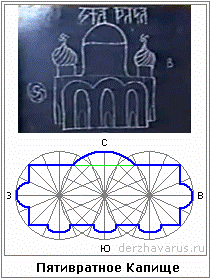

# Пятивратное Капище

**Пятивратное Капище** (Храм Пяти Врат) — имеет прямоугольную форму, с южной стороны Храм имеет три входа, а с западной и восточной сторон по одному привходу, этот Храм также называют Капищем Рода или Храмом Жизни, он посвящён Роду Небесному.

В гористой местности для Капища Рода так же, как и для Капища Света, использовались естественные ходы и пещеры в горах. Четыре естественных хода перекрывались вратами и соединялись с большим залом внутри горы, в котором проводились богослужения в честь Бога Рода. Пятыми Вратами, ведущими в Капище Рода, была Пещь Ра, т.е. специальная система, через которую в Капище Рода попадали чада-сироты, проходящие обряд посвящения древним Богам. Мы уже разбирали систему Пещь Ра, см. Йогиня-Матушка.  
\* Т.е. в гористой местности в Капище было четыре отдельных входа (для Да’Арийцев, х’Арийцев, Расенов и Святорусов), и 1 вход для детей-сирот, проходивших обряд Пещь Ра. **Горный храм** – это который в горе, а сейчас разберём **дольний храм**, т.е. который строили в долине, на ровной поверхности.

## Устроение Капища

Чтобы построить Пятивратное Капище, нужно вспомнить круговую систему. Получается, в северной части – Асгард, с южной стороны мелкие врата, а на западе и востоке привходы.  
\* Вход в Капище с юга и востока (т.е. 4 врат), а выходят через западные врата.  
\* **Центральный круглый зал** был не сплошной стеной, а стояли деревянные узорчатые столбы, на которых изображались Куммиры, и между столбами висели холсты, которые убирались и поднимались в определённые дни (праздники, службы), получался сплошной зал. Поэтому когда древние путешественники и торговцы приходили в Капище, потом описывали, что стоят резные узорчатые столбы, между которыми развешаны холсты с изображением битв, героев, чудных животных (грифоны, гамаюны и пр.). Деревянные столбы были обязательны. Даже если несущие были из камня, рядом ставили деревянные резные с Куммирами.  
\* **На куполах по 16 спиралей** и символ движения Солнца («свастики»), они одинаковые, вращаются в одну сторону, т.е. показывают, где восток и запад. Но эти символы обычно делали не жёсткой формы, а закруглённые как Сваор, и заключали в круге. А на главном куполе был шпиль со Звездой Инглии.  
\* **Система света** играла важную роль. Оконные проёмы на центральном верхнем строении были построены таким образом, что в определённый день, а также в определённый час, солнечный свет своим лучом освещал определённую часть Асгарда. Допустим, в день осеннего равноденствия, луч через специальное отверстие над окном, освещал определённый лик или Куммир.  
\* **Система звука**. В стены Капища замуровывались кувшины, горлышком внутрь зала, поэтому, когда жрец в центральном святилище говорил, его было слышно не только в этом центральном зале, но даже в привходах. Т.е. система звука была построена так, что всё сказанное из Асгарда, было слышно даже в так называемых глухих зонах Храма.
