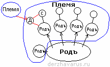

# Род – Племя – Народ - Держава

**Род** – это семья. Допустим, в Роду 5 сыновей и 4 дочери, сыновья создали свои семьи, как бы новые Роды, получается дети братьев – это уже племянники и племянницы, т.е. **Племя**, они все племенники, одного Рода-Племени. Когда несколько Родов-Племён объединяются, получается **Народ** – т.е. основанный на Родах с общими критериями: одна Вера, язык, культура, традиция. Формируются города и Веси (духовно-административные районы), там объединяются народы Расы; и вот все Веси Расы назывались одним словом – **Держава**.

1. Родовая книга  
2. Родовой и Племенной Союз  
3. Хутор, деревня, город, Весь  
4. Система управления  
5. Жречество

## Родовая книга

Отец имел свою Родовую книгу, где была указана вся родословная, т.е. он вместе со своим отцом передал детям знания о своём Роде. Каждый из его сыновей в первую очередь брал отцову Родовую книгу, переписывал (делал копию) и составлял себе Родовую книгу, где указывал в сторону Роды братьев своих. Т.е. они как бы родооснователи своих Родов. Дочерей отдавали для продолжения других Родов.

Младший сын всегда оставался с родителями, содержал их в старости, и как бы оставался в данном Роду, поэтому у него было указано, что он последний и от него Древо пошло дальше. Т.е. младший остаётся в этом Роду, а старшие четверо братьев создают как бы свои Рода, но в основе всё равно Род отца.

## Родовой и Племенной Союз

**Родовой Союз** - это одно Древо по отцовской линии, от Пращура и до нынешних прапра…правнуков (сыны, внуки, правнуки, праправнуки и т.д. - потомки).

**Племенной Союз** – это объединение с другими Родами. Т.е. чтобы образовалось Племя, братья взяли невест из других Родов, внешних, т.е. к Роду-Племени уже относились и другие Племена, произошёл обмен, братья взяли дочерей из того Рода, а от этого Рода отдали дочь туда, - это Племенной Союз.

Род - объединяет все семьи одного Рода по отцовской линии.  
Племя - объединяет всех братьев и тех, с кем породнились.  
Племенной Союз - когда несколько Племён объединились.

Но это всё (Родовой и Племенной Союзы) в пределах одной местности, одного поселения. Т.е. Родовой Союз – это допустим: хутор или деревенька, где одни родственники. Родо-Племенной Союз – это допустим: город или большое село.

## Хутор, деревня, город, Весь

**Село, деревня, хутор** – это Родовой Союз (или Род), т.е. там одни родственники.

**Село, деревня** (может состоять из нескольких хуторов) – это Племенной Союз (Племя).

**Город, село** – Родо-Племенной Союз (т.е. Община - Миръ).

**Весь, города** – там объединяются Рода, Племена на основе одной Веры, языка, культуры, традиций и т.д. (Народ).

Весь – это духовно-административный район (совр. - губерния, область, край).  
Народ – т.е. «на Роду», как бы на поверхности Родо-Племенных Союзов, т.е. основанный на Родах с общими критериями: единая Вера, единый язык, единая культура, традиция.

## Система управления

\* Родовой Союз управлялся **Старцем**, т.е. самым старшим в Роду.  
\* Племенной Союз управлялся **Радой**, т.е. собирались старшие родственники (Родовичи) в каждом Племени, и они решали. И заметьте, сейчас высший орган государственного управления на Украине – Рада, т.е. Племенной союз. Там было два Рода: Анты и Рось, они создали Племя.  
\* Община управлялась **Копой** (см. КОПА); отсюда и Копное право, т.е. Общинное право.  
\* Народы управлялись **Устоем** (КОН).  
\* Веси объединяли Народы Расы, и здесь управление шло уже маленько по-другому:  
1) **Веды** - т.е. Мудростью;  
2) **Собор** - собирались хранители Устоя и Кона, т.е. князья, боярые и жрецы;  
3) **Вече** - всенародное, когда решали какой-то глобальный вопрос.

Все Веси назывались одним словом – Держава. И раз всенародное решение – значит всеми Родами, всеми Народами, т.е. был Родовой принцип, и это всё держалось Мудростью, Устоем. **Держава держится мощью Родов** - вот наша мирооснова. И заметьте, ни жреческая система не управляла Державой, ни Собор не управлял Державой, ни Вече не управляло Державой, но при этом Держава была непобедима. Т.е. как такового управления нет, никто никем не управляет, всем управляет только одна система – Совесть. Потому что Совести внемлют и Боги, и люди, и человеки. Совесть над всем.

## Жречество

Если надо решить какой-то вопрос, приходили к жрецам. Жрецы были везде, в каждом Роду, т.е. **старший в Роду был одновременно и Старцем и Жрецом**, как Родовой жрец. Без жреца ни один вопрос не решался. Допустим, Собор или Вече выдвигали какого-то князя воеводой, жрецы давали напутствие, а без жреческого напутствия, без слова жреца ни одна армия (рать) в бой не шла, потому что считалось - без божьего благословения делать нечего. Единственное когда не надо было спрашивать у жрецов благословения и пр., это когда шла агрессия, нападок на какой-то Род, Племя... Там сразу отправляли гонцов, и кто находился в Племенном союзе, Родо-Племенном союзе, тут же все собирались и давали отпор.

**Веды, жрецы – это не только духовное управление, но и наука и искусство и пр.** всё там. Т.е. Собор решал какие-то общие (обще Родовые, обще Племенные) вопросы; Вече собиралось решать вопросы какого-то глобального характера, вопросы войны и мира; а в основном всё решалось через жречество, потому что жрецы в первую очередь думали о благосостоянии Родов, об их Духовном развитии, о просвещении, о защите. Поэтому любой Род, накапливая какое-то родовое наследие, опыт, он копию этого родового наследия, опыта отдавал на хранение жрецам. Жрецы это всё сохраняли. Даже существовала «*жертва Богам*», т.е. в больших Родах (раньше 20-30 детей было нормой) одного ребёнка (обычно одного из младших или первородного) отдавали жрецам, как бы приносили в жертву Богу. Т.е. если случится непоправимое, допустим, вороги напали и весь Род погиб. Так вот, этот ребёнок становился продолжателем Рода, изучал у жрецов всю мудрость, потом получал добротную, чистокровную супругу, и с него Род возрождался.

Поэтому, раз в основе Державы - Роды, значит, и **возрождение Державы пойдёт с Рода**, т.е. с каждого конкретного человека. Не с постановления ЦК какой-нибудь партии, правительства, или указа президента о возрождении, а именно с этого человека, который старается, чтобы его Род выжил в это трудное время, нашёл близких себе по Духу, дабы это всё сохранить.

\* Типы государств и Держав  
\* Инородцы на Руси – наше попустительство
