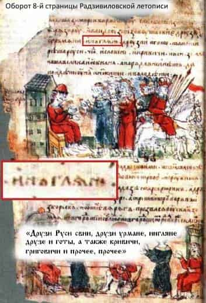

# Староверы – это Православные Славяне

Многие не понимают отличия между староверами, старообрядцами и язычниками.  
**Староверы** – это Православные Славяне, т.е. Правь славят, исповедуют Старую Веру Предков, которая была у славян до насильственной христианизации.  
**Старообрядцы** – это Праведные Христиане, сторонники старого христианского обряда, который был на Руси до XVII века (до Никонианской реформы).  
**Язычники** – это инородцы, иноверцы.

## Староверы-Инглинги

Сегодня средства массовой информации и работники различных ведомств, администраций называют староверов «язычниками», потому что многие чиновники и работники СМИ не принадлежат к нашему народу, к нашей культуре, они библейской национальности, кавказской и вообще не понятно какой от смешанных браков, допустим: мама грузинка, папа азербайджанец. Мы же в повседневной жизни именуем себя Староверами-Инглингами или Православными Славянами, ибо:

1. Мы – **Староверы**, т.к. исповедуем Старую Веру Расы Великой, ниспосланную Родом Небесным.

2. Мы – **Инглинги**, т.к. храним Инглию – Священный Божественный Огонь Первопредков наших, и возжигаем его перед Образами и Куммирами Светлых Богов и Святомудрых Предков наших.

3. Мы – **Православные**, ибо ПРАВЬ и СЛАВЬ прославляем. Знаем мы воистину, что Правь – это Мир Светлых Богов наших, а Славь – Светлый Мир, где обитают Великие и Многомудрые Предки наши.

4. Мы – **Славяне**, ибо славим от нашего чистого сердца всех Светлых Древних Богов и Святомудрых Предков наших.

\* Святомудрые – потому что хранят Святую Мудрость.  
\* Инглинги (др.-слав. Ингляне) – в Радзивиловской летописи на оборотной стороне 8-го листа сказано: «Друзи Руси СВИИ [ныне Шведы], друзи УРМАНЕ [т.е. живут в урмане, в тайге], ИНГЛЯНЕ друзе и готы, а также кривичи, григовичи и прочее, прочее…».

