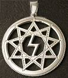
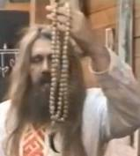
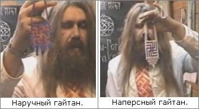

# Виды славянских оберегов

**Оберег** – это неотъемлемая часть славянской культуры, связь с Богами. Славяне в совершенстве владели искусством нанесения оберегов, **любую вещь делали оберегом**: одежду, оружие, посуду, хату и т.д. Совокупность солярных символов, их расположение, количество повторений - создают вязь заговора, несущего в себе замысел желания, цели. Ниже рассмотрим несколько личных оберегов.

1. Нательный оберег  
2. Артакона  
3. Гайтан  
4. Берегиня

## Нательный оберег

**Нательные и наперсные обереги** обычно имеют «ушко» или прорезь, за которые их можно повесить на нить. Это родовые или общинные обереги (у каждой общины свой символ). Таких оберегов может быть несколько, только не надо наряжаться как новогодняя ёлка, и при этом некоторые символы могут друг друга нейтрализовать.

\* Нательные обереги носят на теле под одеждой.  
\* Наперсные обереги носят на груди поверх одежды (от слова «перси» - грудь).

## Артакона

**Артаконы** – это чётки с когтем Родовича (т.е. птицы или зверя почитаемого в Роду). Это наперсные источники Духовной и Природной силы, соединяют в своей основе Силу животного Мира и чётки из Священного древа. Допустим: если мы говорим о Перуне, то чёты делаются из дуба, а коготь орла. Если Сварог, то чётки из малины, а коготь медведя. Но никто ради Артаконы не убивает птиц и зверей.

\* Стандартные чёты из 33, 72, 108 или 144 насадок.

## Гайтан

**Гайтан** – плетёный шнурок или тесьма с флажком из кисея или бисера.

\* Наперсный гайтан делают с более широким орнаментом, носят на груди.  
\* Наручный гайтан имеет более узкий шнурок и орнамент, носят на руке.  
Гайтан ещё называют Листвица или Листок, потому что он может быть не только квадратный или прямоугольный, но и как листочек.

Христиане переняли у славян Листвицу (**лестовка**), и старообрядцы до сих пор их плетут из кисея или бисера.

## Берегиня

**Берегиня** – лента или вышитая тесьма, которой повязывают волосы вокруг чела. Берегиню плели из бересты, материи, делали из кожи, но особенно берегиня из шерсти выполняла несколько функций:

- защищает разум от плохих мыслей;  
- удерживает волосы, чтобы ветер не растрепал;  
- поглощает пот, чтобы не застилал очи во время труда.
