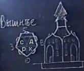

# Вышнее Капище

**Вышнее Капище** (Храм Четырёх Врат) — имеет форму пятиугольника, он предназначен для Богослужений во Славу Великого Триглава Мира Яви и Единого Небесного Бога-Творца — Рода-Породителя, а также во Славу четырёх древних Родов Великой Расы — Да’Арийцев, х’Арийцев, Расенов и Святорусов.

## Устроение Храма

Храм как бы разделён на 5 частей:  
\* С северной стороны отделена область Асгарда Даарийского, т.е. наша Прародина, Род – он с севера. Затем четыре области:  
\* **Да’Арийцы и Святорусы** отделены, они как бы ближе к Небесам, потому что они больше созидатели (Святорусы создают всё новое, новые космические корабли, а Да’Арийцы – управляющие, пилоты). Как бы витают в облаках, живут одним Духом, не думают о материальном.  
\* **Расены и х’Арийцы** как бы более приземлённые, ближе к жизни (Расены заняты чисто ремонтом, восстановлением уже созданного, благоустройством, а х’Арийцы – как космонавигаторы, составляют пути, карты и пр.). И эти два Рода как бы более воинственны что-ли, т.е. чуть что – они готовы защитить.  
\* Также четыре Рода (РАСА) разделены на Восток и Запад, т.е. Да’Арийцы и х’Арийцы на Востоке - как бы восходящее Солнце, им ярко, всё видно, что вокруг происходит, а Святорусы и Расены на Западе, уже как бы ближе к тёмному времени, у них нет иммунитета против лжи, не видят, не различают её. Поэтому Боги и говорили: «защищайте Расенов и Святорусов», т.е. Да’Арийцы покровительствуют Святорусам, а х’Арийцы - Расенам.  
\* Расположение врат: 2 на западе и 2 на востоке возле полукружий, т.е. от западного угла по обе стороны врата, и на восточном углу также, возле полукружий врата.

**Купол храма всегда был спиральным**, т.е. грани купольного шатра не прямые сверху вниз, а закручены по спирали, как на Храме Перуна в Москве (ныне Собор Василия Блаженного). На куполе Вышнего Капища было 10 граней (потоков), потому что 5 сторон.
