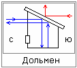

# Дольмены – это здравницы

**Дольмены** – это система защиты источника положительной, либо противоположной силы. Т.е. там выход Силы, эту энергию преломляли за счёт наклона крыши (угол падения равен углу отражения), и энергия, выходя из дольмена, забирала с собой хворь человека. При этом, чем наклон больше, тем дольмен мощнее, и угол отражения создаёт какой-то радиус мощности перед дольменом. Передняя стенка дольмена была с круглым, либо с прямоугольным отверстием, которое закрывалось, допустим, дубовой дверкой, или могли из камня вытачить.

В дольмен с выходом отрицательной энергии закрывали больного человека, чтобы энергия всю хворь забрала. Потом человека переносили в дольмен, где положительная энергия, т.е. хворь забрана, но человек ослаблен, и дольмен наполнял его новой, мощной энергией. Внутри дольмена человек обычно размещался лёжа, головой к выходу, чтобы вытаскивать за голову (ребёнок так же рождается).

## Направление дольменов

**Север и юг** - для восстановления физического тела (болезни, ранение). Т.е. с севера энергия «отрицательная», она забирает хворь, а потом в дольмене на юг восстанавливают силы.

**Запад и восток** - для коррекции Души или Духа. Допустим, приехали купцы на торжище, и сглазили ребёнка или как раньше говорили – спортили, изрочили. Или кликушествовать начинали – это тоже душевный уровень, поэтому в соответствующий дольмен. Западная энергия забирает, т.е. как по ходу Солнца, а восток (восходящее Солнце) – даёт новую энергию.

\* Многие думают что дольмены, это склепы, потому что в некоторых обнаружили скелеты. Но это не так. Допустим, человек был ранен в бою, зная о дольменах, забрался туда, а перейти в следующий уже сил не было, и некому было вытащить, и он там оставался навечно.
