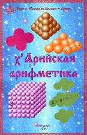

# Книга «х’Арийская арифметика» - скачать безплатно

Название: х’Арийская арифметика  
Серия: Наследие Славян и Ариев  
Составитель: Дарияр  
Формат: djvu  
Размер: 14 Мб  
Год: 2005

Скачать с Яндекс.Диск - х’Арийская арифметика

Издание предназначено для круга читателей, интересующихся Ведическим наследием Древней Руси, её культурой, традициями и знаниями. Данные материалы подготовлены по видеолекциям Асгардского Духовного училища Древнерусской Инглиистической Церкви Православных Староверов-Инглингов.

## Оглавление

**Введение  
Знаки х’Арийского определения  
Системы умножения и их структурные проекции**  
Гармоничные фигуры и их проекции  
   Гармоничная фигура одномерного пространства  
   Гармоничная фигура двухмерного пространства  
   Гармоничная фигура трёхмерного пространства  
   Гармоничная фигура четырёхмерного пространства  
   Гармоничная фигура пятимерного пространства  
   Гармоничная фигура шестимерного пространства  
   Таблица соответствий гармоничных фигур разномерных пространств с количеством их опорных точек  
Триадные системы  
   Структуры различных мерностей с основанием три  
   Объёмно-временное умножение  
   Правила вычислений в х’Арийской арифметике  
х’Арийские таблицы умножения  
   Гармоничная система умножения  
   Триадная система умножения  
   Ровная система умножения  
   Система Пирамидального Умножения  
   Призменная система умножения  
**Пядевая система мер**  
Таблицы соответствий основных пядевых мер  
**Славянские меры времени  
Таблицы умножения**

х’Арийская арифметика (1 урок)
