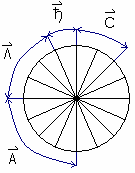
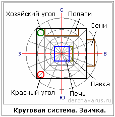
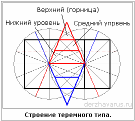
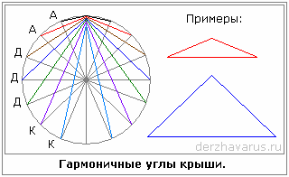

# Круговая система счисления в строительстве

Прежде чем что-то построить, надо считать (счислить) пространственную характеристику. Вы ведь не воздушный замок строите, а будете строить на земле, значит надо найти точки соприкосновения с землёй. Поэтому **для начала находили точку выхода Силы**, для этого пользовались лозой (сейчас многие пользуются рамкой), кто-то чувствовал руками, либо приглашали жреца, и он находил точку выхода силы, т.е. точку, где выходит положительная энергия, и от неё уже начиналось построение. Все размеры были только в пядевой системе.  
\* Здесь записана уже готовая круговая система (круг с 16-ю секторами): 1 часть – это пядь, 2 части – стопа, 3 части – локоть, 4 части – аршин, и т.д. Подробнее см. видеоурок х’Арийская арифметика, курс 1, урок 9 – «Счисления».  
\*\* В 12 уроке говорится, что жилые дома на выходе Силы строить нельзя (ни положительной, ни отрицательной), это опасно для здоровья.

1. Однокружник – простая постройка или заимка  
2. Дом в два или три круга  
3. Пропорции крыши

## Однокружник

**Как разметить круг?** Циркули, линейки, метры в принципе были не нужны. Был очень компактный и удобный измерительный инструмент – шнур. Делали очень просто: в точке выхода Силы ставили колышек, привязывали к нему шнур и завязывали узелок на определённом расстоянии (какой размер постройки хотите: 2 сажени, 5 саженей, 20 саженей). Рядом с узелком привязывали палочку и обходили по кругу. Затем по звёздам или силовым линиям, кто чувствовал, определяли Север, Юг, Запад, Восток. Т.е. сориентировали дом по сторонам света.

**Разметка стен**. В системе круга легко начертить квадрат, его углы - это будут точки перевязи брёвен. Также в этот круг легко вписать сени, их делают для сохранения тепла, и вход не должен быть сквозным, т.е. в доме дверь на восток, а в сенях на юг.

**Планировка внутри дома**. Чтобы внутри дома что-то разместить, рисовали такую же систему, т.е. дополнительные круги. Мы сейчас разбираем на примере заимки, т.е. печь делалась в центре, чтобы прогревала все части дома, и на ней спали. В печи был огонь, т.е. её сравнивали с Солнцем, а круги, которые от неё отходят – это орбиты Земель. Но раньше говорили не «печь», а «ПЕЩЬ» (помните, Пещь Ра?). Окна на северной стороне никогда не делали. Посмотрите на рисунок, там от квадрата стен дома получается ещё один квадрат, и в этом пространстве у северной стены делали полати, чтобы спать головой на север. Но полати делаются не до угла, потому что справа от входной двери – Хозяйский угол, т.е. угол домового, а слева от входа – Красный угол с Куммиром Бога-Покровителя Рода. И если посмотреть старые фильмы, там, когда гость приезжает на ночлег, заходит в дом и делает поклон сначала в левый угол, затем поклон в правый угол, т.е. как бы спрашивает разрешение на ночлег у хозяина, т.е. у домового. В малом круге, у печи ставилась лавка, чтобы гость тоже мог лечь головой на север. Лавка могла быть и с другой стороны, но обычно ставили со стороны входа, т.е. на кухне (как мы сейчас называем). На восточной стороне стоял трапезный стол, на южной стороне готовили. И заметьте, вместо стен, если это обычная заимка, использовались шторы, т.е. просто завешивали материей, а днём убрали и просторная хата.

## Дом в два, три круга

**Разметка кругов**. Точка выхода силы – это центр первого круга, затем к нему добавляем ещё один круг, можно и третий добавить. Как правило, для жилья использовали три круга, т.е. у славян они символизируют: Дух, Душу, тело – все вместе дают Совесть. Круги можно расположить вряд или третий круг опустить вниз. В данном примере, два круга - каждый круг делится на 16 частей.

**Терем**. Для строения теремного типа, надо отступить на одну часть от центральных линий, получаем пирамиду, которая тоже имеет свою основу. Также и снизу строим такую пирамиду. Т.е. здесь как бы и треугольные структуры, и двойственные, тройственные, и квадратуры круга, все эти системы накладываются одна в одну. Но не воспринимайте это как просто развёртку на плоскости, это не круги, а сферы, т.е. пространственные системы. Мы получили трёхуровневую пирамиду, терем, т.е. нижний уровень, средний и верхний (или горний, вышний, т.е. горница).

**Пятистенок**. В круги вписываем прямоугольник – это стены дома, т.е. получился пятистенок, их до сих пор строят. Дом уже разделён на 2-е, даже на 3 части, допустим, две трети слева – это жилое помещение, а треть справа – это кухня. Справа можно нарисовать ещё один круг и там сени будут. Подробнее будем разбирать на следующих уроках.

## Пропорции крыши

Круговая система счисления – вот откуда берутся все пропорции крыши, все угловые величины. Т.е. всё гораздо проще. На рисунке видно, как вписаны в круг различные типы крыш, начиная от шпиля - это Капищные крыши (обозначены буквой «К») и заканчивая почти плоскими для амбаров, овинов (А), а средние формы – это крыши домов (Д).

Заметьте, все данные системы в пядях, саженях, локтях, вершках – это всё взаимосвязано с энергопотоками земли и энергопотоками внутри человека. Эти круги, как чакровая система, являются энергопотоками в теле человека, где они пересекаются (на чертеже) эти места пересечения наши Предки называли – «**жизненные точки**», а китайцы их называли точки жизни и смерти, т.е. где положительное поле, там точка жизни, где противоположное – там точка смерти. Все эти точки влияют на внутренние органы, поэтому и говорили: «дом построить, чтобы в нём жилось, а не умиралось», т.е. либо дом будет наполнять вас силой и вы будете долго жить, а раз долго живёте, за домом смотрите, то и он долго живёт, либо неправильно построили, дом из человека все соки вытянул, и сам разрушился.
