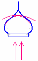
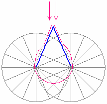

# Купол-луковица зацикливает энергию

Христиане используют маковки в виде луковицы, т.е. скрывают энергию внутри, **не дают энергии подняться в небо**, и она зацикливается на землю. Т.е. когда энергопоток идёт вверх, он об луковицу заворачивается и по каналам опять стекает вниз на землю. Т.е. энергия идёт только сверху вниз, а снизу вверх она не уходит, поэтому в данной системе энергия концентрируется только вниз. Плюс энергия идёт сверху, поэтому, заходя в христианский храм, где луковичные главы, человек чувствует тяжесть. Пока нет службы, человек просто зашёл поставить свечку, вроде бы спокойно находится, но когда массовое скопление народа, начинается круговорот энергетики, она идёт вверх, а купол её сбрасывает вниз, т.е. нагнетается энергетика, и люди начинают грезить наяву, у многих начинаются приступы эпилепсии и прочее, так называемые юродивые, входят в состояние транса, начинают бесноваться, и батюшка говорит: «О, смотрите, дьявол. Сейчас мы будем изгонять».

**С какой целью христиане делают купола в форме луковицы?** Сбор психической энергии.  
Но заметьте, сразу под этой системой (под луковицей) они делают звонницы. И только когда начинает бить колокол, происходит пробой по прямой, и идёт выброс энергии вверх. Как бы сброс лишней, но уходит из храма только чистая энергия, а весь негатив остаётся. Поэтому люди, которые ходят в христианский храм, обращают внимание, что когда колокол бьёт и в это время поставить свечку за умершего родственника или за здравие больного ребёнка, потом ребёнок идёт на поправку, или родственника видят во сне и он говорит: «ну, наконец-то ты обо мне вспомнил». А когда люди просто приходят и колокол не бьёт, они ставят и ставят свечки, службы заказывают, а никаких улучшений не происходит. Потому что **купол-луковица не даёт обратиться к небесам**, т.е. вся энергия, все обращения, молитвы, ничего не уходит из церкви, луковичный купол всё сбрасывает вниз, всё идёт в нижний уровень. И плюс, внутри бабульки ходят, смотрят, вы свечку только поставили, отвернулись, а они её переворачивают вверх ногами и зажигают. Т.е. перевёрнутая свеча, которую зажгли – это всё во славу сатане, это их штучки.

## Купол-шатёр

На славянских храмах маковки строят в виде купольного шатра, и обратите внимание на пересечения линий, которые получаются в круговой системе - именно таким образом наложена черепица на куполах храмов, на старых домах с куполами. Эти пересечения показывают движение энергопотоков. Т.е. когда маковка прямая, выполнена в виде купольного шатра, вокруг неё энергопотоки идут по линиям восходящим - нисходящим, создавая **открытый канал Небеса-Земля**, т.е. энергия идёт как вовнутрь, так и вне.  
\* На рисунке: синим цветом – купольный шатёр, красным – энергии, обтекают шатёр и превращаются в маковку.

## Сфероидный купол

Сфероидный купол (как у мусульман) там прямая линия, т.е. связь есть. Потому что мусульмане славянские храмы не стали переделывать, только Куммиров уничтожали. Допустим, та же Кааба – там 365 Куммиров уничтожили. И сами мусульмане говорят, что там было древнее языческое Святилище, т.е. построено всё правильно, и сфероидный купол не зацикливает, там **нет сбора энергии**, поэтому когда заходишь в мечеть, там спокойно, нормально себя чувствуешь.

И заметьте, сфера – это как Земля. А пол у них начинается между 7 и 11 лучами (посмотрите рисунок купольного шатра, внизу от центральной линии отступите в каждую сторону на две части и проведите линию - вот пол у них между этими точками). А под ним как бы нижняя часть (нижний кусочек сферы). Поэтому, заходя в мечеть, они разуваются, т.е. как бы не наступают на землю, а находятся и совершают молитвы между землёй и небом, т.е. напрямую общаются с Аллахом и ангелами.
