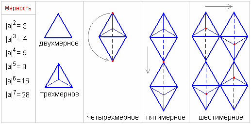

# Определение мерности при использовании чётко структурных изображений

Мы уже разобрали гармоничные фигуры (см. структурные проекции), теперь также займёмся проекцией, только в отображении к чёткой структуре, где **|а| двухмерное = 3**, т.е. три опорные точки. Чтобы вам было проще это воспринять, изобразим на двухмерности чёткую структуру - **треугольник**.

**Трёхмерность**. Чтобы получить трёхмерную структуру, необходимо спроецировать двухмерную по всем сторонам. Получится **4 опорные точки**.

**Четырёхмерность**. Четвёртая считается как бы во времени, поэтому для получения четырёхмерной фигуры, мы должны спроецировать структурно (два «тетрапака» соединённые между собой дном). Получается **5 опорных точек**.

**Пятимерность**. Проецируем четырёхмерную в пространстве, через одну общую точку. Получается **9 опорных точек**.

**Шестимерность**. Для получения шестимерной структуры, проецируем предыдущую через общие точки. Получается **16 опорных точек**.

**Семимерность**. Чтобы получить семимерную структуру, необходимо на шестимерную наложить точно такую же, через общие точки (выделены красным цветом, они на нас выходят). Получится **28 опорных точек**.
