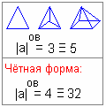

# Объёмно-временное умножение и сложение

**Правило объёмно-временного умножения:** при объёмно-временном умножении фигура будет иметь столько опорных точек, сколько изначальных структур повторят опорные точки трёхмерной фигуры.

**Пример:** |а| = 3. То есть, двухмерная фигура - 3 точки (треугольник). Трёхмерная будет иметь 4 опорные точки. Значит, объёмно-временная фигура будет - 4 треугольника соединённые между собой (пирамида).

Если чётная форма, |а| = 2 или 4. Значит, двухмерная фигура будет иметь квадрат, трёхмерная – куб (т.е. 8 точек), соответственно объёмно-временная фигура будет – 8 квадратов (т.е. 32 точки). Представьте шар на который наклеено 8 квадратных зеркал. Это не трёхмерная, не четырёхмерная фигура, она будет как бы искажённая в нашем понимании, в нашем пространстве.

## Умножение «НА», «ЖДЫ», «Ю»

**Пример:**  
3 на 7 = 21. Умножение «НА» – двухмерное (плоскостное).  
3 х 7 = 28. Умножение «ЖДЫ» – трёхмерное (пространственное).  
3 \* 7 = 35. Умножение «Ю» - объёмно-временное.

Во всех трёх примерах основание одинаковое (три), но определяющий символ говорит, какое именно умножение (см. знаки х’Арийского определения).  
В первом примере – треугольник, т.е. 3 опорные точки (3 на 7 = 21).  
Во втором примере – тетраэдр, т.е. 4 опорные точки (3 жды 7 = 28).  
В третьем примере – пирамида, т.е. 5 опорных точек (3 ю 7 = 35). Например, в долине 7 пирамид, и соединяются они только землёй, на которой построены, т.е. один объем повторяется в пространстве 7 раз.

Пример с чётной формой:  
2 на 2 = 4.  
2 жды 2 = 16 (т.е. квадрат, превращённый в куб (8 точек), а 2 куба в пространстве 16).  
2 ю 2 = 64 (т.е. выше уже разбирали, что это за фигура из 8 квадратов (32 точки), и здесь их 2 штуки).

Объёмно-временное **умножение (Ю)** применялось в трёх случаях – при объёмном умножении, временном и объёмно-временном. Но таким умножением не считают объёмы комнаты и прочее, а считают другие объёмы.

## Объёмно-временное сложение

При объёмно-временном сложении весь левый актив складывается до одного числа.

**Пример:** 2 + 11 + 21 + 3 + 8 будет соответствовать 9.

В современной математике сложили бы все числа до одного (45). Но при объёмно-временном сложении складывают по-другому.  
Сначала: 2 + 11 = 13, т.е. 4.  
Дальше: 4 + 21 = 25, соответствует 7.  
7 + 3 = 10, соответствует 1.  
1 + 8 = 9.

Некоторые математики говорят: «при сложении должна получаться и обратная структура». Да, при обычном сложении, а во временном порядке такого правила быть не может. Где вы видели, чтобы время можно было повернуть, высчитать назад? Допустим сейчас вам 32 года, затем 31, 30, 29 и т.д. - так не бывает, нельзя повернуть реку времени вспять. Можно переместиться в прошлое только скачкообразно, и в той же структуре, т.е. вам так и будет 32 года. Время можно протыкать, искривлять, но нельзя повернуть вспять.
