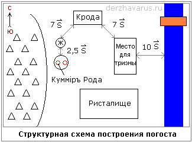
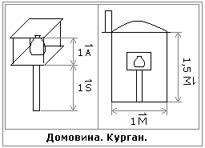

# Погост (схема)

**Погост** – место, куда приходят погостить, навестить Предков (т.е. не «кладбище» - место, где кого-то кладут, а погост - это название наше родное). Погост располагался рядом со скитами, градами в западной стороне, и, как правило, был **отделён водной преградой** (протока, река), если водоёма не было, прокапывали небольшой канальчик, запруду, и наполняли водой, чтобы создать образ реки, разделяющей два Мира – Мир живых и Мир мёртвых. Через водоём делали мостки, а если брать на основе Асгарда (это и в других местах очень часто делали, где река была широкая) - под рекой делались подземные ходы, потому что когда идёт шуга (снежная каша по воде), на лодках, тем более с покойником, переправляться трудно, а подземным ходом спокойно прошли и совершили обряд. Расстояние от водоёма до погоста должно быть не менее 10 саженей.

## Структурная схема построения погоста

**Крода** (погребальный костёр) устанавливалась в северной части погоста. Если умерла женщина, на кроду помещалось ложе, а если воин, ему могли и ладью сделать. Расстояние от кроды до жертвенника или места тризны должно быть не меньше 7 саженей (14 метров).

**Куммир Рода** ставили в юго-западной части погоста. Высота Куммира должна быть не ниже 2 саженей (4 метра). Перед Куммиром с восточной стороны – огневище. Расстояние от Куммира до огневища = 1 столбец.

**Жертвенник** был с северной стороны от Куммира. Расстояние между Жертвенником и Куммиром с огневищем = 2,5 сажени.

**Место для тризны** (т.е. место для проведения поминального обряда) занимало восточную сторону погоста.

**Ристалище** – на юго-востоке погоста. Здесь происходили как бы поединки, сражения, если прощались с воином, т.е. показывали Богам и Предкам его заслуги перед Родом, битвы в которых он участвовал.

**Долина Предков**, т.е. курганы, находились за жертвенником и Куммиром, на запад. Расстояние между курганами должно быть не менее 3 саженей. И заметьте, курганы ставились в шахматном порядке, чтобы Ярило-Солнце освещало все курганы, и один курган не бросал тень на другого.  
\* Раньше **тень** ещё имела понятие, как Душа, т.е. Душа человека, Душа строения, Душа кургана. У некоторых народов это доходило до того, что допустим в среднеазиатских странах (Халифат и пр.) правители могли казнить, если кто-то наступит на их тень. Т.е. вспомните выражение: «Залезли в Душу и вытерли ноги».

## Курган

После кродирования (кремации) прах складывали в кувшин или урну, кои носили название «**домовина**» или говорили просто «дом». Их делали из глины и обжигали, т.е. амфоры, кувшины. В центре будущего кургана устанавливался столб, на его вершине закрепляли площадку с четырьмя столбами, между которыми устанавливалась домовина, и сверху на столбы устанавливали крышку. Высота этой конструкции была 1 аршин. Возле основного столба складывали различную утварь, затем всё накрывали платом, и руками засыпали землёй. Если умирал большой родовитый, высота столба могла достигать 1 сажень, а если родичей мало, высота столба меньше.

Сейчас делают примерно тоже самое (см. рисунок слева) - после кремации, выкапывают в земле **квадратное углубление со стороной в 1 меру, глубиной 1,5 меры**, ставят столб и площадку с домовиной. Но поскольку родственников в наши дни мало, поэтому просто засыпают с небольшим курганом, и в западной части ставится памятный камень, на нём у женщин изображают Крест Лады-Богородицы, а у мужчин или ничего (потому что если сейчас на русской земле солярные символы изображать, то невежи вой поднимут: «свастика на кладбище»), или изображают стилизованные кресты, т.е. маскируют, чтобы солярники лишнего внимания не привлекали (см. примеры в уроке 13, курс 1). Расстояние между курганами также меньше (проход есть и всё), т.е. экономят, раньше-то земли больше было.
