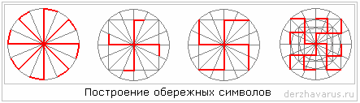
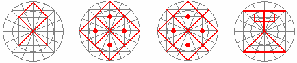

# Построение обережных символов (круговая система)

Славянская круговая система (счислительная система) помогает высчитывать не только всевозможные угловые величины, радиусные, векторные, суммарные и прочие, она ещё и **создаёт обережную систему**. Т.е. круговая система счисления не только в строительстве, но и в правильном построении обережных символов. Допустим, надо вам на одежде вышить славянскую символику, но как правильно вышить символ? Ведь только правильно начертанный символ начинает работать, в нём начинают ходить энергии.

**Пример:** круг можно разделить на 4 или 8 частей, чтобы нарисовать определённый символ (см. Обереги славян). Допустим, в первом примере разделим круг на 16 частей и получим Крест Лады-Богородицы. Если развернуть лучи, получим Колядник.

**Впишем в круг квадрат**. Проведём короткие линии, получится Свастика или Суасти, если развернуть лучи. Доведём линии до края окружности, получим Агни и Фаш.

**Добавим круги и квадраты** – получается чёткое построение символа Одолень Трава иди Цветок Папоротника. Так символ чётко выверяется по каждой линии и потом вышивается, даже обычная Свастика рисуется по определённому стандарту, каждая линия имеет свой определённый размер. За основу берётся Пядевая система, с размером хоть волосок.

## Построение символов по вершинам

Ниже примеры построения по вершинам часто используемых символов. Во втором случае получили символ – Женское плодородие. А если продлить оси, т.е. как бы показать, что плодородие растекается по всему Земному шару, то получим символ Земного плодородия. Также по вершинам рисуют символы Чертогов, пример: символ Дживы (справа).

  
Т.е. всё в круговой системе, Круг – это самая гармоничная система во Вселенной, и у нас всё вписывается в круги, даже любую славянскую букву, Руну можно начертать в этой системе. А когда всё совмещаешь – получается **кристалл**, поэтому и говорят: «кристально чистый», «кристальная мудрость», а кому она принадлежит? Нашим Предкам, а значит и нам тоже, потому что они передали нам этот кристалл мудрости. Уже и современные учёные говорят, что лазерные, магнитные носители – это хорошо, но они портятся, поэтому переходят на кристаллы (запись на кристаллах), больше объём. Т.е. до них дошло, что в древности кристаллы были ценными не потому, что на Солнце переливались, а потому что на них была записана информация. Правда, многие этого не знали, воспринимали кристаллы просто как драгоценные камни, и громадные кристаллы распиливали на мелкие части, делали новую огранку, тем самым информация разрывалась.  
\* Не воспринимайте двухмерно круговую систему счисления.
