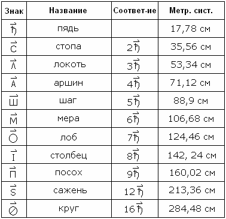
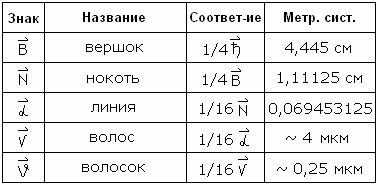
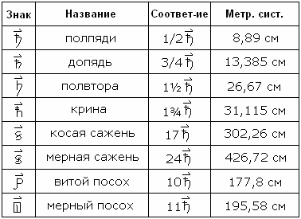
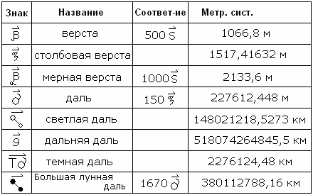

# Пядевая система

В основе пядевой системы лежит единица измерения «пядь», также как в футовой системе – основа «фут», в метрической системе – основа французский «метр».

1. Жреческие и обиходные меры пядевой системы  
2. Основные меры пядевой системы  
3. Основные малые меры  
4. Дополнительные средние меры  
5. Основные большие меры  
6. Примечания

## Жреческие и обиходные меры пядевой системы

**1 пядь = 17,78 см** или расстояние между большим и указующим перстом. Для чего это было нужно? Пядевая система существовала очень давно, она была чётко выражена, имела определённые структуры, меры. Потом эти **меры привязали к пропорции тела человека**, чтобы каждый мог для себя создать гармоничную структуру. Допустим, чертёж дома в пядевой системе – люди разного роста построят хоромы (дома) идентичные по внешнему виду, но разные по размеру, т.е. гармоничные, соответствующие пропорциям тела. Поэтому и было выражение: «У каждого своя пядь, и каждый мерит на свой аршин».

**То есть, были определённые жреческие меры (сама пядевая система) и обиходные, чтобы человек уже под себя создавал гармоничную структуру**. Но в общественной жизни пользовались только определённой мерой. Допустим, сейчас придумывают, что те, кто торговали сукном, старались поставить маленького продавца, т.е. с маленьким локтём – это бред. Раньше когда сукно на локоть или аршин отпускали, у всех был единый эталон (жреческий), со своей мерой даже на торжище не пустят. Смотрящий за порядком на торжище проверял, чтобы у всех меры были одинаковые, не было обмера и обвеса.

## Основные меры пядевой системы

В таблице сама Пядевая система и её привязка к современной метрической системе, чтобы вы могли свободно переводить современные меры на старые, и наоборот.  

## Основные малые меры

## Дополнительные средние меры

## Основные большие меры

## Примечания

1. Над знаками мер обязательно надо ставить мерное титло (см. Знаки х’Арийского определения).  
2. Мера «**шаг**» меньше метра, т.е. удобно ходить мерить, это естественный шаг. Сравнивая с французским метром – приходиться тянуться, делать большой шаг.  
3. Мера «**лоб**» = 7 пядей, отсюда и пословица «Семь пядей во лбу» (124,46 см), обычно этого роста ребёнок достигал в 12 лет. Лоб – это макушка, т.е. самая верхняя часть головы, поэтому раньше глашатай возвещал на лобном месте, т.е. на возвышенности. А часть головы, которую сегодня неграмотные люди называют лбом, это чело (челом бьют, а не лобом).  
4. Мера «**круг**» = 16 пядей - легко запомнить, у нас всё считается кругами: в Круголете 16 Чертогов, в сутках 16 часов, в круге 16 пядей и т.д.  
5. Мера «**допядь**», т.е. чуть-чуть до пяди не хватает.  
6. Мера «**полвтора**», т.е. полная и половинка второй пяди. Потом буква «в» выпала из произношения и стали говорить «полтора».  
7. Мера «**косая сажень**» - это диагональ в квадрате со стороной в сажень.  
8. Мера «**посох**» была в виде обычной палочки. На «витом посохе» делали ещё спираль, либо голову, т.е. плюс 17,78 см. «Мерный посох» ещё длиннее на пядь, именно мерным посохом измеряли наделы земли.  
9. «**Светлая даль**» - расстояние от Ярилы-Солнца до Мидгард-Земли по круговой орбите.
